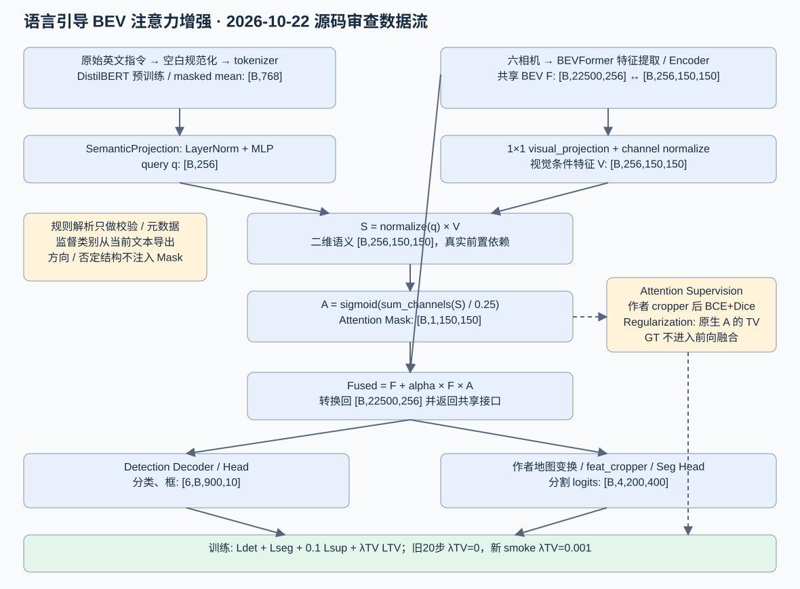
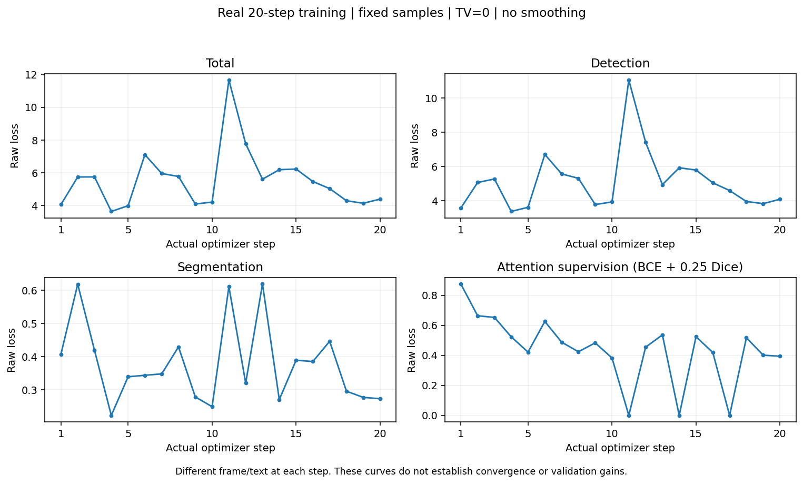
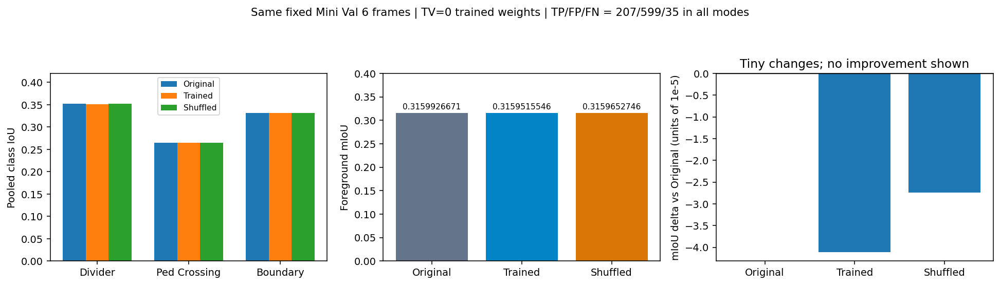

# BEVFormer × DriveLM｜自动驾驶 BEV 感知与语言引导注意力

本仓库记录 BEVFormer、nuScenes / DriveLM 及语言引导 BEV 注意力增强实验。项目严格按原始《BEV感知注意力增强.pdf》的四阶段组织，**V1～V5 是第三阶段研究版本，不是项目阶段**。第二阶段已有工程功能证据，第三阶段正式精度目标未达标，第四阶段全面验证与成果交付未完成。

> **2026-10-26 权威来源与状态更正：** 仓库未找到完整原 PDF，现有“第二阶段原始任务书”仅为第二阶段材料。本次按用户提供的四阶段及性能要求审计，待原 PDF 核对；完整清单见 [四阶段任务交付审计](docs/四阶段任务交付审计_2026-10-26.md)。旧 117 项测试、20 步训练和六帧结果保留为历史事实，不代表正式精度或第四阶段通过。

## 项目进展与交付入口

| 阶段 | 工作内容 | 当前进度 | 主要入口 |
|---|---|---|---|
| 第一阶段 | 环境搭建与基线复现：DriveLM 数据、BEVFormer-Small、验证集 3D mAP／BEV mIoU、说明和图像 | PARTIAL：已有真实基线，正式协议待原 PDF 核对 | [第一阶段导航](docs/stage1/00_阶段一交付导航.md) |
| 第二阶段 | 核心模块设计与实现：DistilBERT、空间映射、Attention、Fusion、多任务 Loss、集成、文档和单测 | PASS，仅工程功能范围；效果有限 | [模块对照](docs/stage2/13_阶段二任务对照.md) |
| 第三阶段 | 模型训练与性能优化：冻结主干、训练新增模块、超参数、权重、DriveLM 验证对比、延迟和结构优化 | NOT_MET：V1～V5 真实研究保留，正式精度未达标 | [V5 报告](docs/stage3/03_V5语言条件耦合与最终探索结论_2026-10-26.md) · [研究归档边界](docs/stage3/04_第三阶段收尾与DriveLM可评价范围_2026-10-26.md) |
| 第四阶段 | 全面验证与成果总结：DriveLM 测试、分场景／分指令、失效案例、README、技术报告、仓库、3～5 分钟视频 | PARTIAL：正式测试和视频 NOT_RUN，当前成果未提交／推送 | [第四阶段状态](docs/stage4/01_综合验收与Git交付_2026-10-26.md) |

原任务性能门槛（按用户提供原写法，待 PDF 核对）：指令相关检测 **mAP 提升至少 2%**、相关区域分割 **mIoU 提升至少 1.5%**、整体平均精度下降 **不超过 2%**、**RTX 3090** 上模块单帧增加 **不超过 20ms**。现有 AP@2m_xy、目标邻域 IoU、Attention／Mask IoU 及 RTX 5080 Laptop 计时均不能替代这些正式验收。未取得达标证据；“百分比／百分点”及正式指标协议不能自行补定。

通用 VQA、生成式回答与完整 VLA 链路不在本次用户提供的原始四阶段强制项中，不自行增设为完成条件；DriveLM 正式感知测试未执行，也不能归咎于没有回答 decoder。

**推荐阅读顺序：** [当前四阶段审计](docs/四阶段任务交付审计_2026-10-26.md) → [第二阶段材料摘录](docs/stage2/02_第二阶段原始任务书.md) → [工程任务对照](docs/stage2/13_阶段二任务对照.md) → [架构设计](docs/stage2/11_模块架构设计.md) → [历史结果](results/stage2_delivery_2026-10-23/README.md) → [复现说明](docs/stage2/17_第二阶段复现指引.md)。

## 第三阶段：LG-BEV 当前工程状态（2026-10-28 V3 最终准入）

LG-BEV 是第三阶段的独立探索，沿用冻结原生双 Head 与语言编码器，仅训练新增 Adapter。
**V3 工程准入 READY，等待用户单独授权；正式训练尚未启动，正式优化器更新为 0。**
历史 smoke、16 步 pilot 和有界 GPU 工程测试分别保留，不能计入正式训练进度，
也没有正式精度达标结论。

| 项目 | 2026-10-28 V3 最终准入状态 |
|---|---|
| CPU 工程回归 | 260 passed、20 warnings；属于工程测试，不代表正式训练完成 |
| GT | 19123 / 19123 帧、476 场景、35 日志；正式来源验收 PASS，选中块 970 个 |
| 正式训练 | 未执行正式 start/resume，正式更新 0；development / cold_final 未评价 |
| 资源协议 | 新正式 CLI 默认 V3，累计硬上限 null，48/72 小时只预警；每会话 27000 秒、提前 600 秒保存 |
| 真实控制验收 | 自动暂停、人工 stop、跨进程 resume、部分梯度/AdamW/Scheduler/RNG、实际退出全部 PASS；32 微步/8 测试更新 |
| 准入边界 | 8 项门槛全 PASS；READY 不自动启动；A128 grounding 门槛仍在未来正式 A 终点执行 |

代码入口和逐文件用途见 [LG-BEV 源码索引](scripts/stage3/README.md)。建议按以下顺序阅读：

1. [V3 每日操作](scripts/stage3/README_LG_BEV_V3_20261028.md)：四条真实命令、离线运行、安全保存和关机。
2. [固定训练方案](docs/lg_bev_formal_training_protocol_2026-10-27.md) 与 [V3 执行协议](docs/lg_bev_resource_protocol_v3_2026-10-28.md)：旧 V1/V2 和草案保留，新正式运行使用独立 V3。
3. [工程实现](scripts/stage3/README_LG_BEV_ENGINEERING_20261027.md) 与 [监督空间及历史 pilot](scripts/stage3/README_LG_BEV_SPACE_20261027.md)。
4. [今日唯一中文 Logbook](docs/logbook_2026-10-28.md) 与 [今日 Git 人工白名单](results/lg_bev_v3_20261028/git_whitelist.json)。

本轮只完成 V3 实施和必要有界验收；正式 start/resume 及 commit/push 均未执行。
仓库只交付代码、测试、文档与少量协议/收尾元数据；G 盘原始数据、GT 张量、BEV 缓存、
权重、checkpoint、数据库和 profiler trace 均不上传。CPU 复核命令及本地资产边界见源码索引。

## 第二阶段：语言引导 BEV 注意力增强

第二阶段及 V1～V5 历史回归位于 [`tests/stage2/`](tests/stage2/)，LG-BEV 的 9 个测试文件位于 `tests/` 根目录；
默认在仓库根目录执行 `.venv-bevformer/bin/python -m pytest -q -p no:cacheprovider`。
完整命令和文件用途见 [测试 README](tests/README.md)，整理前后结果与迁移清单见
[测试目录规范化报告](docs/stage2/24_测试目录规范化_2026-10-26.md)。

### 实现与数据流

- **语言编码：** 本地预训练 DistilBERT + Tokenizer、attention mask、masked mean pooling，生成 `[B,768]` 文本向量；受约束英文规则解析负责输入检查与训练目标类别一致性校验。
- **二维语义映射：** `SemanticProjection` 将语言通道映射为 `[B,256]`，再与归一化 BEV 视觉特征交互，形成 `[B,256,150,150]` 的二维语义特征。
- **空间注意力与融合：** 由二维语义特征生成 `[B,1,150,150]` Attention Mask，通过 `BEV + α × BEV × Attention` 残差融合；关闭增强时支持与作者模型一致的精确旁路。
- **真实 BEVFormer 接入：** 在共享 BEV 特征处通过实验级运行时 Hook 注入，增强特征同时进入 **3D Detection** 和 **BEV Segmentation** 两个 Head，不修改作者第三方源码。
- **多任务损失：** Detection Loss + Segmentation Loss + Attention BCE/Dice Supervision；新增可配置的 Attention Total Variation（TV）Regularization，并进行了独立梯度与兼容性测试。



**主要源码：** [`scripts/stage2/`](scripts/stage2/)；统一运行入口：[`scripts/stage2/run_stage2.py`](scripts/stage2/run_stage2.py)。模块分工、张量协议和集成边界见 [架构设计文档](docs/stage2/11_模块架构设计.md)。

### 工程功能与早期训练证据（历史协议）

下表单测、集成前反向属于第二阶段功能验证；实际 optimizer 更新及六帧 A/B 属于原第三阶段训练研究，不能因代码位于 `scripts/stage2/` 而改变归属。

| 验证项目 | 已取得的证据 | 结论范围 |
|---|---|---|
| CPU 单元测试 | **117 passed**；包含文本处理、二维映射、Attention、Loss、Hook、低内存和完整性检查 | 工程功能通过 |
| 真实 GPU 前向与反向 | 联合 BEVFormer 双 Head、共享增强 BEV、真实三任务梯度；关闭增强时输出差为 0 | 集成/梯度链通过 |
| 真实微型训练 | nuScenes Mini Train 固定 20 帧，**20 次 `optimizer.step()`**，参数与 AdamW 状态更新可核验 | 证明可优化，不代表收敛 |
| 固定 Mini Val A/B | 6 帧，Original / Untrained / Trained / Shuffled 对照及预测数组只读复核 | 诊断性评估，不是官方完整评估 |
| 新增 TV 正则 | `TV=0.001` 的 GPU smoke 和梯度通过，**0 次新训练更新** | 证明实现与梯度，不证明 TV 训练收益 |

> **版本边界：** 20 步实际训练使用的旧损失协议 **TV=0**；之后新增的 TV 正则只完成了独立 smoke/梯度测试。两部分证据严格分开，不能把旧训练结果称作非零 TV 正则训练结果。

**六帧诊断性分割结果（前景 mIoU）：**

| Original | Untrained | Trained（20 步） | Shuffled Text |
|---:|---:|---:|---:|
| 31.5993% | 31.5993% | 31.5952% | 31.5965% |

训练后前景 mIoU 相对 Original **下降约 0.0041 个百分点**；检测诊断 TP/FP/FN 在 Original、Trained、Shuffled 分支均为 **207 / 599 / 35**。正常文本未稳定优于置乱文本。检测统计使用固定阈值及 XY 中心匹配，**不是官方 nuScenes AP/NDS**；BEV 与地图 GT 的完整物理空间配准仍为 `NOT_VERIFIED`。





更多 [原始 GT 与分割对照、Attention 正常/置乱文本热力图及溯源数据](results/stage2_delivery_2026-10-23/README.md)。图表由已有 JSONL/NPZ 离线生成；单帧与历史不同时序、不同 checkpoint、不同评估协议的数据不做直接比较。

### 第二阶段工程交付材料

| 交付物 | 仓库路径（是否提交以实际 Git 状态为准） |
|---|---|
| 完整增强模块与实验级集成源码 | [`scripts/stage2/`](scripts/stage2/) |
| 模块架构图、设计与说明 | [架构设计](docs/stage2/11_模块架构设计.md) · [SVG 图](docs/images/stage2/stage2_audited_architecture_20261022.svg) |
| 真实训练、A/B 结果与图表 | [图表与证据](results/stage2_delivery_2026-10-23/README.md) |
| 单元测试与严格审查 | [单测报告](docs/stage2/12_单元测试报告.md) · [缺口审查](docs/stage2/21_第二阶段最终缺口审查_2026-10-22.md) |
| 完整复现说明、交付检查与每日记录 | [复现指引](docs/stage2/17_第二阶段复现指引.md) · [Git 交付检查](docs/stage2/22_第二阶段Git交付检查_2026-10-23.md) · [10 月 22 日 Logbook](docs/logbook_2026-10-22.md) |

## 第一阶段：环境搭建与基线复现（2026-10-10—2026-10-13）

- 搭建 WSL2、PyTorch、MMCV、MMDetection3D、BEVFormer 实验环境，并完成 GPU / CUDA 自定义算子验证。
- 完成 nuScenes Mini 数据读取、六相机图像、3D 标注与 LiDAR BEV 可视化，以及 BEVFormer 检测/分割推理。
- 核对 DriveLM v1.1 与 nuScenes 官方 Val 的对应关系：**149 个场景、799 个关键帧，匹配 799/799，场景 token 不一致为 0**。
- 对 DriveLM 799 帧稀疏子集开展独立帧 3D 检测与地图分割评估，并排查 BEV 空间方向、GT 参考系及评价协议问题。
- 准备 DriveLM 语言问答基线的 20 条样本（perception、prediction、planning、behavior 各 5 条），完成图像路径检查；**尚未完成 VQA 模型推理和回答质量评分**。

| 实验 | 指标 | 已记录结果 |
|---|---|---:|
| DriveLM 799 帧独立帧 3D 检测 | mAP / NDS | 13.39% / 25.79% |
| DriveLM 799 帧独立帧地图分割 | 前景 / 含背景 mIoU | 5.12% / 22.22% |
| nuScenes Mini 分割（81 帧） | Temporal ON / OFF 前景 mIoU | 6.38% / 5.99% |

**评估边界：** 799 帧为稀疏、独立帧子集评估，不是完整 nuScenes Val 官方成绩；81 帧 Temporal ON/OFF 属于另一实验协议，不可与 799 帧、第二阶段 6 帧 A/B 直接比较。完整口径与复现细节参见 [第一阶段基线性能报告](docs/stage1/03_基线性能测试报告.md) 和 [阶段交付导航](docs/stage1/00_阶段一交付导航.md)。

## 项目目录

```text
README.md                项目总览与交付入口
scripts/stage2/          第二阶段增强模块、真实集成、训练、审计及复现脚本
stage2/                  早期语言编码/投影兼容模块
tests/stage2/            第二阶段正式 pytest 测试（含早期兼容模块回归）
requirements_stage2.txt 第二阶段附加依赖
scripts/                 其他数据处理、推理、评估及图表脚本
docs/stage1/             第一阶段交付
docs/stage2/             第二阶段架构、任务对照、测试、复现及历史审查
docs/stage3/             第三阶段训练研究记录（V1～V5 不代表阶段完成）
docs/stage4/             第四阶段状态与交付缺口，不代表全面验收通过
docs/images/             真实实验图、架构图与可视化
docs/logbook_*.md        每日中文实验记录
results/                 版本化的小型 JSON/CSV/日志、测试证据和图表
patches/                 第三方工程的本地兼容补丁
```

## 快速复现与外部依赖

在已配置好的 WSL 项目根目录执行 **离线 CPU 单元测试**：

```bash
CUDA_VISIBLE_DEVICES='' HF_HUB_OFFLINE=1 TRANSFORMERS_OFFLINE=1 OMP_NUM_THREADS=2 \
  .venv-bevformer/bin/python -m pytest tests/ -q -p no:cacheprovider
```

在**原始实验资产已按复现指引准备完整**的机器上，可进一步执行旧实验只读核验（不会重新训练）：

```bash
.venv-bevformer/bin/python scripts/stage2/replay_stage2.py --verify-only
```

以上命令需要相应兼容环境；第二条依赖冻结旧源码与旧实验的本地资产，**仅克隆 Git 仓库不足以运行**。真实 GPU 入口、配置、checkpoint 哈希、数据根目录和环境版本见 [第二阶段复现指引](docs/stage2/17_第二阶段复现指引.md)。

本仓库**不包含**完整 nuScenes / DriveLM 数据集、第三方 BEVFormer 作者工程、大型作者 checkpoint、DistilBERT 预训练文件、Python 虚拟环境、全部融合 checkpoint、六帧 NPZ 或 171 MiB 的独立交付包。这些资产需另行准备；[独立资产清单](results/stage2_delivery_2026-10-23/non_git_assets.json) 说明其位置与边界。`results/` 中的轻量证据可以在线阅读，但不是所有实验原始文件。

## 工程范围、正式验收与当前未完成项

**第二阶段工程范围：** 按现有第二阶段材料及用户本次明确要求，已实现语言编码、语义空间映射、注意力／Fusion、多任务损失、实验集成、文档和单测。该结论不替代完整原 PDF，也不代表项目正式精度达标。

- **本阶段已验证：** 117 项 CPU 单元测试、真实 GPU 双 Head 集成与梯度检查；完成 TV=0 协议的 20 步真实参数更新及固定 6 帧 A/B 诊断。新增 TV 正则已验证功能与梯度，尚未验证非零 TV 权重下的训练收益。
- **第三阶段正式目标仍未满足：** V1～V5 已真实训练并保留失败结论，但尚无符合原任务协议的指令相关 mAP／mIoU 达标结果或 RTX 3090 延迟验收。精度要求不能改列为可选研究。
- **第四阶段仍未完成：** DriveLM 正式测试 NOT_RUN；有限场景／模板分析不能代替全面验证；演示视频 NOT_RUN，当前新增成果尚未 commit/push。
- **研究扩展边界：** 通用 VQA／完整 VLA 不自行加入原任务强制项。V5 已按有限预算停止，本次只做审计，不继续训练、不创建 V6。

历史阶段二实验及图像仍可从 [数据图表总览](docs/stage2/数据图表总览_2026-10-21.md)、[完整实验图索引](docs/stage2/全部实验图表索引_2026-10-21.md) 和 [2026-10-21 记录](docs/logbook_2026-10-21.md) 查询；这些历史结果保留原评估设置，不替代当前版本的验收结论。
