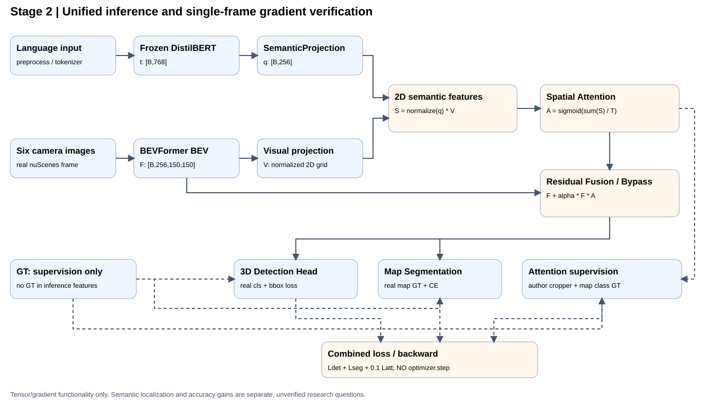

# BEV / DriveLM / VLA 线上实习项目

本仓库记录自动驾驶视觉感知、BEV 表征及视觉语言方向的阶段性实验、评估与问题排查。已完成第一阶段基线复现并推进第二阶段语言引导 BEV 注意力增强；共享 BEV 双 Head 的单帧前向及真实梯度验收通过。完整 VLA 模型训练尚未完成。

## 第一阶段已完成工作（2026-10-10—2026-10-13）

- 搭建 WSL2、PyTorch、MMCV、MMDetection3D、BEVFormer 相关实验环境，并进行 GPU / 自定义算子验证。
- 完成 nuScenes Mini 数据读取、六相机图像、3D 标注、LiDAR BEV 可视化。
- 完成 BEVFormer 3D 检测推理、BEV 特征提取与注意力实验性可视化。
- 核对 DriveLM v1.1 验证集与 nuScenes 官方 Val：**149 个场景、799 个关键帧，匹配 799/799，场景 token 不一致为 0**。
- 对 DriveLM 799 帧子集开展独立帧 3D 检测与 BEV 地图分割评估。
- 准备 DriveLM 语言问答基线的 20 条样本，覆盖 perception、prediction、planning、behavior 四类，每类 5 条；已检查样本图像路径。**尚未完成语言模型推理与回答质量评分。**

## 已记录的实验指标

| 实验 | 指标 | 结果 |
|---|---|---:|
| DriveLM 799 帧独立帧 3D 检测 | mAP | 13.39% |
| DriveLM 799 帧独立帧 3D 检测 | NDS | 25.79% |
| DriveLM 799 帧独立帧 BEV 地图分割 | 前景 mIoU | 5.12% |
| DriveLM 799 帧独立帧 BEV 地图分割 | 含背景 mIoU | 22.22% |
| nuScenes Mini 分割实验（81 帧） | Temporal ON 前景 mIoU | 6.38% |
| nuScenes Mini 分割实验（81 帧） | Temporal OFF 前景 mIoU | 5.99% |

**评估边界：** 799 帧结果为稀疏、独立帧子集评估，不是完整 nuScenes Val 官方成绩；不同模型、权重和时序设置不可直接横向比较。Mini Temporal ON/OFF 指标属于另一组 81 帧实验，不等同于 799 帧子集指标。

## 仓库目录

- `docs/`：中文每日 Logbook、阶段报告与排查记录
- `docs/images/`：实验截图和可视化证据
- `docs/stage1/`：第一阶段交付文档
- `scripts/`：数据检查、推理、评估与可视化脚本
- `patches/`：第三方 BEVFormer 的本地兼容性修改补丁
- `results/`：适合版本管理的小型结果文件
- `stage2/`：Day 1 语言编码和语义投影模块
- `tests/`：离线单元测试；依赖见 `requirements_stage2.txt`

## 阅读入口

- [第一阶段交付导航](docs/stage1/00_阶段一交付导航.md)
- [第一阶段基线性能报告](docs/stage1/03_基线性能测试报告.md)
- [10 月 12 日实验记录](docs/logbook_2026-10-12.md)
- [10 月 12 日分割问题排查](docs/logbook_bev_seg_debug_2026-10-12_CN.md)
- [10 月 13 日实验记录](docs/logbook_2026-10-13.md)
- [第一阶段周报](docs/stage1/06_第一阶段周报_2026-10-13.md)

## 复现说明与限制

本仓库主要保存实验脚本、文档和小型结果，不包含完整 nuScenes / DriveLM 数据集、模型权重、Python 虚拟环境或大型推理产物。运行时需自行准备相应数据、第三方工程、兼容依赖与权重；部分脚本含本地路径，需要按实际环境调整。

后续工作包括 DriveLM VQA 模型推理与评价、感知结果和语言问答的进一步衔接，以及 BEV 注意力增强方案验证。所有尚未完成的任务均不作为已验证成果呈现。


## 第二阶段｜语言引导 BEV 注意力增强（2026-10-21）

最终严格验收以 [指导老师原始任务书](docs/stage2/02_第二阶段原始任务书.md) 为准：8 项任务、4 项产出均有源码与本轮证据。69 项 pytest、7 组旧回归、真实 GPU 前向/bypass 及新统一入口 Mini Train 单次前向三任务联合 backward 通过；不执行参数更新。详见 [最终严格验收与拟提交清单](docs/stage2/20_第二阶段最终严格验收_2026-10-21.md)。

第二阶段已实现 DistilBERT 文本编码、语义到 BEV 的二维注意力映射、共享 BEV 融合接口，以及检测 + 分割 + 注意力多任务损失。作者联合 BEVFormer 双 Head 的真实单帧前向与三任务梯度检查通过；不宣称语言语义定位准确、完整时序评估或稳定精度提升。



- [阶段二实测证据与图片](docs/stage2/16_阶段二实证汇总_2026-10-21.md)
- [第二阶段复现命令](docs/stage2/17_第二阶段复现指引.md)
- [前次归档提交审查与回归结果](docs/stage2/18_提交前审查与回归_2026-10-21.md)
- [实验图片来源与阅读说明](docs/images/stage2/README.md)
- [模块架构设计](docs/stage2/11_模块架构设计.md)
- [单元测试报告](docs/stage2/12_单元测试报告.md)
- [真实联合梯度验证](docs/stage2/14_真实联合梯度验证.md)
- [2026-10-21 Logbook](docs/logbook_2026-10-21.md)

> 模型权重、nuScenes 数据和完整推理产物未放入仓库；选定的 JSON 证据位于 `results/stage2_2026-10-21/`。

已有兼容的 PyTorch、Transformers、NumPy 和 pytest 环境时，可在项目根目录执行离线 CPU 回归：

```bash
python scripts/stage2/run_stage2.py --mode cpu-tests \
  --output outputs/stage2_completion/reproduce_cpu.json
```

覆盖 Day 1 和新增工程 pytest、Step56 合成输入及 Step68～73 自检；不重跑真实模型推理。当前 WSL 已验证的解释器为 `.venv-bevformer/bin/python`。输出已存在时需换一个新路径，避免覆盖历史记录；真实模型验证的环境、数据和权重要求见复现指引。

## 第二阶段真实数据可视化

[第二阶段真实数据与图像总览](docs/stage2/数据图表总览_2026-10-21.md)，以及[完整数据分析报告](docs/stage2/数据分析报告_2026-10-21.md)。
图表保留原实验设置；已验证功能与未验证精度分开陈述。
