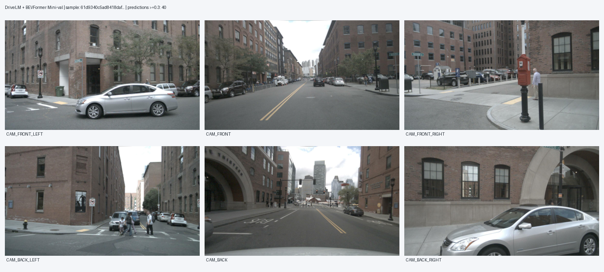
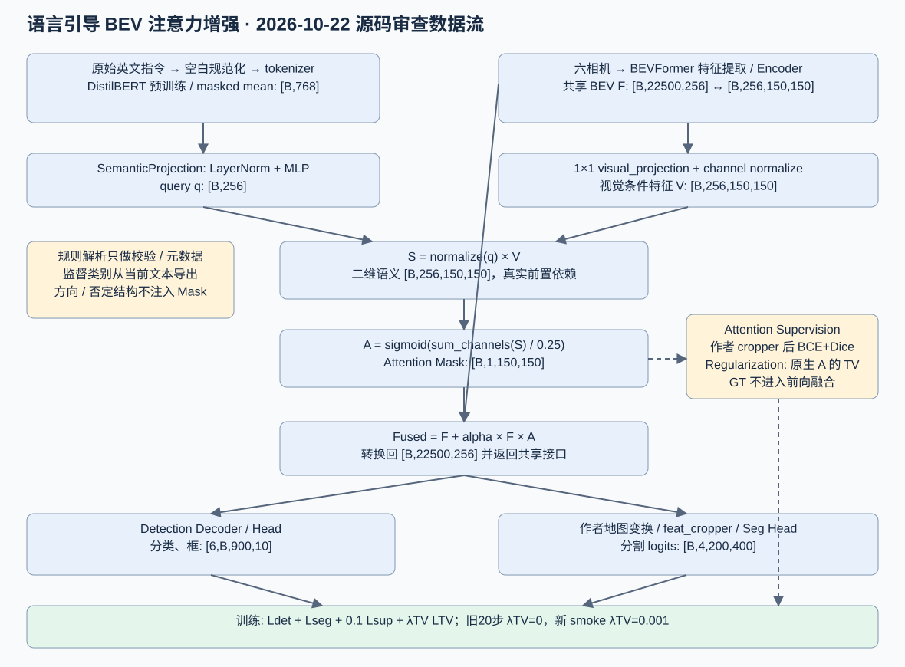
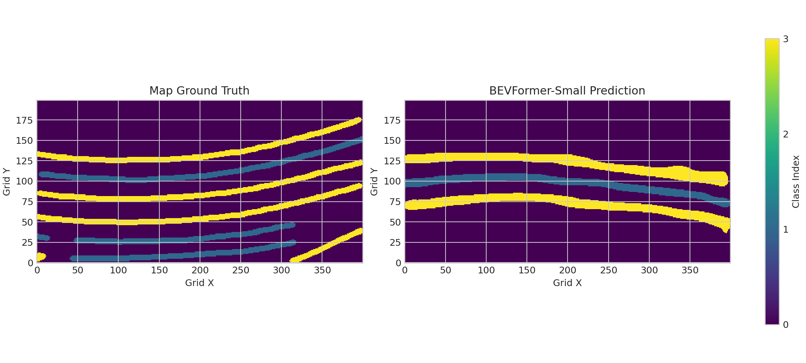
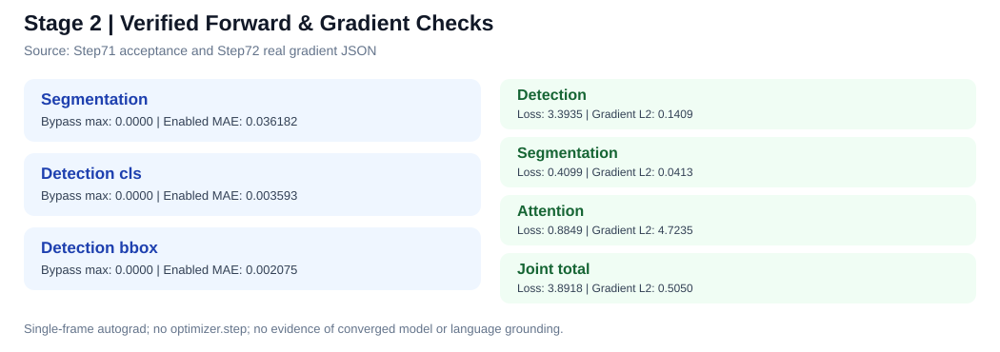
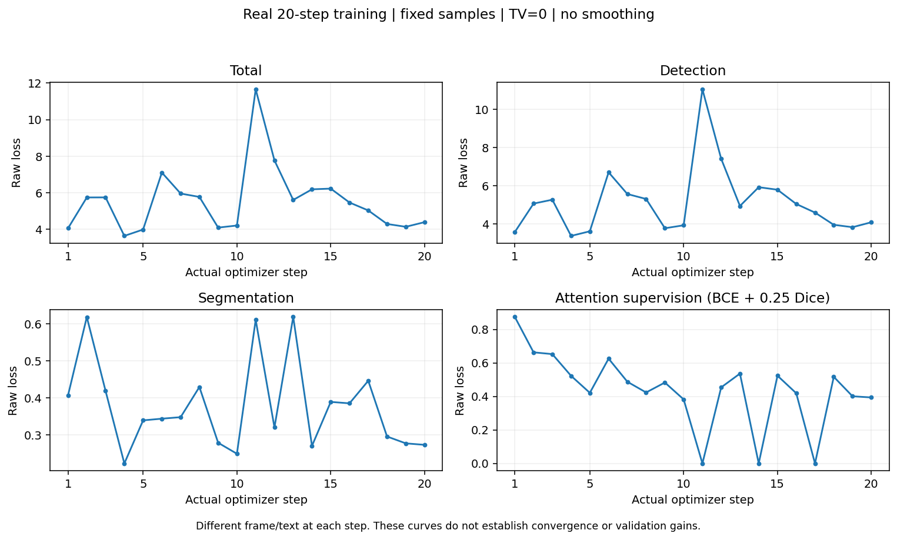
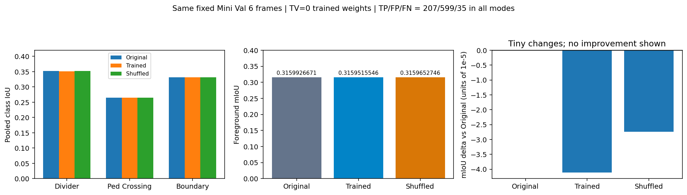
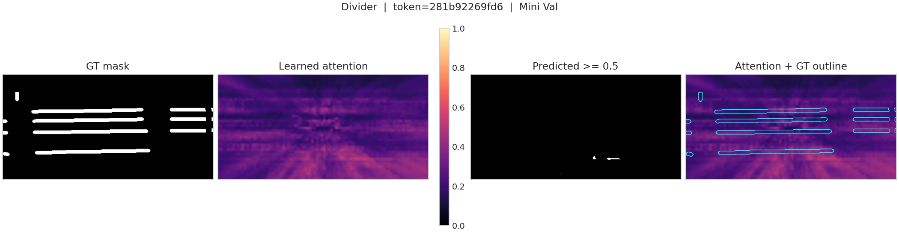

# BEVFormer × DriveLM：语言引导 BEV 感知增强项目总结报告

**编制日期：** 2026 年 11 月 2 日<br>
**项目计划结项日期：** 2026 年 11 月 6 日<br>
**研究范围：** BEVFormer、nuScenes / DriveLM、语言引导空间注意力与检测/分割联合增强<br>
**实验统计截止：** 2026 年 11 月 2 日；2026 年 11 月 3 日新增只读分组分析、RCA 与交付材料。历史实验日期、协议与结果保持不变。

**文档复核：** 2026 年 11 月 3 日；修正检测 AP 口径与对照状态，补充 RCA 和第四阶段交付导航，模型实验统计截止不变。

> **结果声明。** 本报告区分（1）工程实现/单测通过，（2）真实训练完成，（3）模型效果经过固定协议评估，三者不能互相替代。各实验的样本集合、时序设置、模型权重和指标定义若不同，不直接计算性能增益。2026 年 11 月 1 日的 Stage A/A128 数据来自本地正式运行状态与 `warmup_gate.json`；截至 10 月 30 日的仓库周报属于历史快照，不能代替最新状态。原正式 Stage B 仍为 **NOT_RUN**；独立探索 Stage B 已完成 **256/256 更新**，320 帧 Development 评价因数据依赖缺失失败，修复版本待新哈希授权，指标标记 **NOT_COMPLETED**。固定 8 帧诊断结果与 Development 严格分列。

## 摘要

本项目面向自动驾驶视觉感知场景，围绕 BEVFormer 的多相机鸟瞰图（Bird's-Eye View，BEV）表征，研究如何以自然语言指令调节三维目标检测和地图语义分割的关注区域。项目首先搭建 BEVFormer / nuScenes / DriveLM 推理与评估环境，获得可复核的检测、分割基线，并针对偏低的 BEV 地图分割 IoU 排查数据映射、时序状态和空间参考系问题。在此基础上，实现冻结 DistilBERT 的语言编码、语义—空间映射、注意力生成、残差融合及多任务损失，并将增强后的共享 BEV 输入作者检测与分割双 Head。

早期类别级监督以“某一地图类别”为目标，难以区分同类不同方位或实例；真实小样本对照发现，即使模型响应文本，检测和分割收益也可能为零或负值。研究路线因此转向实例/区域级空间监督、同类难负例和正确/错误指令配对，并进一步建立独立 LG-BEV 训练方案：以真实地图和 3D 标注生成空间目标，冻结原始感知主干和文本编码器，仅优化约 93,866 个 Adapter 参数。正式 Stage A 已在 19,123 帧训练集上完成两轮、9,562 次参数更新，Checkpoint、优化器、随机数状态与样本顺序保存完整。固定 A128 门槛验收的地图/目标 Attention IoU 分别为 **0.122168 / 0.117125**，均低于预设 **0.15**；正确/错误指令 Logit 差 **5.459627**、空目标激活率 **0.006011** 则满足各自门槛。正式判定为 `GROUNDING_NOT_READY`，原正式 Stage B **没有启动**。另行授权的独立探索实验已完成 512 帧、2 epochs、256 更新、1024 微步，使用固定 StageB256 权重；该完成状态不构成原正式准入。

已有工作证明了工程链路、真实梯度、完整训练与保全机制的可实施性，但**尚未证明新增语言空间监督带来稳定的指令相关 3D AP 或地图 mIoU 提升**。现阶段以已经完成的独立 Stage B 三组诊断、负向结果分析和材料终审完成结项交付，不追加训练或正式测试。

**2026-11-02 核心验证更新。** 已复用通过 GPU 预检的固定 8 帧诊断原始预测，无新推理：A9562 地图/对象 Attention macro IoU 为 **14.4377% / 23.0789%**，相对同集合初始化候选增加 **13.6535 / 22.9840 个百分点**。在有效正目标反事实配对上，地图/对象正确−错误 Logit gap 为 **3.497844 / 11.203561**；地图有效配对正确 IoU 仅 **1.6080%**，说明文本响应不能代替准确定位。4 条具备目标和同类干扰的对象指令均呈现目标响应优势，并保存 49 条逐实例记录及空间可视化。该小集合不能替代未通过的 A128，也不能作为 Development 泛化结果。

Development 原加载器缺失 37 条相邻标注链接，已在私有 v2 副本补齐一阶 SDK 速度依赖，并修复带目录描述符的临时清理审计；**155 项回归通过**。原始 GT、正式源码、v1 协议与权重保留。新代码 SHA 尚待授权，未重启正式评价。

**2026-11-03 交付更新。** 完成 4 场景、8 帧、16 条指令、7 类指令组合的既有结果分析，并建立 F01—F05 失效案例及三级 RCA 证据表。4 分钟本人中文配音视频包含同场景正确／错误指令和目标／同类干扰局部对照，采用中文字幕及 AAC 音轨，独立保存于本地交付目录。这些新增成果属于分析与交付，不改变 11/02 的实验截止日期。

**关键词：** 自动驾驶；BEVFormer；DriveLM；多模态感知；语言引导注意力；空间监督；实例定位；检测与分割。

---

# 第 1 章 项目背景与研究问题

## 1.1 研究背景

自动驾驶感知需要综合多摄像头输入，识别周边交通参与者、道路边界、车道线和人行横道。相比直接在相机图像平面处理多个视角，BEV 将场景投影到车辆附近的统一地面参考平面，使跨相机目标关联、空间位置理解和下游规划接口更加一致。BEVFormer 通过时空 Transformer 构建 BEV 特征，再由任务 Head 执行三维检测、地图分割等感知任务。

传统 BEV 感知输出通常不随使用者当前问题而变化。例如指令“关注车辆前方左侧最近的交通参与者”要求定位**指定位置与指定实例**，而不仅是把全图所有车辆都判为同一类别。DriveLM 为驾驶场景中的语言任务提供研究语境；本项目实际完成的核心工作是**语言条件化的 BEV 感知**，并未建立通用问答生成器或端到端动作控制器，故不将完整 VLA 或 VQA 生成能力列为已实现成果。

## 1.2 核心研究问题

本项目重点回答以下问题：

1. 现成 BEVFormer/地图分割模型在本地 nuScenes 与 DriveLM 关联帧上是否可复现稳定的推理与评估？当地图分割 IoU 低时，如何区分模型能力、空间协议和实现问题？
2. 使用冻结语言编码器得到的文本向量，能否在共享 BEV 特征上形成可解释、可验证的空间注意力？
3. “类别级目标监督”能否说明模型理解“左侧、右侧、最近目标”等指令？若不能，如何建立有明确几何来源的实例/区域级监督？
4. 空间注意力变化能否进一步传导为指令相关检测 AP、分割 IoU 的改善，同时约束无关区域退化？
5. 在 GPU 显存、存储和多日训练限制下，怎样保持模型、GT、参数更新与评估结论可复现、可审计？

## 1.3 研究范围与结项原则

研究对象包括 BEVFormer-Small（含作者联合检测/分割模型）、nuScenes、DriveLM 关联标注、DistilBERT 与可训练语言空间 Adapter。实验设计固定数据来源、评价协议和独立对照，并完整报告负向结果。预训练暴露范围、自定义诊断与官方指标分别说明。

原任务规定指令相关检测 mAP、分割 mIoU、整体性能退化及 RTX 3090 延迟四项验收目标，详细要求见[原始任务交付矩阵](../stage4/04_原始任务与交付清单_2026-11-03.md)。**四项目标均尚无正式达标证据。**

| 性能目标（源于现存任务与审计材料） | 目标值 | 截至统计日期的结论 |
|---|---|---|
| 指令相关检测 mAP | 提升至少 2% | NOT_VERIFIED |
| 指令相关区域分割 mIoU | 提升至少 1.5% | NOT_VERIFIED |
| 整体平均精度退化 | 不超过 2% | NOT_VERIFIED |
| RTX 3090 模块单帧额外延迟 | 不超过 20 ms | NOT_VERIFIED；本机 RTX 5080 Laptop 计时不可替代 |

历史材料的百分比口径尚需与原始任务文件核对，现阶段不将百分比直接视作绝对百分点。来源：[四阶段任务交付审计](https://github.com/JiaxuanJin/bev_vla_internship/blob/main/docs/四阶段任务交付审计_2026-10-26.md)、[仓库总览](https://github.com/JiaxuanJin/bev_vla_internship/blob/main/README.md)。

# 第 2 章 研究目标与技术路线演进

## 2.1 原项目四阶段与实际进度

下表的“项目阶段”不同于 LG-BEV 训练内部的 Stage A / Stage B，也不同于第三阶段的 V1—V5 研究版本。

| 项目阶段 | 目标 | 截至 2026-11-03 的交付状态（模型实验截至 11/02） |
|---|---|---|
| 第一阶段：基线与数据 | 环境、nuScenes/DriveLM 数据、3D 检测与地图分割推理、评估和可视化 | 已取得 799 帧检测/分割子集基线及根因排查证据；不等于复现作者官方完整指标 |
| 第二阶段：核心模块设计与集成 | DistilBERT、语义—空间映射、Attention、Fusion、多任务 Loss、真实双 Head 接入、单测 | 工程功能已有验证；旧类别监督的模型效果不稳定 |
| 第三阶段：训练与性能优化 | 真实训练、空间对齐、相关/无关指标与基线对照 | 已完成 Stage A、独立 Stage B 256 更新及 8 帧诊断；A128 未达门槛；320 帧 Development 修复版待授权 |
| 第四阶段：验证与成果交付 | 多场景/指令评估、总结报告、复现材料及必要展示 | 有限样本报告、RCA 与本人中文配音演示已具备；正式性能验收及接收端审阅尚未完成 |

## 2.2 技术演进链路

```text
原始 BEVFormer 感知基线
    ↓ 发现地图前景 IoU 低、空间协议存在疑点
基线复现、坐标映射 / 方向 / 时序根因排查
    ↓
冻结 DistilBERT + 类别级 BEV Attention + 双 Head Fusion
    ↓ 真实 A/B 显示文本响应不等于空间定位，也不保证 AP/IoU 收益
实例 / 方位 / 距离约束 + 正确/错误指令对比 + 难负例
    ↓ 仍存在背景误激活、同类干扰物和感知收益不足
独立 LG-BEV：真实物理空间 GT + Stage A 空间学习 + Stage B 联合增强
    ↓ 当前 Stage A 已完成、A128 IoU 未过门槛
保留原正式失败结论；探索独立 Stage B 最小对照和结项分析
```

## 2.3 关键设计决策及原因

**决策一：冻结原作者感知模型。** 保留作者 BEVFormer、原生检测与分割 Head，避免在资源受限条件下重训整个感知模型；新增 Adapter 的表现需要与相同原生基线对照。

**决策二：从类别监督升级到空间目标监督。** `GT == target_class` 会把全图同类区域全部当正例，无法回答“选的是哪一个目标”；因此增加真实地图 record / 3D 实例 ID、Ego 坐标、方位和距离约束及错误指令配对。

**决策三：拆分 Stage A 与 Stage B。** Stage A 优先验证注意力是否落到正确空间位置；Stage B 才允许残差影响真实检测/分割 Head，并验证相关/无关指标。检测梯度连通性属于工程验证，空间命中率由独立 Attention 指标评价。

**决策四：为负向结果保留原始协议。** 一旦 A128 未通过，原正式 run 停止，Stage B 准入保持关闭；独立探索使用新的配置、优化器和输出目录，原封存证据保留。

# 第 3 章 数据、实验环境与评估协议

## 3.1 计算与软件环境

| 组件 | 本地实际使用/记录 |
|---|---|
| 操作系统 | Windows 11 + WSL2 Ubuntu 22.04（Ubuntu-22.04-E） |
| GPU | NVIDIA GeForce RTX 5080 Laptop GPU，16 GB 显存 |
| 主要语言/工具 | Python 3.10.12、PyTorch 2.8.0+cu128、CUDA、VS Code、Git、pytest |
| 检测/地图模型 | BEVFormer-Small 检测预训练权重、BEVFormer-Small Seg、第三方作者联合双 Head checkpoint |
| 语言编码 | 本地冻结 DistilBERT；不在训练中下载预训练资产 |
| 数据与缓存 | 原始 nuScenes、模型权重及滚动缓存位于 G 盘；代码和小型证据在 `~/projects/bev_vla` |
| 工程规范 | 中文记录和注释；Python 按 Black 行宽 88；历史源码/权重与输出通过 SHA 和独立 manifest 区分 |

仓库无法完整分发原始 nuScenes/DriveLM、第三方工程、全部模型权重和 G 盘缓存；克隆 GitHub 后需根据实际的环境与资产清单另行准备。当前 Stage3 环境、源码构建来源、Checkpoint SHA 与路径映射以 [2026-11-02 复现说明](../stage3/05_Stage3环境与非Git资产复现_2026-11-02.md)及[独立 requirements](../../requirements_stage3_20261102.txt)为准；[第二阶段历史复现指引](https://github.com/JiaxuanJin/bev_vla_internship/blob/main/docs/stage2/17_第二阶段复现指引.md)中的 `.venv-author` 与 Stage3 的 `.venv-bevformer` 分开登记。

## 3.2 数据集与划分

| 数据来源 | 规模 | 使用目的与限制 |
|---|---:|---|
| nuScenes Mini Train / Val | 323 帧 / 81 帧，8 / 2 场景 | 初始模型加载、功能检查和基线；样本很小 |
| DriveLM v1.1 关联的 nuScenes Val 子集 | 799 帧，149 场景 | 稀疏、独立帧检测/分割基线；不是完整 Val 排行榜成绩 |
| nuScenes 官方 Val | 6,019 帧，150 场景 | 连续时序分割复核与几何排查 |
| LG-BEV Train | 19,123 帧，476 场景，35 日志 | 空间 GT 构建、Stage A 正式训练 |
| LG-BEV Development | 2,692 帧 | 按独立协议预留；截至 2026 年 11 月 1 日正式 Stage B 终点评价 NOT_RUN |
| LG-BEV Cold Final | 3,288 帧 | 冷启动最终验证预留；不得用来调参，报告统计日 NOT_RUN |

DriveLM 的 799 帧来自语言 QA 关联的场景 token，但第一阶段实际评估的是**视觉检测与地图分割**，并没有执行完整的语言问答生成与评分。LG-BEV 的训练语言标签则来自真实 GT 派生的受约束指令模板，**不是 19,123 帧原始 DriveLM 自然语言问答监督**。详见 [基线性能报告](https://github.com/JiaxuanJin/bev_vla_internship/blob/main/docs/stage1/03_基线性能测试报告.md) 与 [10/26—10/30 工程周报](https://github.com/JiaxuanJin/bev_vla_internship/blob/main/docs/weekly_report_2026-10-26_to_2026-10-30.md)。

**预训练暴露风险。** 联合检测/分割 checkpoint 的精确预训练样本清单未嵌入资产；因此即使新的 Adapter 训练/评估按日志或场景拆分，也不能据此证明作者预训练主干未见过评估样本。后续开发评估必须声明这种独立性范围。来源：[正式资产与协议审计](https://github.com/JiaxuanJin/bev_vla_internship/blob/main/docs/lg_bev_formal_training_protocol_2026-10-27.md)。

## 3.3 BEV 坐标与模型张量约定

研究使用原生共享 BEV 特征作为语言调节接口。典型共享特征为 `B×256×150×150`，作者地图分割 Head 输出四类 `B×4×200×400` logits，检测 Head 使用原生多层 Decoder/3D 检测输出。两个网格具有不同物理范围与分辨率，空间监督通过 LiDAR／Ego 标定投影完成。

LG-BEV 的空间目标以 nuScenes 3D 实例/地图 record、LiDAR 与 Ego 标定及 BEV 栅格协议构建；训练/评估时追踪 `scene_token`、`sample_token`、实例 ID、指令目标、GT 来源与坐标变换。必须区别**模型注意力的 BEV 网格**、**作者地图输出网格**和**用于空间监督的真实物理区域**，并对齐各自的裁剪、插值和有效像素集合。

## 3.4 评价指标定义与可比性

地图分割采用 IoU：

\[
\operatorname{IoU}_c = \frac{TP_c}{TP_c+FP_c+FN_c},\quad
\operatorname{mIoU}_{fg}=\frac{\operatorname{IoU}_1+\operatorname{IoU}_2+\operatorname{IoU}_3}{3}.
\]

第一阶段报告中的分割指标为**全数据累计混淆矩阵后计算类别 IoU**。检测 mAP/NDS 在 799 帧自定义 nuScenes 子集上按 nuScenes Devkit 匹配得到。早期 V1—V5 探索中的 `AP@2m_xy` 使用自定义非插值 AP；第 8.4 节独立 LG-BEV 固定 8 帧诊断则使用 SDK 式 **101 点插值**、`min_recall=min_precision=0.1`，在 Ego XY 中以距离严格小于 2 m 匹配，并对 car/pedestrian 两类 AP 求平均。其实现见[封存 v1 评分器](../../experiments/lg_bev_stage3_exploration_20261101/reports/evaluation_20261102/source/eval_metrics.py)。同名指标按各自历史协议报告；独立诊断与官方完整 nuScenes mAP/NDS 分列。

语言条件评价除 Attention IoU、正确/错误指令响应差和空目标激活外，还需要按**同一正确 GT 与固定空间规则**分别统计：Relevant Detection AP、Irrelevant Detection AP、Relevant Segmentation IoU、Irrelevant Segmentation IoU。相关和无关区域分别累计，采用各自固定分母。空 GT 及无正例需明确记录，并保留假阳性统计。

# 第 4 章 模型体系与模块架构

## 4.1 原生 BEVFormer 共享感知结构

基础模型以六相机图像为输入，经视觉 Backbone 和 BEV Transformer 得到空间特征，再送入原生 3D Detection Head 与 BEV Map Segmentation Head。历史部署了单独检测/分割 checkpoint；后续真实双 Head 实验使用第三方 joint checkpoint，不能把不同 checkpoint 下的指标作为纯“是否添加 Adapter”的消融。

在语言增强研究中，尽量维持同一 joint checkpoint、同一输入和同一时序状态，利用共享 BEV 的 Hook/融合接口实现可关闭的对照，避免直接修改第三方作者模型源码。



*图 4-1　基线感知输出示例。该图展示原生模型的可视化结果，不作为语言增强收益证据。*


## 4.2 第二阶段：语言编码—空间注意力—共享融合



*图 4-2　语言引导 BEV 注意力增强模块架构；检测、分割与注意力监督分支共享经融合的空间特征。*

语言编码器对规范化英文指令执行 tokenization、冻结 DistilBERT 前向与 mask-aware 池化；二维语义模块将文本特征与 BEV 视觉特征交互形成 Attention。第二阶段核心路径保留 `BEV + α × BEV × Attention` 的残差融合。关闭融合时，输出应与原始模型精确对应；开启后双 Head 的数值可能变化，但**输出变化并不意味着检测质量提高**。


原型 Loss 将真实检测 Loss、地图分割 CrossEntropy、Attention BCE/Dice 和可选 TV 平滑项组合。早期 20 步真实训练的 TV 权重为 0；后来 TV=0.001 只作独立梯度/功能 smoke，不可称其已经带来训练收益。源码接口、形状、损失权重详见 [模块架构设计](https://github.com/JiaxuanJin/bev_vla_internship/blob/main/docs/stage2/11_模块架构设计.md)。

## 4.3 从类别到唯一空间目标的监督设计

类别级监督 `GT == target_class` 无法区分同类不同实例；即使给出 front-left 象限，仍可能包含多个同类目标。后续探索引入 `instruction_id`、`instance_id`、`instance_mask`、`related_region`、`coordinate_frame` 和 `annotation_source` 以固定对象身份、物理区域与标签出处。对于“最近/最远”指令，须有真实空间距离和歧义排除规则，而不是使用模型预测选择标签。

受约束的方向语句依赖 Ego 米制参考系；错误方位、同类非目标实例和背景区域用于构建可比较的负例。标签生成与模型输出彼此独立，防止“预测即真值”的循环监督。相关代码接口与范围见 [空间监督协议修订](https://github.com/JiaxuanJin/bev_vla_internship/blob/main/docs/stage2/23_空间指令监督与评估修订_2026-10-26.md)。

## 4.4 LG-BEV 独立模型与训练阶段

独立 LG-BEV 方案延续冻结作者 BEVFormer、原生双 Head 和冻结 DistilBERT，仅优化约 **93,866 个新 Adapter 参数**。原生共享 BEV 输入语言与几何条件 Adapter，Attention 在物理监督网格上与真实目标匹配；新模块的残差输出再连接共享感知特征与两个 Head。

- **Stage A（空间学习）**：空间目标的 Attention BCE/Dice、正确/错误指令配对排序以及难负例/空目标约束。关键交付是空间 Attention 在固定正目标上的命中率，而不是只看训练 Loss。
- **A128 Gate（独立准入）**：固定 128 条验收 token 检查地图/对象 Attention IoU、正确/错误指令 Logit gap 及空目标激活率。必须通过后才允许在**原正式训练协议**中进入 Stage B。
- **Stage B（联合增强）**：让语言条件残差实际影响原生检测与分割输出，同时衡量相关区域变化及无关区域的保护效果。目前原正式 run 因 A128 未通过而**未启动 Stage B**。

正式 Stage A 终点 `up.weight`、`up.bias` 均为零；因此在相同输入和条件下，Stage A Only 的残差输出理论上为零，Detection/Segmentation 应保持原生基线。此前固定 8 帧 GPU 对照已验证双 Head 逐张量一致，证据见第 8.2、8.4 节及其链接；这一结论仅限该诊断集合，不构成感知性能收益。独立 StageB256 已从 A 权重的 `state_dict` 初始化并完成训练，使用**新优化器、随机种子与输出目录**，未调用旧正式 run 的 `resume`；320 帧 Development v2 仍待单独授权。

## 4.5 系统工程模块边界

| 模块 | 职责 | 实际实施状态 |
|---|---|---|
| 数据/元数据层 | 场景、帧、图像、地图、3D 实例及其来源索引 | 已构建并验证 Stage A Train 元数据 |
| 物理空间标注层 | LiDAR/Ego 标定、地图 record/实例、空间目标与有效域 | GT 完整性与边界核查 PASS；细粒度预测准确率仍需评价 |
| 原生模型层 | BEVFormer 主干、检测与分割双 Head | 冻结、真实前向及一致性测试已有证据 |
| 语言条件层 | DistilBERT、Attention Adapter、空间/文本对照 | 已实现并完成正式 Stage A 训练 |
| 学习与评估层 | A/B Loss、A128、Relevant/Irrelevant 分项指标 | Stage A 与 A128 已运行；独立 StageB256 训练及 8 帧诊断完成，320 帧 Development NOT_COMPLETED |
| 可靠性层 | 数据分片、滚动缓存、Checkpoint、SHA、跨会话恢复 | 正式训练与独立失败终态保全已验证；原 V3 失败收尾分支仍有缺口 |

# 第 5 章 第一阶段：基线复现与空间根因排查

## 5.1 基线功能实现

2026 年 10 月 10—13 日完成 WSL、GPU/CUDA 自定义算子、nuScenes 目录、六相机/3D GT/LiDAR BEV 可视化、BEVFormer 检测及地图分割推理。DriveLM v1.1 的 799 个官方 Val 关联 token 全部匹配；799 帧稀疏子集采用独立帧协议，历史 BEV 不跨不连续帧传递。第一阶段不训练新权重。

| 数据与协议 | 样本规模 | 3D mAP | NDS | 地图前景 mIoU | 说明 |
|---|---:|---:|---:|---:|---|
| nuScenes Mini Val | 81 帧 | 32.50% | 37.71% | 6.38% | 初始基线，Mini 协议 |
| DriveLM 关联 Val 子集 | 799 帧 | 13.39% | 25.79% | 5.12% | 稀疏独立帧，自定义子集 |
| 官方 nuScenes Val | 6,019 帧 | NOT_REPORTED | NOT_REPORTED | 4.6416% | 后续连续时序分割根因复核 |

其中 DriveLM 799 帧分割的三类前景 IoU：divider **2.08%**、pedestrian crossing **8.07%**、boundary **5.21%**；含背景的四类 mIoU 为 **22.22%**。800 量级子集与 81 帧 Mini 的难度、场景分布和时序条件不同，两者差距不用于推断训练退化。



*图 5-1　DriveLM 799 帧子集的分割真值与模型预测对照，反映前景结构定位的局限。*
证据：[第一阶段基线性能报告](https://github.com/JiaxuanJin/bev_vla_internship/blob/main/docs/stage1/03_基线性能测试报告.md)。

## 5.2 低前景 IoU 的排查方法

发现 DriveLM 子集和完整官方 Val 均出现较低的前景分割 IoU 后，依次核对：checkpoint 是否与发布权重相同、6,019 帧和传感器路径是否完整、两套评价器是否一致、时序 ON/OFF 差异、CUDA Attention 数值、地图 GT 类别编码、BEV 的 `rot90/flip` 与特征 Slicer 的几何关系，以及真实 LiDAR→Ego 外参。

已复核官方 Val 150 场景、6,019 帧，传感器路径检查无缺失；作者评估函数与本地混淆矩阵重算具有一致性。关闭时序使 Mini Val 前景 mIoU 从约 **6.3756%** 变为 **5.9922%**，说明时序确有影响，但不足以单独解释所有低分。

## 5.3 方向与物理坐标的受控消融

最初的几何诊断发现 `rot90(-1)+flip` 和物理 Ego 参考系之间的排列关系值得重点检查。固定官方权重、输入、GT 和评价函数，在 14 个 Val 样本上尝试方向候选，前景 mIoU 从 **5.4470%** 升到 **19.8236%**（14/14 样本改善）。进一步对完整官方 Val 的候选方向复核记录 **4.6416% → 19.6000%**，但在其他独立/交叉场景中存在明显退化，因此该方向不是经过普适性验证的正式修复。

随后对作者独立代码的 Mini Val 81 帧重跑得到 **6.38%**，说明低 IoU 并非本机单一工程修改所致；真实标定下的推理端校准使 **6.38% → 5.76%（下降约 0.62 个百分点）**，已被排除为可直接合入的改善方案。人工坐标场误差验证几何映射；模型定位能力仍由真实预测 IoU 评价。

## 5.4 阶段性结论与边界

第一阶段完成了可核验的基线数据链路和主要错误假设排查。**空间朝向/地图栅格与作者训练约定的对应关系是有证据支持的根因线索，但不是完全闭环的唯一根因。** 尚缺作者历史训练实际源码、当时的地图/GT 配置与多场景稳健修复验证，不应将 19.60% 的方向候选当作正式基线修复后的成绩。主要证据：[10/19 根因排查](https://github.com/JiaxuanJin/bev_vla_internship/blob/main/docs/stage1/07_DriveLM799分割根因排查_2026-10-19.md)、[10/20 空间协议复核](https://github.com/JiaxuanJin/bev_vla_internship/blob/main/docs/stage1/08_BEV分割空间协议与独立复现_2026-10-20.md)。

# 第 6 章 第二阶段：语言增强模块实现与监督范式迭代

## 6.1 类别级语言增强模块的工程验收

已实现本地 DistilBERT 语言编码、语义映射、Attention Mask、可关闭残差融合、多任务 Loss 和真实联合双 Head 接入。初期 117 项 CPU 单元测试通过，真实单帧联合模型前向、检测/分割/注意力梯度都已观察到。关闭融合时双 Head 输出最大绝对差为 0；开启后分割、检测 logits 出现数值变化。这证明插件式增强可运行，并**不证明精度提高**。



*图 6-1　语言增强模块的前向、梯度与接口测试证据，属于工程功能验收。*


旧 20 步真实训练在 nuScenes Mini Train 固定样本上完成了 `optimizer.step()`，并用 Mini Val 固定六帧进行 Original / Untrained / Trained / Shuffled 指令对照：

| 六帧前景 mIoU | Original | Untrained | Trained（20 步） | Shuffled Text |
|---|---:|---:|---:|---:|
| 记录值 | 31.5993% | 31.5993% | 31.5952% | 31.5965% |



*图 6-2　早期小样本训练损失；训练损失与验证集精度分别记录。*



*图 6-3　相同六帧条件下的 A/B 对照，训练后没有获得稳定的地图分割改善。*

训练后的分割较原始值下降约 **0.0041 个百分点**。原记录中固定条件下的检测 TP/FP/FN 在 Original、Trained、Shuffled 分支均为 207/599/35；这不是官方 mAP，正常文本没有表现出稳定优势。历史 20 步训练使用 `TV=0`；非零 TV 的梯度传播由独立 smoke 测试验证，尚无对应的长期训练收益证据。来源：[阶段二历史 A/B 汇总](https://github.com/JiaxuanJin/bev_vla_internship/blob/main/README.md)、[功能与梯度证据](https://github.com/JiaxuanJin/bev_vla_internship/blob/main/docs/stage2/16_阶段二实证汇总_2026-10-21.md)。

## 6.2 类别级监督的结构性局限

旧监督把与指令目标类别相同的所有地图像素当正例，容易出现“类别正确但实例或位置错误”。例如同一帧有多个左前/右前同类记录时，仅靠类别目标并不知道要关注哪一处；原型冻结文本向量的平均池化也可能削弱方向词差异。Attention 预测还存在背景区域占比大、目标正样本稀疏、同类非目标实例未受到充分惩罚等问题。

因此，后续研究不再把“Attention 对不同文本有响应”当作空间理解成功，而要求真实空间 GT、实例 ID、正确/错误方位对照、空目标和背景假阳性的独立统计。



*图 6-4　类别级地图注意力诊断可视化，呈现模型激活与真实道路要素之间的差异。*


## 6.3 2026-10-26 的空间监督探索结果

**阶段划分：** 下述 V2/V5 属于**原项目第三阶段的训练/优化研究版本**，此处回顾其对空间监督设计的影响，阶段归属与正式验收状态保持独立。

第二轮空间模型 V2 在真实 BEV 缓存上完成 **200 次注意力预热更新**，并完成 **40 次真实双 Head 联合更新**，共 **240 次 optimizer.step()**。在固定留出场景六帧、30 条地图实例指令上，对第一轮和第二轮的同协议比较显示：

| 项目 | 第一轮空间模型 | 第二轮选中模型 | 说明 |
|---|---:|---:|---|
| Target Attention IoU | 0.1398% | 3.7113% | 有提高，但绝对命中率仍低 |
| 正确左右指令目标注意力胜出 | 12/30 | 30/30 | 受约束方位对照有效 |
| Relevant Segmentation IoU | 50.2918% | 50.3380% | 仅提升约 0.0462 个百分点 |
| Irrelevant Segmentation IoU | 53.8890% | 53.8824% | 略有下降 |
| Relevant Detection AP@2m_xy | 48.0196% | 47.9864% | 独立对象指令协议，未改善 |

这组结果说明方位区分取得有限进展，但目标注意力仍扩散到背景和其他实例，检测收益尚无证据。该 AP 为自定义中心距离匹配，地图实例指令与对象指令采用不同任务，不能在同一指标上混合平均。证据：[第二轮空间对照报告](https://github.com/JiaxuanJin/bev_vla_internship/blob/main/docs/stage2/26_第二轮空间对比监督与独立留出评估_2026-10-26.md)。

V5 进一步采用真实共享 BEV 残差语言耦合和三路等预算控制：global_control、targeted_no_language、targeted_language。每路训练 **96 次**，共 **288 次真实 CUDA 更新**；三路保持作者主干/原生双 Head/DistilBERT 冻结。目标语言分支相对 Original 的相关分割 IoU **+0.051190 个百分点**，但相关 AP@2m_xy **−0.478943 个百分点**，且正确文本没有稳定优于错误文本；因此未达到预设的联合收益门槛，研究按协议停止，没有拿额外训练步数寻找正向结果。证据：[V5 语言耦合探索结论](https://github.com/JiaxuanJin/bev_vla_internship/blob/main/docs/stage3/03_V5语言条件耦合与最终探索结论_2026-10-26.md)。

## 6.4 由负向证据得到的技术启示

1. 类别正确并不等于空间位置正确，目标监督必须包含真实物理区域和实例身份。
2. 目标像素很稀疏时，全图损失可能允许低激活或背景扩散，必须检查正例权重、同类难负例及面积偏置。
3. 正确指令对 Attention 更敏感，并不能自动推出真实检测 AP 提高；冻结 Head 对增强 BEV 的分布偏移可能敏感。
4. 检测任务梯度和分割任务梯度可能存在方向冲突，工程上“有梯度”不能当作优化目标一致。
5. 开发样本、留出样本、作者预训练可能见过的样本，必须分别说明独立性范围。

这些启示直接推动后续独立 LG-BEV 更严格的空间监督、A128 门槛和 Stage B 的相关/无关区域评价设计。

# 第 7 章 第三阶段：LG-BEV 空间监督、正式 Stage A 与验收

## 7.1 独立 LG-BEV 的目标与实验原则

LG-BEV 独立方案针对上一轮“语言响应存在但目标定位弱、AP 与分割收益不稳定”的问题，建立真实目标的物理空间监督链路。作者联合 BEVFormer checkpoint、原生 Detection/Segmentation Head 和 DistilBERT 保持冻结，仅学习约 93,866 个语言空间 Adapter 参数。真实物理 GT 与语言模板分别由地图记录/3D 标注和受约束几何规则生成，不从模型预测中反推标签。

研究不是把第三方作者模型重新端到端预训练，而是在真实原生 BEV 和原有双 Head 上，评价一个增量条件模块能否产生可测量的空间与感知收益。

## 7.2 数据完整性、来源与隔离

正式 Stage A 训练集包含 **19,123 帧、476 个场景、35 个日志**；GT 构建成功 **19,123/19,123**。工程准入包含 970 个 GT 块来源/哈希校验及固定训练/开发/冷最终划分。数据标签基于真实地图和对象标注派生，语言为受约束模板；不能将其写为 DriveLM 原始自由文本一一标注。

G 盘保存完整数据、权重、SQLite 与中间缓存；滚动缓存预算为 **30 GB**，且必须保留 **250 GB** 以上空闲容量。源代码、轻量结果及文档在项目仓库，训练断点不上传 GitHub。正式训练使用原生 BEV 重算与受控 FP32 缓存，避免无限制保存全量特征。原生输出与工程参考的数值一致性已在小规模测试中验证，但性能优化不改变训练目标或放宽容差。证据：[阶段三周报](https://github.com/JiaxuanJin/bev_vla_internship/blob/main/docs/weekly_report_2026-10-26_to_2026-10-30.md)、[LG-BEV 固定协议](https://github.com/JiaxuanJin/bev_vla_internship/blob/main/docs/lg_bev_formal_training_protocol_2026-10-27.md)。

## 7.3 Stage A / Stage B 训练协议

| 项目 | 封存方案 | 当前执行状态 |
|---|---|---|
| 作者 BEVFormer / 原生双 Head / DistilBERT | 冻结 | 已执行并验证对应冻结策略 |
| 新增可训练 Adapter | 约 93,866 参数 | Stage A 已完成更新 |
| Stage A | 2 个 frame epochs，9,562 次 optimizer updates | **DONE** |
| A128 Gate | 固定128 token；Map、Object Attention IoU；正确/错误 Logit 差；空目标激活 | **DONE，但 NOT_PASS** |
| Stage B | 4 个 frame epochs，19,124 次 optimizer updates | **NOT_RUN（原正式 run）** |
| 计划总更新 | 28,686 次 | 实际只完成 Stage A 的9,562次 |
| Development / Cold Final 正式终点 | 按固定隔离方案评价 | **NOT_RUN** |

Stage A 的正样本以空间 Attention BCE/Dice 及指令配对排序学习；Stage B 计划将条件特征送入真实冻结双 Head，在分割、检测与无关区域保护之间做受控权衡。训练时采用独立时序状态、严格固定数据/配置和日志，避免把历史研究不同版本的指标合并成同一训练曲线。

## 7.4 工程完整性与多会话训练

正式训练在 RTX 5080 Laptop + WSL 环境下多次安全暂停、恢复并完成 9,562 次 AdamW 更新。已有工程验证覆盖完整参数、优化器、Scheduler、RNG、样本顺序和部分梯度恢复；正式 Stage A 终点不存在待累积梯度（`partial_accumulation=0`）。2026 年 11 月 1 日最终已核验的 Checkpoint：

```text
run_id: lg_bev_formal_v3_20261028_v1
stage: A
updates: 9562 / 9562
frame_cursor: 19123
checkpoint: /mnt/g/BEV_VLA_Datasets/lg_bev_rolling_cache/runs/
            lg_bev_formal_v3_20261028_v1/checkpoints/
            A_u009562_m019123_1d99b39859.pt
checkpoint_sha256: b19dacd76ee5861a05d6f915e4d096250d36d7280bc3701dbf5e99e1430b038a
```

CPU 反序列化、Checkpoint 和时间 receipt SHA、AdamW step、参数/优化器有限性、RNG 与样本顺序均由本地独立审计确认。固定原生源码与执行协议的 SHA 仍匹配。以上是**训练持久化证据**，不是相关 AP/mIoU 改善证据。

## 7.5 A128 固定验收：实际成绩与失败边界

2026 年 11 月 1 日的固定 A128 验收读取同一 Stage A 终点，返回：

| 验收指标 | 实际值 | 固定门槛 | 结论 |
|---|---:|---:|---|
| 地图正目标 Attention macro IoU | **0.12216785（12.22%）** | ≥0.15 | 未通过 |
| 对象正目标 Attention macro IoU | **0.11712482（11.71%）** | ≥0.15 | 未通过 |
| 正确−错误指令目标 Logit gap | **5.45962678** | ≥0.10 | 通过 |
| 空目标激活率 | **0.00601052（0.60%）** | ≤0.05 | 通过 |

最终 `warmup_gate.json` 为 **`GROUNDING_NOT_READY`**。该结果说明模型对正确/错误指令具有较强数值响应差异，且总体空目标激活受到限制，**但空间注意力与 GT 的真实重叠仍不足**；较大的 Logit 差不能单独证明唯一实例/方位理解，也不能作为检测 AP 增益。

固定 A128 的 map/object macro IoU 与第二阶段某些 pooled Attention IoU、目标 ROI IoU 或自定义分割 IoU 在正例集合、聚合方式及协议上不同，不能横向直接计算改善。训练前初始化 Adapter 与 A9562 的统一 A128 样本对照尚未完成，因此**“Stage A 训练使 Attention IoU 提高了多少”当前为 NOT_VERIFIED**。

## 7.6 失败收尾、安全存档及可复现边界

A128 未过门槛时，Worker 完成 Checkpoint/`session_end` 保存并正常退出，随后 Supervisor 因原控制器只允许 `STOPPED/COMPLETED` 安全收尾，未生成该次标准 `sessions/*.exit.json`，管理器遗留 `FAILED / GROUNDING_NOT_READY / can_resume=false / safe_to_shutdown=false`。这与模型验收失败应明确区分：**A128 未通过是模型效果结论；Supervisor 收尾分支未覆盖失败验收是工程控制缺口**。

独立只读安全核查于 **2026-11-01 15:58:38（北京时间）**确认：该 run 的最新 Checkpoint、优化器/随机数、源代码及原始文件证据完整；有关 Worker/Supervisor 与 tmux 进程均已退出；仅就该 run 在审计时点可安全关机。核查**不等于**原 V3 标准退出回执已补齐，也不允许恢复原正式 run 或开启 Stage B。隔离安全收尾候选通过 **52 项 CPU 测试**，但未集成到受 SHA 封存的正式控制器。独立审计报告位于本地：

```text
experiments/lg_bev_safe_close_candidate_20261101/
  reports/historical_safety_audit.json
  reports/preservation_result.json
  reports/pytest_final.log
```

候选研究与正式模型不同目录保存，没有改写原 Checkpoint、gate、status、control、admission、execution 或源代码 SHA；历史回执缺失和完整会话退出时限无法回溯验证，均如实保留为限制。

## 7.7 Stage A 后的下一项研究任务

LG-BEV 的正式 Stage B **不具备直接恢复资格**。后续如需满足结项对照要求，应采用**全新隔离的探索性实验**：只读迁移 A9562 Adapter 的 `state_dict`，重新建立优化器、Scheduler、RNG、预算、缓存和评价输出；不得通过调低或绕过 A128 门槛解锁原 run。

以下为 2026-11-01 可行性审计的历史设计：当时已有联合前向、Loss 和反向组件，独立入口、A 权重迁移和统一评分器尚待实现。建议的最小研究配置为 **512 帧训练 / 256 更新**，固定 320 帧开发评价及 Baseline / Stage A Only / Stage B Enhanced 三组；当时均为**待实施方案**。2026-11-02 主方案已完成 256 更新和完整恢复链核验；当前状态以第 8.4 节为准。预计资源需求只是预估，必须经真实预检校准；开发数据可能与作者预训练存在暴露，故不能作为作者主干未见样本泛化证明。

隔离审计与拟议清单位于本地（尚未在 GitHub 上核验）：

```text
experiments/lg_bev_stage3_feasibility_audit_20261101/
  审计与最小实验方案.md
  proposed_subset_metadata.json
  只读核查证据.json
```

**截至 2026 年 11 月 1 日的第三阶段结论：** 项目已完成工程封装与空间监督规模化 Stage A 训练，具有可信的固定 A128 失败验收；尚无“训练前后空间 IoU 提升多少”的严格证据，也没有正式 Stage B 相关/无关检测与分割对照成绩。模型效果应保留 `GROUNDING_NOT_READY`，不以训练完成、测试通过或日志 Loss 下降代替性能达标。

---

# 第 8 章 Stage B 联合增强实验设计与执行边界

## 8.1 研究目的和前置条件

Stage B 研究目标是验证语言条件空间特征能否在保持冻结原作者 BEVFormer 主干、原生双 Head 和 DistilBERT 的前提下，改善指令相关对象检测与地图分割，同时限制无关区域的性能退化。其效果评价不能由 Stage A 的训练 Loss、Attention Logit 差或工程梯度测试替代。

原正式运行已因 `GROUNDING_NOT_READY` 终止，Stage B 未获得正式协议准入。为保留这一失败结论，后续小规模对照须作为**独立探索性实验**执行，而不能恢复原运行或更改其验收条件。2026 年 11 月 1 日的独立可行性审计确认既有前向、Loss 和反向组件具备复用基础，当时隔离入口和统一评分器尚待实现；现已完成独立训练、迁移/冻结验证、区域评分器及 8 帧 GPU 预检。320 帧 Development 首次加载失败，v2 修复须重新绑定授权。

## 8.2 对照组与可训练参数

| 实验组 | 初始状态 | 参数更新 | 比较目的 |
|---|---|---|---|
| Baseline | 原生联合 BEVFormer，旁路 Adapter | 无 | 原生检测与分割参考 |
| Stage A Only | 载入 Stage A 终点 Adapter | 无 | 验证 Stage A 对注意力与感知输出的影响 |
| Stage B Enhanced | 从 A9562 Adapter 状态初始化新实验 | 仅新增 Adapter 的 93,866 个参数 | 验证联合优化是否带来相关区域收益 |

A9562 的 `up.weight/up.bias` 均为零，因而 Stage A Only 在相同数值条件下预期与 Baseline 具有相同检测和分割输出；这一预期已在固定 8 帧三组 GPU 诊断中逐张量核验通过。Stage A 的直接收益应单独评价训练前后 Attention 定位。独立实验不继承原正式运行的 AdamW、Scheduler 或训练状态。

**模型身份边界：** 本表 Baseline 是作者联合感知模型直接接收原生 BEV、绕过 Adapter 的对照组，Attention 为 N/A；它不是零更新候选 A0。A0 只参与初始化 Attention 对照，不进入感知指标表。A9562 与 StageB256 分别使用固定 9,562／256 更新终点。已核对原生作者权重、A9562、StageB256 和 A0 的文件 SHA，以及诊断回执中的 Adapter／冻结权重摘要；详见[身份与数据来源核查](../../experiments/lg_bev_stage3_exploration_20261101/reports/delivery_gap_audit_20261102/核查记录.json)。

## 8.3 固定数据与统计设计

可行性审计登记的探索方案包括训练 **512 帧、256 次优化器更新**，开发评价 **320 帧**；资源不足时的短方案为 **256 帧、64 次更新**。两种方案均属于实验设计，**截至 2026 年 11 月 1 日未正式执行**。训练、评价以场景/日志隔离为优先原则，并在同一比较内固定帧、目标真值、指令、候选预测池、阈值、坐标变换及匹配规则。

四个主要感知指标为 Relevant Detection AP、Irrelevant Detection AP、Relevant Segmentation IoU 与 Irrelevant Segmentation IoU。无关区域需独立统计背景、误检及实际混淆矩阵，不由全局指标减去相关指标推算。检测 AP 的自定义中心距离协议与官方 nuScenes mAP 需分别命名；车辆/行人检测与地图分割的指令集合不作未经定义的混合平均。

本地候选开发评价样本全部来自 nuScenes 原始 `train`。其与新增 Adapter 训练的划分独立，不代表作者预训练主干一定未见过这些样本；结果应定义为开发条件下的对照实验，不能声称严格的预训练未见数据泛化。

## 8.4 截至 2026-11-02 的实验状态

独立探索 Stage B 已完成 512 帧、2 epochs、256 更新、1024 微步；AdamW、scheduler、RNG、冻结权重、样本顺序及三次会话恢复/退出链均已核验。最终 Checkpoint SHA256 为 `fd0bead6f70aff8eac103817ea1059b4e598c59b4c59c2c04bf6b77ff1636621`。只更新 93,866 个 Adapter 参数，没有重新训练。

| 实验组 | 320 帧相关检测 AP@2m_xy | 无关检测 AP@2m_xy | 相关分割 IoU | 无关分割 IoU |
|---|---|---|---|---|
| Baseline | NOT_COMPLETED | NOT_COMPLETED | NOT_COMPLETED | NOT_COMPLETED |
| A9562 | NOT_COMPLETED | NOT_COMPLETED | NOT_COMPLETED | NOT_COMPLETED |
| StageB256（训练完成） | NOT_COMPLETED | NOT_COMPLETED | NOT_COMPLETED | NOT_COMPLETED |

首次 Development 在 GT 覆盖阶段因相邻标注缺失而失败，模型预测为 0/320。数据加载修复和临时文件清理修复已通过 155 项统一回归，但涉及新封存源码哈希，因此按照既定授权边界暂停相关正式评价。需单独授权 v2 协议及同一评分场景内的一阶标注/时间戳上下文；320 帧评分清单、GT、模型和评价阈值保持原值，不覆盖 v1 现场。

以下仅为**此前固定 8 帧工程诊断**，不是 Development，也不是官方 nuScenes mAP：

| 模型 | 相关 AP@2m_xy | 无关 AP@2m_xy | 相关分割 IoU | 无关分割 IoU |
|---|---:|---:|---:|---:|
| Baseline | 84.3852% | 93.6673% | 45.6083% | 42.8239% |
| A9562 | 84.3852% | 93.6673% | 45.6083% | 42.8239% |
| StageB256 | 84.3852% | 93.6673% | 45.6313% | 42.8256% |

上表直接摘录已有[8 帧感知指标 CSV](../../experiments/lg_bev_stage3_exploration_20261101/reports/stage_a_acceptance_20261102/既有8帧感知诊断.csv)，三行分别对应既有 `metrics.json` 的 `baseline/correct`、`a_only/correct`、`enhanced/correct`。检测读取相关／无关区域的 `AP@2m_xy`，没有使用四距离平均 `mAP`；分割读取对应区域的 `mIoU`。三组共享同一 8 帧、16 条指令、GT、有效域和 v1 评价协议。对照表核对了 12 个已存数值的一致性，未重新计分；原 JSON 路径、SHA、协议 SHA 及字段映射见上述核查记录，逐帧预测身份见[核心验收汇总](../../experiments/lg_bev_stage3_exploration_20261101/reports/stage_a_acceptance_20261102/核心验收汇总.json)。

该诊断集合检测 AP 没有变化，相关/无关分割仅增加约 **0.0230 / 0.0017 个百分点**，不足以证明稳定收益。StageB256 的地图/对象 Attention macro IoU 为 9.7131%/14.0929%，低于同集合 A9562 的 14.4377%/23.0789%，保留为负向证据，不据此调参。独立训练完成不等于模型性能验收通过。

Stage A 核心证据、有效指令配对、49 条实例统计与图表见 [核心验收报告](../../experiments/lg_bev_stage3_exploration_20261101/reports/stage_a_acceptance_20261102/核心验收报告.md)。加载根因、版本差异、官方 SDK 对照和授权边界见 [修复验收报告](../../experiments/lg_bev_stage3_exploration_20261101/reports/evaluation_fix_v2_20261102/修复验收报告.md)。

## 8.5 第四阶段有限样本分析与失效案例（11/03）

[有限样本性能评估](../stage4/02_有限样本综合性能评估_2026-11-03.md)复用 4 个场景、各 2 帧，共 8 帧和 16 条正确指令；地图／对象各 8 条。指令分为 7 种任务×类别×限定词组合，包含 lane、crosswalk、car、pedestrian 以及 all、nearest、farthest。分场景结果直接摘录既有 JSON；缺少的类型统计仅对同协议存储标量分组，不重新推理或计分。

地图正目标／空目标为 4／4，对象为 5／3；正确／错误有效正配对分别为 3／5，同类干扰可比较对象 query 为 4 条。各分组样本量仅 1—4 条，表现差异同时受到类别、位置、面积和指令构成影响，尚无城市、天气、道路类型或自由语言的独立归因证据。

| 案例 | 实际失败现象 | 诊断意义 |
|---|---|---|
| F01 | 地图 farthest 的目标 Logit gap 为 3.002330，Attention IoU 仍为 0 | 相对响应优势与绝对空间命中分离 |
| F02 | 地图 Recall 约 98.33%，IoU 仅 1.4125%；背景／同类干扰激活为 3034／475 像素 | 预测范围过宽、背景扩散 |
| F03 | 对象 IoU 17.1123%，注意力峰值仍在目标外 | 区域选择性尚未形成准确峰值定位 |
| F04 | StageB256 Attention 低于同集合 A9562，检测 AP 无增益 | 联合优化未形成一致收益 |
| F05 | A128 地图／对象 12.2168%／11.7125%，均低于 15% | 正式空间准入保持 NOT_PASS |

案例身份、完整分母及原图入口均见性能评估第 7 节。固定 8 帧来自预登记诊断场景；Development、DriveLM-v1 正式测试和作者预训练未见泛化仍需独立评价。

# 第 9 章 主要问题、排查过程与技术局限

## 9.1 地图分割的空间协议与低 IoU

第一阶段在 799 帧子集及完整官方 Val 上均发现较低地图前景 IoU。排查覆盖 checkpoint 身份、评价函数、传感器文件、时序条件、CUDA 数值、BEV 旋转/翻转、LiDAR 与 Ego 标定及地图栅格化。方向变换在部分固定样本上能够提升指标，但跨场景稳定性不足；物理坐标人工测试和真实模型预测表现也不完全一致。因此没有把某一方向候选作为已经验证的全局修复。

## 9.2 类别级监督与实例定位的差别

早期类别级标签无法区分同类别不同方位或不同实例。引入真实实例 ID、米制坐标、最近/最远限定与正确/错误方位配对后，部分实验的注意力指令响应改善，但背景误激活与同类干扰物仍较明显。V5 真实耦合实验中，相关分割取得极小的正向变化，检测自定义 AP 则退化，说明空间注意力变化与最终感知质量之间并无必然单调关系。

## 9.3 Stage A 验收未达标

正式 Stage A 完成 9,562 次更新后，A128 地图／对象 Attention IoU 为 12.22%／11.71%，均低于 15%；正确／错误指令 Logit 差和空目标激活率满足预设标准。空间重叠不足是该验收未通过的直接判定依据。A128 尚缺初始化／终点的完整同协议对照，其训练增益为 NOT_VERIFIED；第 8.4 节和核心验收报告中的固定 8 帧初始化对照独立报告。

11/03 对已有源码、8 帧原预测及 StageB256 标量日志的[独立根因定位](../stage4/06_StageA_StageB_根因定位_2026-11-03.md)进一步确认：A9562 零残差解释其感知恒等；StageB256 预测确有变化，并存在任务／空目标采样覆盖不对称。采样是否导致退化、冻结 Head 分布适配及梯度方向冲突尚无充分因果验证，不能认定唯一根因；该分析复用既有预测和训练记录，原指标保持不变。

## 9.4 训练计算与安全收尾

为适配 RTX 5080 Laptop、WSL 和 G 盘数据访问，工程采用原生 BEV 重建、容量受限滚动缓存、离线训练和跨会话恢复。部分 CUDA 优化方案因数值等价性或效率未达要求而未被采用，保障了实验的可追溯性。固定 A128 的跨场景访问和时序 BEV 重建产生较长耗时，且进度监控缺少探针心跳。

原 V3 Supervisor 对「验收失败但 Worker 正常保存退出」缺少完整安全收尾分支，致使原始退出回执未生成。后续隔离的独立安全核查确认存档完整、相关进程已退出；候选修复通过 52 项 CPU 测试，未部署于受 SHA 绑定的原正式控制器，也未修改失败的实验结论。

## 9.5 研究结论的适用范围

已有研究证据以有限场景、受约束语言模板和自定义部分指标为主；原始自然语言开放表达、完整 VLA 行为决策、作者预训练未见样本泛化、完整官方 DriveLM 感知终点评价及 RTX 3090 平台延迟要求，均未由现有实验充分验证。上述限制应与工程功能通过、真实训练完成分别记录。

## 9.6 评价数据裁剪与失败收尾

原单帧子集构造器会保留 annotation 的真实 prev/next 字段，却不加载评分范围外的直接邻居。官方 SDK 的速度中心差分还需要这些邻居的 sample 时间戳；故 32 帧前缀在边界失败。训练侧完整场景缓存掩盖了此问题。v2 仅在私有派生索引中补齐依赖，拒绝缺失、跨场景和实例链接不一致，不修改 SDK 或填零。对训练侧 2/32 帧前缀的新建视图与 IndexedNuScenes 重载视图，速度结果与完整场景官方 SDK 零误差一致。

另一项退出错误来自审计钩子忽略 shutil.rmtree 的 dir_fd，将临时文件相对路径误判为仓库路径。v2 以真实目录描述符为锚点核查，正常清理自有临时目录，并保持越界、路径穿越和符号链接限制。旧失败文件及非零退出记录均保留。

## 9.7 Stage A／Stage B 根因证据分级（11/03）

[独立 RCA](../stage4/06_StageA_StageB_根因定位_2026-11-03.md)沿坐标与 GT、监督目标、阈值、残差融合和双 Head 输出核查，复用固定 8 帧预测及 StageB256 的 1024 条微步日志。结论如下：

| 等级 | 已有证据与解释范围 |
|---|---|
| **CONFIRMED** | A9562 的零 up 投影使残差为零，解释其感知输出与 Baseline 一致；StageB256 后残差已传入双 Head，框、分数及部分语义像素实际变化。任务／空目标采样轮换绑定，地图空目标仅 3/512、对象 242/512，确认为覆盖不对称 |
| **SUPPORTED_HYPOTHESIS** | 相对指令排序与绝对定位目标不等价；稀疏目标和约 0.683 m 原生网格存在空间表达限制；小幅增强及任务覆盖／目标差异与收益不足相容。采样不对称是否导致 Attention 退化仍缺少因果对照 |
| **UNVERIFIED** | 冻结 Head 的有害输入分布漂移、StageB256 任务梯度方向冲突，以及解释全部失败的唯一机制。现有梯度范数无法恢复向量夹角；V5 的负余弦记录仅适用于历史 V5 |

Stage A 的主要阻断是空间重叠不足，Stage B 则表现为注意力变化尚未稳定传导到感知收益。工程通路连通、训练完成与预测数值变化均已有证据，正式精度成功仍缺失。后续因果验证应采用固定样本、单一因素和等预算对照，保持原阈值与历史失败记录。

# 第 10 章 综合结论与后续研究方向

本项目完成了 BEVFormer / nuScenes / DriveLM 视觉基线复现、语言引导 BEV 注意力模块的工程实现及真实双 Head 接入，并经过多轮由类别级监督到实例/区域级空间监督的设计迭代。独立 LG-BEV 完成 19,123 帧训练标签构建和 Stage A 的 9,562 次参数更新，取得可核验的 Checkpoint 与固定 A128 评价结果。

现有证据能够证明：模型模块与冻结原生检测/分割链路可集成，真实多任务梯度和参数更新能够执行，空间指令响应在部分受约束场景下具有差异；同时也表明，已有方法尚未形成稳定、可推广的相关检测和分割收益。正式 Stage A 的地图/对象 Attention IoU 未达到 15% 门槛，Stage B 尚未在原正式协议中启动。**工程实施完成不等于性能目标达到，训练过程完整也不等于空间定位已经准确。**

在 2026-11-06 结项前，优先完成已有证据、报告和视频的终审与交接；不追加训练、模型推理或正式测试。固定 320 帧 Development 保持 NOT_COMPLETED，v2 仍待单独授权，不替换样本或放宽门槛。未来研究再围绕正例／背景覆盖、同类干扰、空间表达与多任务优化开展因果验证；当前 StageB256 的梯度方向冲突及有害分布漂移均未确认。所有比较继续区分评价协议、样本和预训练暴露边界。

第四阶段附件见[有限样本性能评估](../stage4/02_有限样本综合性能评估_2026-11-03.md)、[RCA](../stage4/06_StageA_StageB_根因定位_2026-11-03.md)及[当前视频分镜与旁白](../stage4/03_项目演示分镜与旁白_2026-11-03.md)。

---

## 10.1 第四阶段交付与正式缺口

第四阶段已具备[有限样本评估](../stage4/02_有限样本综合性能评估_2026-11-03.md)、[RCA](../stage4/06_StageA_StageB_根因定位_2026-11-03.md)、完整技术报告和[交付矩阵](../stage4/04_原始任务与交付清单_2026-11-03.md)。演示为 240 秒本人中文配音视频，含中文字幕、AAC LC 48 kHz 双声道人声，本地路径为 `outputs/stage4_delivery_20261103/demo_voice_20261103/LG-BEV_demo_4分钟.mp4`。媒体不随 Git 分发；[分镜与来源说明](../stage4/03_项目演示分镜与旁白_2026-11-03.md)记录素材、字幕和独立交付方式。

正式 Stage A 完成 9562 次更新，A128 为 NOT_PASS；独立 StageB256 完成 256 次更新。固定 8 帧检测 AP 无增益，相关／无关分割仅约 +0.0230／+0.0017 个百分点。Development 为 NOT_COMPLETED；DriveLM-v1 正式测试、Cold Final 和 RTX 3090 正式延迟测试为 NOT_RUN。四项原始性能目标完整保留，均无正式达标证据。

# 主要证据与复核入口

| 编号 | 资料及其支持范围 |
|---|---|
| E01 | [项目主 README](https://github.com/JiaxuanJin/bev_vla_internship/blob/main/README.md)：项目四阶段状态、阶段一/二历史实验、公开源码路径（GitHub 存档版本） |
| E02 | [第一阶段基线报告](https://github.com/JiaxuanJin/bev_vla_internship/blob/main/docs/stage1/03_基线性能测试报告.md)：Mini、DriveLM799 检测与分割的实际子集指标 |
| E03 | [10/19 根因排查](https://github.com/JiaxuanJin/bev_vla_internship/blob/main/docs/stage1/07_DriveLM799分割根因排查_2026-10-19.md)、[10/20 根因复核](https://github.com/JiaxuanJin/bev_vla_internship/blob/main/docs/stage1/08_BEV分割空间协议与独立复现_2026-10-20.md)：6019 帧、空间候选/真实校准的正反证据 |
| E04 | [第二阶段架构](https://github.com/JiaxuanJin/bev_vla_internship/blob/main/docs/stage2/11_模块架构设计.md)、[第二阶段实证](https://github.com/JiaxuanJin/bev_vla_internship/blob/main/docs/stage2/16_阶段二实证汇总_2026-10-21.md)：语言融合、双 Head 与梯度功能 |
| E05 | [空间标注协议](https://github.com/JiaxuanJin/bev_vla_internship/blob/main/docs/stage2/23_空间指令监督与评估修订_2026-10-26.md)、[V2 空间对照](https://github.com/JiaxuanJin/bev_vla_internship/blob/main/docs/stage2/26_第二轮空间对比监督与独立留出评估_2026-10-26.md)：类别到实例监督、有限位置效果及检测负结果 |
| E06 | [V5 研究负向结论](https://github.com/JiaxuanJin/bev_vla_internship/blob/main/docs/stage3/03_V5语言条件耦合与最终探索结论_2026-10-26.md)：三路控制、真实任务耦合及未达到联合目标 |
| E07 | [10/26—10/30 周报](https://github.com/JiaxuanJin/bev_vla_internship/blob/main/docs/weekly_report_2026-10-26_to_2026-10-30.md)、[LG-BEV 正式协议](https://github.com/JiaxuanJin/bev_vla_internship/blob/main/docs/lg_bev_formal_training_protocol_2026-10-27.md)：数据划分、工程恢复、固定 A/B 训练设计 |
| E08 | **本地正式运行资料：** `.../runs/lg_bev_formal_v3_20261028_v1/warmup_gate.json`、`control.jsonl`、最新 Stage A Checkpoint、`status.json`：11/01 的 Stage A 与 A128 结果；正文所列 SHA 可在本机复核 |
| E09 | **本地隔离审计资料：** `experiments/lg_bev_safe_close_candidate_20261101/reports/` 与 `experiments/lg_bev_stage3_feasibility_audit_20261101/`：安全核查与 Stage B 探索方案 |
| E10 | **11/02 本地新增复核：** `experiments/lg_bev_stage3_exploration_20261101/reports/stage_a_acceptance_20261102/`：固定 8 帧 Attention、有效配对、实例记录、PNG/PDF 图表；不属于 Development |
| E11 | **11/02 版本化修复：** `experiments/lg_bev_stage3_exploration_20261101/reports/evaluation_fix_v2_20261102/`：数据依赖闭包、清理限制、155 项回归、原/新 SHA、待授权 v2 协议 |
