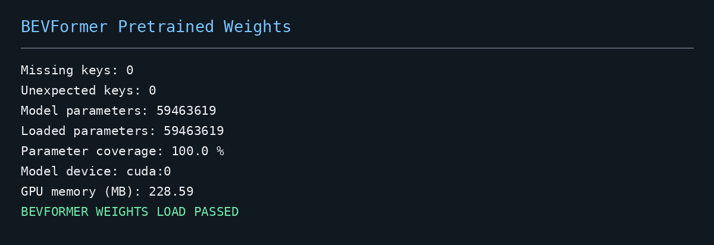

# 实习工作日志（Logbook）

**日期：** 2026年10月10日

**实习阶段：** 第一阶段——环境搭建与基线复现

**工作主题：** BEVFormer-Small 开发环境搭建、CUDA 算子适配、预训练模型验证及 nuScenes 数据集准备

## 一、今日工作目标

本阶段主要围绕 BEVFormer 自动驾驶视觉感知模型展开，目标是搭建可正常运行的 PyTorch + CUDA 深度学习开发环境，熟悉 BEVFormer 的基础架构及代码组织形式，并为后续模型推理、性能评估和算法模块开发做好准备。

今日工作重点包括：

1. 配置适用于 NVIDIA RTX 5080 的 GPU 深度学习环境，解决旧版框架兼容性问题。
2. 验证 MMCV 自定义 CUDA 算子的前向计算和反向传播能力。
3. 完成 BEVFormer-Small 模型构建、GPU 部署及参数统计。
4. 下载并加载官方预训练权重，验证模型与参数的一致性。
5. 完成 nuScenes Mini 数据集下载、解压及数据读取测试。
6. 整理工程目录、实验日志和测试结果图片，形成可复现的实验记录。

## 二、详细工作内容

### 2.1 深度学习环境搭建与 GPU 验证

首先在 Windows 系统中配置 Ubuntu 22.04 WSL2 开发环境，并通过 VS Code Remote WSL 实现 Linux 环境下的代码编辑、终端操作和 Python 调试。

为方便后续项目管理，将 WSL 系统安装位置迁移至 E 盘，并建立独立的 Python 虚拟环境 `.venv-bevformer`，避免 BEVFormer 的相关依赖与其他项目产生冲突。

主要环境配置如下：

| 组件 | 当前配置 |
|---|---|
| 操作系统 | Ubuntu 22.04 / WSL2 |
| Python | 3.10.12 |
| PyTorch | 2.8.0+cu128 |
| CUDA Toolkit | 12.8 |
| GPU | NVIDIA GeForce RTX 5080 Laptop GPU |
| MMCV | 1.7.2 |
| MMDetection | 2.28.2 |
| MMSegmentation | 0.30.0 |
| MMDetection3D | 0.17.1 |

通过 PyTorch 的 CUDA 接口检查 GPU 可用性，并构建随机张量执行矩阵乘法测试，确认 Tensor 可以在 GPU 上正常分配、参与计算和返回结果。

测试输出表明，CUDA 可用状态为 `True`，计算结果位于 `cuda:0`，GPU 环境验证通过。

**图1：PyTorch 2.8.0、CUDA 12.8 与 RTX 5080 GPU 环境验证结果**

该测试验证了基础 GPU 计算链路，为后续 CUDA 扩展编译及模型运行提供了基础。

### 2.2 MMCV CUDA 算子兼容性适配

BEVFormer 依赖 MMCV 中的 Multi-Scale Deformable Attention（多尺度可变形注意力）等自定义 CUDA 算子。

由于当前使用的 RTX 5080 GPU 架构较新，而原始 BEVFormer 项目依赖较早版本的 OpenMMLab 组件，安装与编译过程中存在版本和 CUDA 扩展兼容性问题。

针对这一情况，主要开展以下工作：

- 配置 CUDA Toolkit 12.8、编译工具及相关环境变量。
- 确认 GPU Compute Capability，并设置对应 CUDA 编译架构。
- 编译安装 MMCV 1.7.2，验证 `mmcv._ext` 扩展能够正常加载。
- 编写独立的 CUDA 算子测试程序 `test_mmcv_cuda.py`。
- 使用模拟特征张量、采样位置和注意力权重测试算子的 Forward 与 Backward 过程。
- 检查输出张量所在设备、数值结果及梯度传播情况。

测试中，Deformable Attention 算子能够输出预期维度的张量，且输入特征、采样位置和注意力权重均能够获得梯度。

前向数值对比误差约为 `5.96×10⁻⁸`，在本次测试条件下具有良好的数值一致性。

**图2：MMCV Multi-Scale Deformable Attention CUDA 算子前向计算与反向传播验证**

最终输出 `MMCV CUDA FORWARD/BACKWARD PASSED`。

该结果说明关键 CUDA 扩展能够在当前显卡上完成基本计算和梯度传播，但仍需通过实际模型推理进一步验证完整运行链路。

### 2.3 BEVFormer-Small 模型结构分析与构建

获取 BEVFormer 官方源码后，对项目目录及 Small 模型配置文件进行了初步学习。

重点关注以下结构：

**（1）Backbone：ResNet**

负责从输入图像中提取多层次视觉特征，为后续特征融合提供基础表示。

**（2）Neck：FPN**

负责融合不同尺度的图像特征，形成供 BEVFormer 使用的多尺度特征表示。

**（3）BEVFormer Encoder**

主要包含 Temporal Self-Attention（时间自注意力）及 Spatial Cross-Attention（空间交叉注意力），分别用于融合历史 BEV 特征以及从多相机图像特征中提取空间信息。

**（4）Detection Head：BEVFormerHead**

负责对 BEV 特征进行进一步处理，生成三维目标检测相关的预测结果。

在环境配置完成后，通过 `build_model()` 读取 BEVFormer-Small 配置并实例化完整神经网络。

模型构建验证结果如下：

| 测试指标 | 结果 |
|---|---|
| 模型类型 | BEVFormer |
| Backbone | ResNet |
| Neck | FPN |
| Detection Head | BEVFormerHead |
| 模型总参数量 | 59,463,619 |
| 参数规模 | 约 59.46M |
| BEV 网格 | 150 × 150 |
| GPU 设备 | cuda:0 |
| 模型迁移后 PyTorch 已分配显存 | 约 228.59 MB |

**图3：BEVFormer-Small 网络构建、参数规模统计及 GPU 迁移测试**

完成模型构建后，调用 `model.to("cuda")` 将模型部署到 RTX 5080 GPU，并通过 CUDA 设备检查及显存分配信息确认模型迁移成功。

需要说明的是，该阶段统计的 228.59 MB 为测试时 PyTorch 已分配的 GPU 显存，并不代表后续完整推理过程中的总显存需求。

### 2.4 官方预训练权重加载与参数验证

在成功构建 BEVFormer-Small 网络后，从官方发布渠道下载 `bevformer_small_epoch_24.pth` 预训练权重。

下载过程中使用断点续传机制处理网络连接中断问题，最终完成约 680 MB 权重文件的下载。

随后编写独立测试程序 `test_bevformer_weights.py`，完成以下验证：

1. 使用 `torch.load()` 读取官方 checkpoint。
2. 提取 `state_dict` 中保存的模型参数。
3. 比较 checkpoint 与当前模型的参数名称及形状。
4. 通过 `load_state_dict()` 加载模型权重。
5. 检查缺失参数和多余参数数量。
6. 计算模型可训练参数的加载覆盖率。
7. 将已加载预训练权重的模型移动至 GPU。

实际测试结果：

| 验证项目 | 结果 |
|---|---|
| Missing Keys | 0 |
| Unexpected Keys | 0 |
| Model Parameters | 59,463,619 |
| Loaded Parameters | 59,463,619 |
| Parameter Coverage | 100.0% |
| Model Device | cuda:0 |

**图4：BEVFormer-Small 官方预训练权重加载及参数匹配验证**

测试最终输出 `BEVFORMER WEIGHTS LOAD PASSED`。

结果说明官方预训练参数已经成功加载到当前网络中，模型架构和 checkpoint 在参数名称及形状方面完全匹配，为后续使用真实道路数据进行推理提供了条件。

### 2.5 nuScenes Mini 数据集下载与读取验证

为开展真实自动驾驶场景下的数据处理与模型验证，开始准备 nuScenes 数据集。

考虑到完整 nuScenes Trainval 数据量较大，首先选择 nuScenes v1.0-mini 数据集验证数据读取及预处理流程。

**数据集下载与管理**

采用 E 盘存放算法工程、G 盘存放大型数据集的方式，实现程序与数据分离。

数据存储目录为：

`G:\BEV_VLA_Datasets\nuscenes\`

在 WSL 中使用软链接，将 BEVFormer 项目的 `data` 路径指向 G 盘真实数据位置，避免对原有算法路径进行大规模修改。

下载过程中遇到网络连接重置、SSL 连接中断等问题。通过分析 HTTP Partial Content 响应、调整 curl 下载与重试方式，并使用文件大小检查和断点续传，最终完成数据获取。

压缩包最终大小为 4,167,696,325 字节，并通过 `tar -tzf` 压缩包完整读取检查。

**数据集解析与验证**

完成解压后，使用 nuScenes 官方 Python API 初始化数据集对象，读取场景、关键帧、传感器记录以及对应图像路径。

重点验证：

- 场景记录数量及数据表读取是否正常。
- 样本关键帧记录是否完整。
- 是否可以通过 `CAM_FRONT` 获取前置摄像头数据。
- 摄像头图像对应的实际文件是否存在。

测试结果如下：

| 项目 | 验证结果 |
|---|---|
| 数据集版本 | v1.0-mini |
| 场景数量 | 10 |
| 关键帧样本数量 | 404 |
| 首个场景 | scene-0061 |
| 验证摄像头 | CAM_FRONT |
| 图像文件存在 | True |
| 数据读取状态 | PASSED |

**图5：nuScenes Mini 场景加载、关键帧读取与前置摄像头图像路径验证**

最终成功输出 `NUSCENES DATASET LOAD PASSED`。

该结果说明当前 Python 环境能够读取 nuScenes Mini 的元数据和标注索引，并能够定位真实的摄像头图像文件。

目前尚未执行完整 BEVFormer 数据预处理流程，也未生成正式基线评估所需的全部数据索引。

### 2.6 工程目录及实验结果整理

为满足后续实验复现及团队协作要求，对工程目录进行了分类整理。

目前按照以下方式组织：

| 文件夹 | 主要作用 |
|---|---|
| BEVFormer | 官方模型源码、配置及测试程序 |
| BEVFormer/ckpts | 官方预训练模型权重 |
| data | 指向 G 盘数据集目录的软链接 |
| build_logs | CUDA、模型构建、权重验证等测试日志 |
| docs | 实习 Logbook 与技术说明 |
| docs/images | 实验结果图片 |
| experiments | 后续算法实验 |
| outputs | 后续模型预测与可视化结果 |
| scripts | 环境测试与实验记录自动化脚本 |

编写 `make_logbook_figures.py`，自动调用现有测试程序，提取实际运行输出并生成 PNG 格式的结果图。

目前已经成功生成五张实验结果图片，包括 CUDA 环境测试、MMCV 算子验证、模型构建、预训练权重加载和 nuScenes 数据读取结果。

图片和原始运行日志分别保存，实现了测试结果与实验记录的对应管理，便于后续追溯。

## 三、今日遇到的主要问题及解决方法

**问题一：新 GPU 与旧版本视觉框架存在兼容性问题。**

BEVFormer 原项目依赖的部分 OpenMMLab 组件较旧，无法直接保证在 RTX 5080 及当前 PyTorch/CUDA 环境中运行。

**解决方法：** 分别测试 CUDA 计算、MMCV 扩展、MMDetection3D 模块导入及模型初始化，通过源码兼容性调整和 CUDA 扩展重新编译逐步建立可运行环境。

**问题二：部分非核心模块导致 BEVFormer 插件导入失败。**

调试过程中出现 Detectron2、tkinter 等依赖相关的模块导入异常。

**解决方法：** 检查模块导入关系，并通过补充必要依赖、调整非核心模块导入方式等方法，完成插件导入测试。

**问题三：大文件下载多次中断。**

官方模型权重与 nuScenes 数据包体积较大，部分服务器连接存在超时、SSL 中断问题。

**解决方法：** 使用 HTTP 断点续传、分次重试及已保存文件大小检查，减少下载失败造成的重复传输。

**问题四：需要提高工程管理规范性。**

早期源码、虚拟环境和数据准备工作集中在同一项目目录中，不便于后续管理。

**解决方法：** 按代码、数据、模型权重、日志、文档及实验输出进行分类，并通过软链接实现多磁盘协同存储。

## 四、今日阶段性成果

今日已经完成：

1. 建立可在 RTX 5080 上运行的 PyTorch + CUDA 开发环境。
2. 成功编译并验证 MMCV Deformable Attention CUDA 算子。
3. 完成 BEVFormer-Small 模型构建与 GPU 迁移。
4. 成功加载官方预训练权重，参数匹配覆盖率达到 100%。
5. 完成 nuScenes Mini 的下载、解压、元数据读取及真实图像路径验证。
6. 建立分类管理的工程目录，并自动生成 5 张实验结果图和对应运行日志。

这些成果主要验证了基础开发环境、模型初始化、参数加载及数据读取流程的可用性。

## 五、当前存在的不足

尽管已经完成基础环境和模型加载验证，但仍存在以下未完成内容：

- 尚未在真实道路场景上执行完整的 BEVFormer-Small 推理。
- 尚未生成正式 nuScenes Trainval 所需的完整 BEVFormer 数据索引。
- 尚未加载完整验证集并计算 3D 检测 mAP、NDS 等性能指标。
- 尚未完成 DriveLM-v1 数据集准备及其问答标注结构分析。
- 部分旧版依赖仍存在版本声明或兼容性警告，后续需要继续测试和记录。
- 尚未生成 BEV 特征可视化或模型预测的三维检测结果图。

因此，目前属于**基础开发环境与模型加载验证完成、正式基线性能复现尚未完成**的阶段。

## 六、下一步工作计划

**1. nuScenes 数据结构学习**

重点分析六摄像头图像、车辆位姿、相机内外参、三维目标标注以及时间序列数据的组织方式。

**2. 数据可视化**

编写 Python 可视化程序，展示 nuScenes 的多相机道路图像，并尝试叠加实际 3D 标注框，直观理解数据集内容。

**3. BEVFormer 真实数据推理**

检查数据预处理脚本与模型输入格式，完成从真实道路图像读取到 BEVFormer 预测结果生成的流程验证。

**4. 正式基线评估**

准备完整 nuScenes Trainval 验证数据及必要扩展文件，在条件允许时运行官方评估，记录 3D 检测 mAP、NDS 等指标，并与官方基准进行比较。

**5. DriveLM-v1 数据准备**

下载对应图像及 QA 标注，研究其与 nuScenes 场景、目标及驾驶决策相关信息之间的对应关系，为后续视觉语言相关任务奠定基础。

## 七、今日工作总结

今日主要完成了 BEVFormer-Small 开发环境搭建、CUDA 算子适配、模型初始化、预训练权重加载及 nuScenes Mini 数据读取等基础工作。

通过分模块测试，成功验证了 RTX 5080 GPU 上的 CUDA 计算能力、MMCV 自定义算子的前向与反向传播、BEVFormer-Small 网络构建，以及官方预训练权重与网络结构的完整匹配。

在数据准备方面，完成了 nuScenes Mini 的下载与基础读取验证，并建立了代码、模型权重、数据集和实验结果分离存放的工程结构。

本次工作为后续真实道路场景推理、BEV 特征可视化和正式基线性能评估提供了基础。下一阶段将重点从环境及模型验证转向数据处理、实际推理和定量评估。

