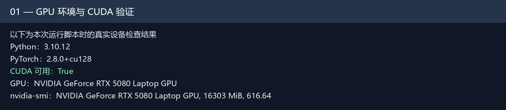
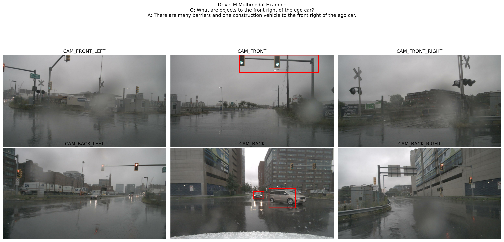
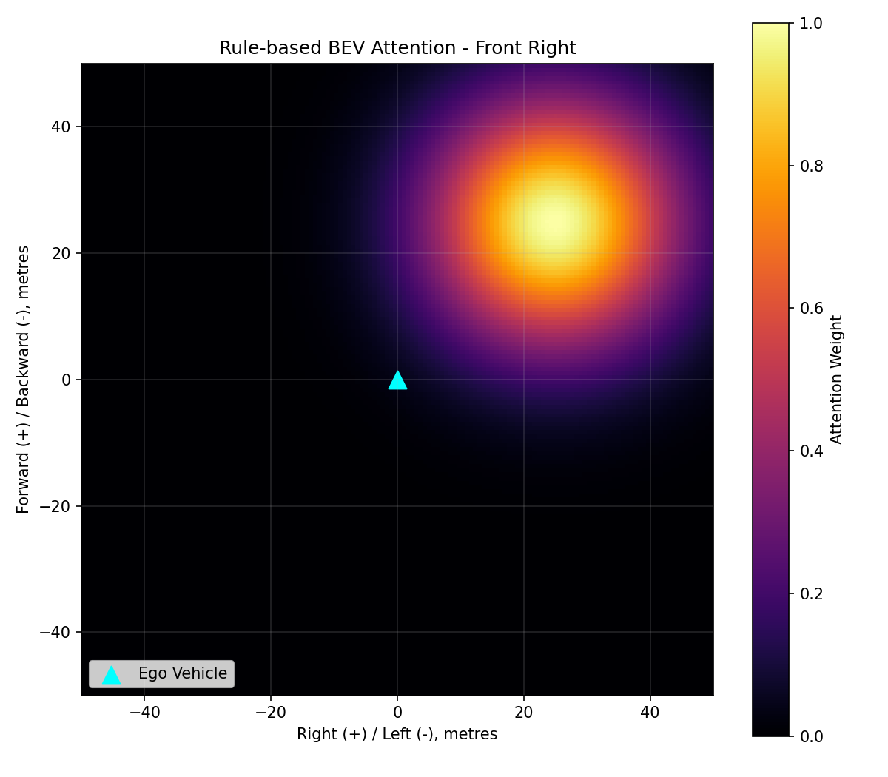
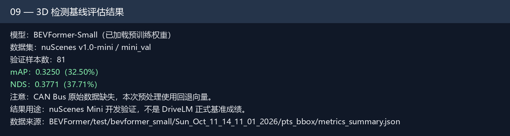
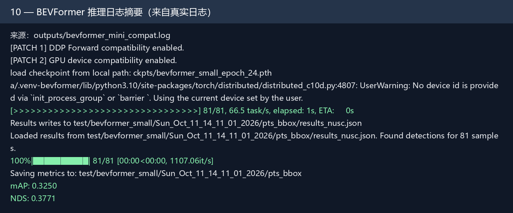

# 实习日志 · Day 2（2026 年 10 月 11 日）

**项目名称：** 自然语言指令引导的 BEV 感知注意力增强模块研发  
**实验平台：** Windows + WSL2（Ubuntu 22.04）、NVIDIA RTX 5080 Laptop GPU  
**工作主题：** DriveLM 数据探索、语言引导 BEV 注意力原型、BEVFormer-Small 基线推理与评估

---

## 一、今日工作目标

1. 验证 Python、PyTorch、CUDA 与 GPU 开发环境正常运行。
2. 读取和可视化 nuScenes Mini 多摄像头、3D 标注与 LiDAR 点云。
3. 了解 DriveLM-v1 的问答标注结构，完成示例图像与语言信息关联。
4. 建立语言方向到 BEV 空间掩码的概念验证流程。
5. 在 nuScenes Mini 上运行真实 BEVFormer-Small 3D 检测，并记录推理结果、性能指标及遇到的兼容问题。

## 二、具体工作内容

### 2.1 环境恢复与 GPU 验证

重新打开 WSL 中的 `bev_vla` 项目，激活 `.venv-bevformer` 虚拟环境。检查 PyTorch 和 CUDA 的设备访问情况，确认 NVIDIA RTX 5080 能被当前 Python 环境识别。此处的检查用于验证 GPU 能否被调用，并不单独证明 BEVFormer 自定义 CUDA 算子全部兼容。

### 2.2 nuScenes Mini 数据读取与可视化

检查 nuScenes Mini 的 `samples`、`sweeps`、`maps`、`v1.0-mini` 等目录，使用官方 `nuscenes-devkit` 读取元数据。生成以下可视化结果：

- 六路环视摄像头图像拼接图；
- 前视相机上的 3D **真实标注框（Ground Truth）**；
- LiDAR 点云鸟瞰图（BEV 视角）。

三项结果均用于理解多传感器数据结构，不能误认为是 BEVFormer 模型的预测输出。

### 2.3 DriveLM-v1 示例数据与多模态标注分析

获取并读取 DriveLM 官方示例 JSON 和配套的相机图片，确认其中包含 `scene_description`、`key_frames`、`QA`、`image_paths` 和目标二维标注信息。完成六路摄像头、二维框、示例问题与答案的联合可视化。

将 DriveLM 示例中的场景和关键帧 ID 与 nuScenes Mini 比较，本次两份小规模样本未出现直接匹配，说明后续仍需要明确场景对应关系，不能直接把示例当作完整评估集。

### 2.4 语言语义提取与 BEV 注意力掩码原型

编写规则语义提取脚本，处理 **337 条** DriveLM 问答记录，提取关注方向、目标类别与运动状态。修复早期规则法中的方向重复识别（如同时输出 `front`、`front right`、`right`）、把 `ego car` 误当目标以及复数识别的问题。

以 `front right` 为示例，使用人工设定的方向中心与二维高斯函数，生成 **150 × 150** 的空间权重矩阵，并保存为 PNG 和 NPY 文件。随后使用模拟 BEV 张量 `(1, 256, 150, 150)` 在 GPU 上进行广播与逐元素加权融合，验证维度及数值正常。

**实验边界：** 该掩码是人工构造的空间先验，并非 DistilBERT 学习得到的注意力，也尚未融合进真实 BEVFormer 特征。

### 2.5 BEVFormer-Small 数据预处理与模型推理

检查 BEVFormer-Small 配置文件和预训练权重。通过官方数据转换脚本生成 nuScenes Mini 的时序数据索引：

- `nuscenes_infos_temporal_train.pkl`：323 条索引；
- `nuscenes_infos_temporal_val.pkl`：81 条索引。

由于当前缺少官方 CAN Bus 扩展数据，开发测试阶段使用转换器的缺失数据回退方式生成车辆运动向量，并在实验记录中明确标注该限制。

调用单 GPU `torchrun` 及必要的运行时兼容补丁，最终完成 **81/81** 条验证样本的真实 BEVFormer-Small 推理，成功生成 nuScenes 格式的预测 JSON 和检测评估文件。

### 2.6 真实 3D 检测结果可视化

从 `results_nusc.json` 中读取模型输出，在真实前视摄像头画面中投影 3D 预测框，并以自车为中心绘制 BEV 鸟瞰框。调试时先后解决了相机坐标轴自动缩放与透视投影未归一化的问题，最终得到相机视角与 BEV 视角一致展示的结果。

**注意：** 这张图绘制的是模型 Prediction；与前面 nuScenes 数据自带的 Ground Truth 图需要区分。可视化显示的框数还受置信度阈值影响，不能直接当作准确检测数量。

## 三、实验结果与指标

| 实验项目 | 本次结果 | 说明 |
|---|---:|---|
| nuScenes Mini 训练索引 | 323 | 元数据索引样本数 |
| nuScenes Mini 验证索引 | 81 | 元数据索引样本数 |
| 完成推理的验证样本 | 81 | 以已保存的预测 JSON 为准 |
| 3D 检测 mAP | **0.3250** | 开发测试结果 |
| NuScenes Detection Score（NDS） | **0.3771** | 开发测试结果 |
| 语言问答规则解析 | 337 条 | 不等于全部解析准确 |
| BEV 注意力矩阵 | 150 × 150 | 人工生成的空间先验 |
| 模拟 BEV 特征融合 | 通过 | 仅验证张量融合流程 |

**结果说明：** 3D 检测指标来自本次 nuScenes Mini 的评估文件。由于原始 CAN Bus 数据缺失且使用了兼容补丁，以上数字仅用于开发阶段验证，**不是 DriveLM-v1 正式验证集成绩，也不等同于标准 nuScenes 基线复现结果**。本次尚未评估 BEV 分割 mIoU。

## 四、调试过程、问题与解决方案

| 遇到的问题 | 处理方法与结论 |
|---|---|
| 运行官方预处理程序时找不到 `tools` 模块 | 临时设置 `PYTHONPATH`，使项目根目录与工具目录可以导入 |
| CAN Bus 扩展数据缺失 | 使用官方转换器的缺失数据回退机制，仅供开发测试；正式评估仍需真实数据 |
| 普通方式运行 `tools/test.py` 触发断言 | 改为单 GPU `torchrun` 分布式测试入口 |
| DataLoader 报 `cannot pickle 'dict_keys' object` | 将 `data.workers_per_gpu` 临时设为 0 |
| 旧版 MMCV 与 PyTorch 分布式转发接口不兼容 | 在独立脚本中增加单 GPU 运行时兼容处理，不直接修改安装包 |
| MMCV Scatter 传递整数 GPU 编号时报错 | 将设备编号转换为 `torch.device` 类型 |
| 终端出现主机名解析警告 | 作为分布式初始化警告单独观察，未将其误判为本次失败根因 |
| 相机预测框位置错乱或显示为白底 | 开启投影归一化 `normalize=True`，并固定相机像素坐标轴范围 |

## 五、实验图片与运行记录

下列图片来自已生成的真实实验结果；其中标注为“记录图”的图片由真实日志或程序输出重新排版生成，**并非桌面原始截图**。

### CUDA / GPU 开发环境检查

### nuScenes Mini 六路环视相机图像

### 前视图上的 nuScenes 真实 3D 标注框（Ground Truth）

### LiDAR 点云与鸟瞰（BEV）可视化

### DriveLM 六路图像、2D 标注框和视觉问答

### 规则法生成的右前方 BEV 空间注意力热力图

### 模拟 BEV 特征的 GPU 注意力融合测试

### 真实 BEVFormer-Small 3D 检测预测与 BEV 视角

### nuScenes Mini 检测基线指标

### BEVFormer-Small 推理日志记录

## 六、当前局限性

1. 目前仅接入了 DriveLM 官方小规模示例，尚未完成完整 DriveLM-v1 数据集对齐和标准评估划分。
2. nuScenes Mini 的 CAN Bus 运动信息不完整，现有评估不能用作论文或项目验收中的正式基线成绩。
3. 语言规则解析尚未进行系统准确率验证，复杂指令和多目标描述仍可能识别错误。
4. BEV 注意力掩码由规则生成，融合测试使用模拟特征，**尚未提取并修改真实 BEVFormer 中间特征**。
5. 本次只完成 3D 检测指标测试，BEV 分割 mIoU 尚未开展。

## 七、下一步工作计划

1. 将真实 BEVFormer 预测与 Ground Truth 进行可视化对比，分析误检及漏检。
2. 提取 BEVFormer 中间 BEV 特征，确认张量排列和空间坐标范围。
3. 将语言引导注意力与真实特征进行小规模融合验证，再探索可训练的文本编码和注意力模块。
4. 补齐必要的数据与标注，对增强前后的检测性能和推理时间进行公平比较。

## 八、今日总结

今天完成了 nuScenes Mini 多传感器数据探索、DriveLM 图文示例关联、337 条问答的规则解析、BEV 空间注意力与模拟特征融合原型，并成功跑通 BEVFormer-Small 在 nuScenes Mini 验证集上的真实 3D 检测推理与可视化。已经建立了可继续开发语言引导注意力模块的工程基础；后续重点是从模拟特征走向真实 BEV 特征，并建立可信的正式评估流程。
