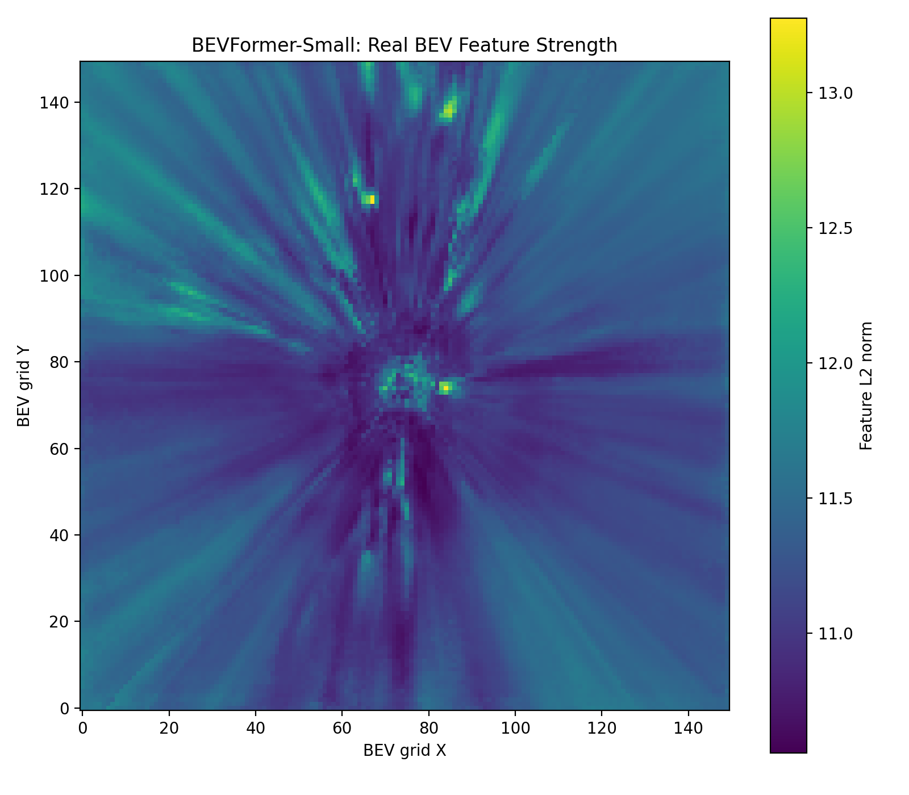
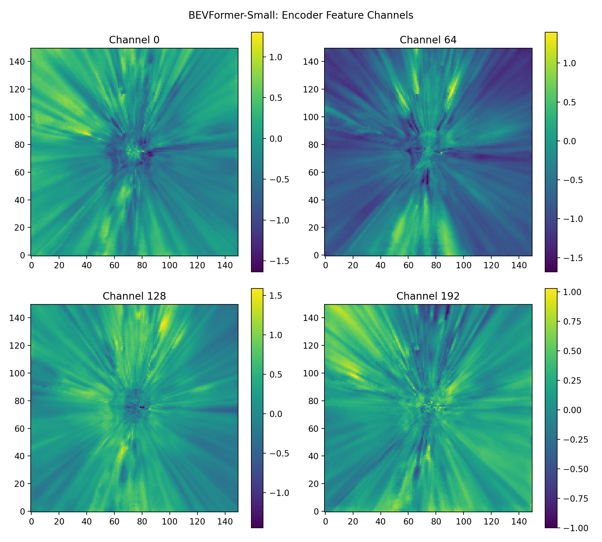
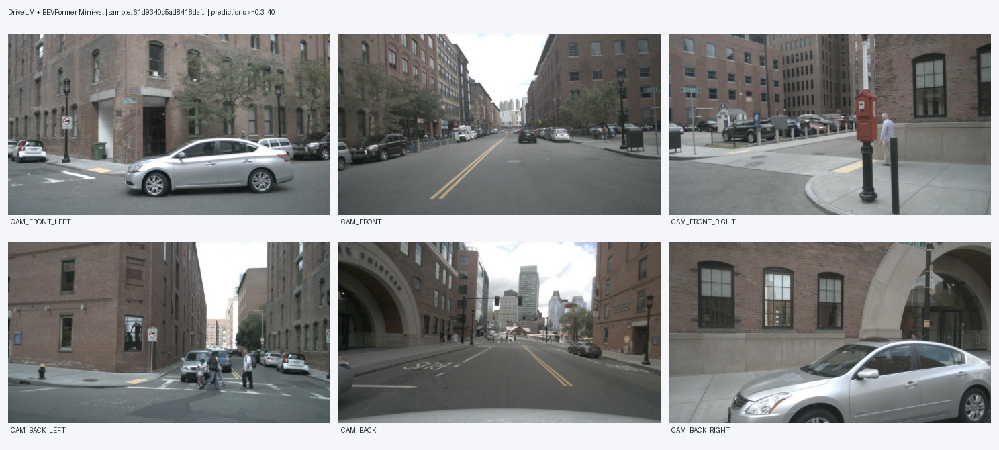
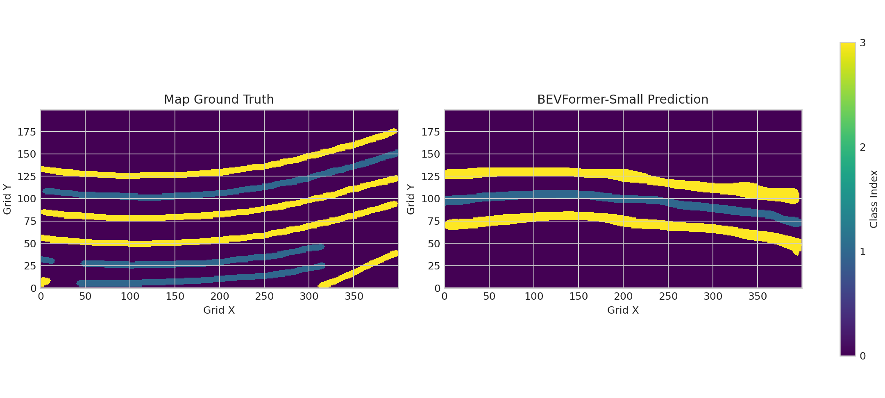
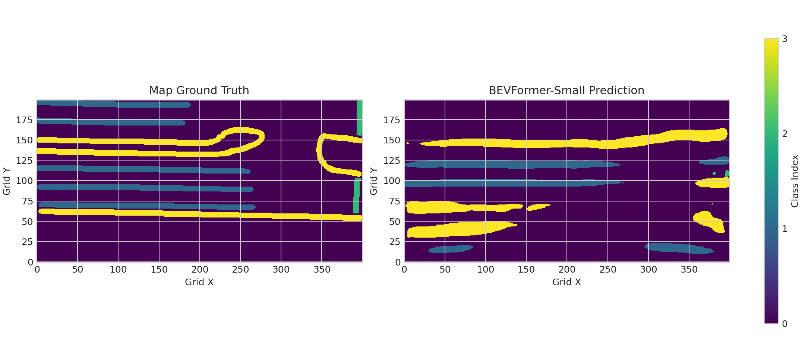
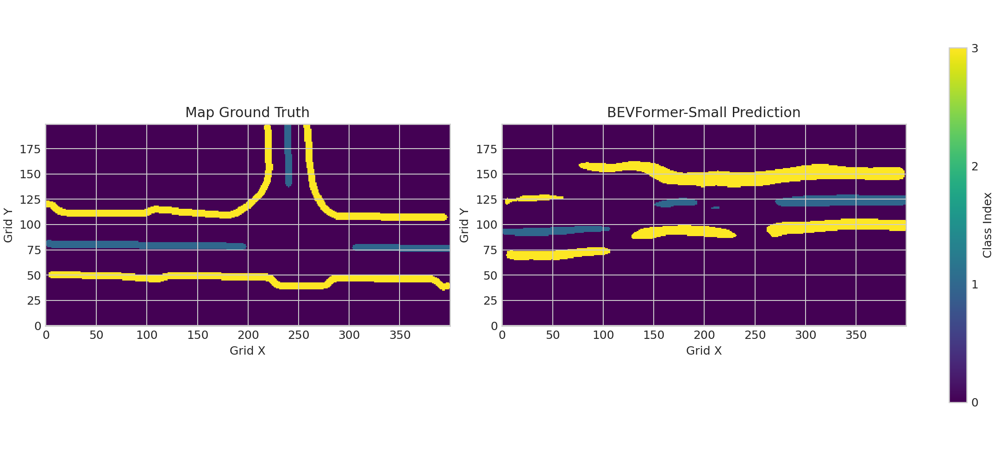

# 实习 Logbook｜2026-10-12｜第一阶段基线复现与数据预处理

**项目**：DriveLM × BEVFormer-Small  
**今日目标**：从 Mini 实验推进至 DriveLM 验证子集的检测和地图分割，完成官方问答训练数据预处理，整理阶段一交付证据。  
**实验平台**：WSL Ubuntu 22.04，PyTorch 2.8.0+cu128，NVIDIA RTX 5080 Laptop GPU。

## 一、今日完成工作

1. **提取并可视化 BEV 特征**：从预训练 BEVFormer-Small 的 Encoder 输出 `(150, 150, 256)` 特征，保存各通道响应图和 L2 强度热力图；对照 `get_bev_features()` 与空间/时间注意力模块，理解从六路相机到 BEV Query 的融合过程。
2. **准备 DriveLM 数据与 nuScenes 关联**：完成 v1.1 训练/验证 JSON、六路图像与样本 Token/元数据检查；训练部分含 696 场景、4072 关键帧、24432 张相机图片。验证集与 nuScenes 官方 Val 对应的 799 帧完成六路图像/标定关联，独立帧 PKL 和官方场景 PKL 分别面向检测和分割。实际抽查 0、399、798 帧输入 `(6,3,736,1280)` 均通过。
3. **运行 799 帧 3D 检测**：加载官方 BEVFormer-Small 检测权重，在 GPU 上完成 799/799 帧独立帧推理，保存 239700 个原始候选框及每帧 NPZ、CSV、日志；按对应真实 GT 计算 799 帧子集检测 **mAP=13.39%、NDS=25.79%**（进入评估的预测框 204445 个、GT 16974 个）。平均纯 GPU 前向约 0.278 s/帧。
4. **运行 799 帧 BEV 地图分割**：加载分割权重并关闭历史 BEV 复用，在保留真实场景 token 的条件下生成真实地图 GT，完成 799/799 帧预测与混淆矩阵统计，前景 **mIoU=5.12%**，含背景 mIoU **22.22%**，耗时约 519.77 秒。生成第 0、399、798 帧预测与真值对照图。
5. **分割精度问题诊断**：检查了 GT/预测 `(200,400)` 一致性、四类索引、`argmax` 解码、IoU 累计方式、CAN Bus 与车辆位姿、BEV slicer 坐标映射。分割结果仍存在地图空间差异，**尚未确定根因**，未使用诊断性平移/翻转替代正式成绩。
6. **完成 DriveLM 官方问答训练数据预处理**：下载并调用官方 Challenge `extract_data → convert_data → convert2llama` 三个函数，在 smoke/full 两种模式完成；全量输出 29450 条记录、24432 条唯一图片路径，缺失 0、对话结构错误 0，耗时 49.38 秒，`test_llama.json` 已通过六路图像和 `conversations` 字段验收。
7. **核查 BEVFormer 训练资源边界**：已有 nuScenes Mini 训练/验证 PKL（323/81 帧），完整 Trainval 原始 LiDAR/Sweeps/CAN Bus 不齐全；这不影响 DriveLM QA 转换完成，但暂不能声称完整 BEVFormer Trainval 训练 PKL 已生成。
8. **整理阶段一交付文档**：完成中文数据结构与标注说明、BEVFormer 原理与源码导航、基线性能报告、可视化索引、复现及 GitHub 提交前检查清单；所有材料纳入同一工程，不再生成零散的临时 Markdown。
9. **执行最终交付自检**：运行 `python scripts/check_stage1_submission.py`，共检查 **25 项，通过 25 项，失败 0 项**。已核验正式文档、脚本、9 张 Markdown 引用图片（缺失 0）、QA 转换结果与检测/分割指标 JSON；验收记录保存在 `outputs/stage1_checks/stage1_audit.json`。GitHub 上传留待 10 月 13 日。

## 二、关键实测结果

| 评估 | 样本 | mAP | NDS | BEV 前景 mIoU |
|---|---:|---:|---:|---:|
| nuScenes Mini | 81 | 32.50% | 37.71% | 6.38% |
| DriveLM 799 帧独立帧子集 | 799 | **13.39%** | **25.79%** | **5.12%** |

**备注**：DriveLM 数据是与 nuScenes 官方 Val Token 对应的稀疏独立帧子集。结果是真实计算，但**不是官方完整 nuScenes Val 时序排行榜成绩，也不是 DriveLM 问答准确率**。不同数据和时序条件的 Mini/DriveLM 指标不能直接作严格可比性结论。

## 三、图片证据

### BEV 特征响应

### DriveLM 与 BEVFormer 六路相机关联

### BEV 分割：真实地图 vs 模型预测

## 四、问题、经验与下一步

- **问题**：BEV 分割预测与真实地图存在错位、漏检、多检，前景 mIoU 偏低；目前仅完成一致性排查，没有确定可以修复问题的单一根因。
- **数据范围**：DriveLM 官方 QA 训练数据已完成全量转换；与官方文档示例数量 29,448 相比，本次得到 29,450 条，差异 2 条尚未逐条定位；nuScenes 完整 Trainval 的 BEVFormer 训练 PKL 尚未生成，不能写作已完成。
- **经验**：将“模型可以运行”“指标可以真实计算”“达到作者官方时序基线”区分开；技术报告如实记录独立帧协议和分割低精度，不使用人为翻转/平移后的诊断图替代原始成绩。
- **下一步（2026-10-13）**：建立 GitHub 仓库，整理中英文 README 与 `.gitignore`，上传必要的源码、`docs/`、日志和图片；跳过原始数据、权重、虚拟环境、缓存及大体积中间文件。在 GitHub 网页检查 README、图片路径与链接后交给师傅查收。

**今日总结**：DriveLM 官方预处理、799 帧 3D 检测与 BEV 分割实测、基础代码原理整理以及 25/25 项本地交付检查均已完成。**第一阶段本地交付材料已准备好**；尚未完成 GitHub 发布，也尚未解决 BEV 分割精度偏低的根因。
