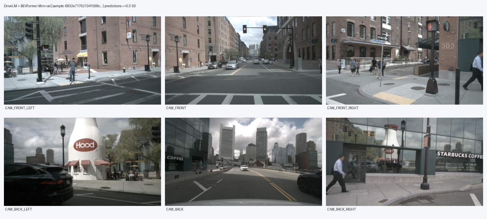
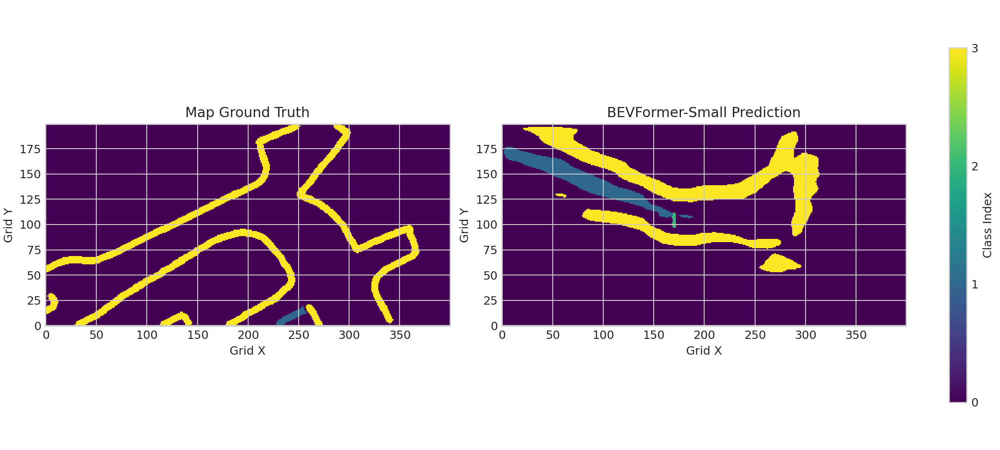

# 第一阶段可视化成果索引

本页所有图像均来自已完成的本地真实推理/数据检查。引用使用**相对路径**，便于 VS Code Markdown Preview 和将来 GitHub 正确显示。实际图片应已存在于 `docs/images/YYYY-MM-DD/`，用 `python scripts/check_stage1_submission.py` 检查是否齐全。

## 1. 相机视角与多模态输入

意义：通过 `sample_token` 找到对应六路相机，证明问答样本和感知样本的数据关联存在。**图像对应成功不等于已经计算语言问答准确率**。

脚本：`scripts/build_drivelm_bevformer_pairs.py`；`scripts/check_drivelm_image_links.py`。

## 2. BEV 中间特征

意义：实际从 BEVFormer-Small 的 Transformer Encoder 中提取 `(150,150,256)` 特征，分别展示 L2 范数响应图与四个选定特征通道。**不代表语义分割标注或模型预测概率**。

脚本：`scripts/extract_bev_features.py`，对应原始 `outputs/bev_features/bev_feature.npy`。

## 3. 3D 检测与 BEV 预测

3D 检测图片在此前的可视化任务中已生成，可从 `outputs/bevformer_predictions_visualized.png` 或 `docs/images/2026-10-11/08_bevformer_predictions.png` 查阅。放入 GitHub 前，应优先采用项目 `docs/images/2026-10-11/` 中已有的压缩图以减少仓库体积。

脚本：`scripts/visualize_bevformer_predictions.py`。正式指标使用预测 JSON/NPZ 评估，图片只是展示证据。

## 4. BEV 地图分割：Mini 与 DriveLM 799 帧

### Mini：真实地图 vs 分割预测（第 40 帧）

### DriveLM 799 帧：第 0 帧

### DriveLM 799 帧：第 399 帧

### DriveLM 799 帧：第 798 帧

意义：模型输出与真实地图的分割区域存在明显错位、漏检及多检。显示结果**不等于**问题已解决，相关局限已如实写进性能报告。

脚本：`scripts/run_bev_seg_minival.py`；`scripts/run_drivelm_799_seg_all.py`。

## 5. 图像用途与注意事项

| 图像 | 最适合用于 |
|---|---|
| 六路相机拼图 | 解释 DriveLM → nuScenes 的 sample token 对齐 |
| BEV 通道图/热力图 | 介绍 BEV Encoder 输出与特征表达 |
| 检测结果 | 说明 3D 目标框和 BEV 预测可视化脚本 |
| 地图真值 vs 预测 | 展示真实 mIoU 评估对象、已有局限 |

复制到 GitHub 时只提交**必要图片**，不提交整个 `outputs/` 大目录，也不必包含原始上万张相机图片或权重文件。
