# 第一阶段详细工作周报｜BEVFormer × DriveLM × VLA

> **工作周期：** 2026 年 10 月 10 日—10 月 13 日（4 个工作记录日）  
> **项目方向：** 自然语言指令引导的 BEV 感知注意力增强模块研发  
> **当前阶段：** 环境搭建、数据理解与 BEVFormer-Small 感知基线复现  
> **实验设备：** Windows + WSL2（Ubuntu 22.04）、NVIDIA GeForce RTX 5080 Laptop GPU  
> **仓库：** [JiaxuanJin/bev_vla_internship](https://github.com/JiaxuanJin/bev_vla_internship)（私有仓库，访问需授权）  
> **说明：** 此周报汇总已完成的实验、运行日志、检查输出及已留存图片。不同数据集与评估协议的指标严格分开；不把模拟注意力、Smoke Test 或人工参考答案描述为已完成的语言模型推理。

---

## 一、阶段目标、整体路线与完成情况

### 1.1 阶段目标

本阶段不是直接训练一个端到端 VLA 模型，而是先建立后续视觉—语言融合所依赖的可靠感知底座。工作由三个问题串联：第一，是否能够在实验平台上稳定运行 BEVFormer 及相关 CUDA 自定义算子；第二，是否能正确读取 nuScenes 和 DriveLM 的场景、关键帧、六路相机、几何信息以及检测和分割标签；第三，能否用真实预训练权重得到有记录、可复核的 3D 检测 / BEV 分割评估结果，同时保留语言问答数据接入入口。

### 1.2 本阶段的技术路线

```text
Windows / WSL2 / RTX 5080
        ↓
Python / PyTorch / CUDA / MMCV / MMDetection3D 环境检查
        ↓
nuScenes Mini 数据读取 ─→ 六相机 / LiDAR / GT 可视化
        ↓
BEVFormer-Small 推理与 BEV 特征检查
        ↓
BEV Segmentation 和 Temporal ON/OFF 诊断
        ↓
DriveLM ↔ nuScenes 验证帧 Token / 场景对齐
        ↓
DriveLM 799 帧独立帧检测、地图分割评估
        ↓
nuScenes 完整 Val（6,019 帧）正式 3D 检测评估
        ↓
DriveLM 真实问答样本准备 + GitHub 文档化交付
```

### 1.3 按日期的工作成果总览

| 日期 | 实施工作 | 本日形成的可检查证据 | 结论 |
|---|---|---|---|
| **10/10** | WSL / CUDA / 依赖适配，nuScenes Mini 下载、解压和初始读取 | GPU 测试、MMCV 及权重加载记录，Mini 数据载入图 | 完成从环境到数据读取的基本通路 |
| **10/11** | 六相机、GT 3D 框、LiDAR/BEV 可视化，注意力融合示例、真实预测展示 | 相机拼图、3D 目标框、BEV 图、融合测试日志、预测图 | 对 BEV 感知数据流有了可视化与初步实验验证 |
| **10/12** | 分割标签和空间坐标排查、Mini Temporal 对照；DriveLM 799 帧匹配与检测/分割 | 81 帧对照记录；799 帧 JSON/CSV 和预测/GT 对照图 | 建立稀疏独立帧的可复核子集基线 |
| **10/13** | Trainval Keyframe 10 个分包处理，6,019 帧 Val 评估，Temporal 序列校验，VQA 样本抽检，Git 整理 | 6,019 帧检测结果、完整性校验、VQA 20 问、Git 提交 | 完成完整 Val 感知基线及阶段成果归档 |

---

## 二、10 月 10 日：运行环境、官方代码与 nuScenes Mini 入门

### 2.1 当天目标

在 Windows 主机的 WSL2 Ubuntu 环境中建立可执行的自动驾驶感知研究工程，确认显卡可被 PyTorch 调用；准备 BEVFormer、MMCV、MMDetection3D 相关工程与依赖；下载 nuScenes Mini 并正确解压到实际数据目录，取得后续实验需要的第一批图像和元数据。

### 2.2 工作过程及技术细节

1. **创建独立 Python 环境与项目目录。** 将研究工程与依赖、数据集、输出目录分别管理，避免将模型代码、安装包、缓存和数据混在一起。后期实际工程根目录为 `~/projects/bev_vla`，数据集放在挂载的 G 盘目录。
2. **GPU / CUDA 基本测试。** 在 WSL 中检查 NVIDIA 设备与 PyTorch CUDA 状态，确认运行时能调用 RTX 5080 Laptop GPU。对于这类旧研究仓库，GPU 能识别不等于全部 CUDA 扩展可以编译和运行，因此单独检查 MMCV 以及 BEVFormer 依赖的自定义算子。
3. **依赖兼容性适配。** 处理旧版研究代码与当前 Python / PyTorch / MMCV 环境之间的兼容问题，并保存可复用的编译、测试与版本信息。后续 Git 仓库通过独立补丁记录部分 BEVFormer 源码修改，不直接将第三方原项目整体当作个人项目上传。
4. **获取 nuScenes Mini。** 下载约 3.88 GB 的 Mini 数据包，完成解压与文件结构检查。下载速度不稳定时评估镜像与断点续传等策略，并将数据放入单独磁盘，避免污染 Git 工作区。
5. **初始数据与模型测试。** 加载 nuScenes 表、确认相机图片和标注可访问；开展 BEVFormer-Small 模型构建、Checkpoint 载入等基本检查，为次日可视化和更大规模实验做准备。

### 2.3 当日图像与证据

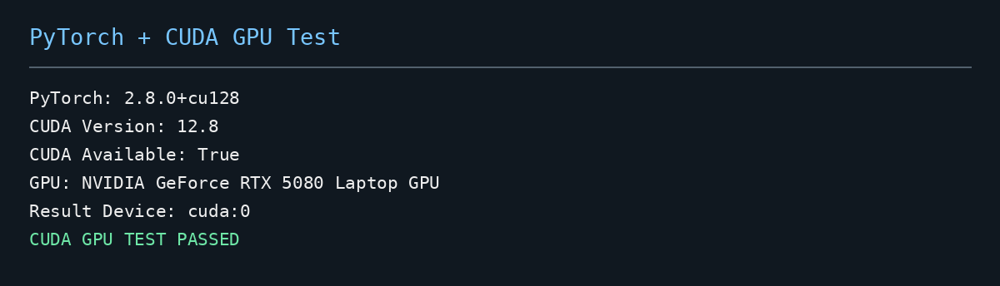

*图 1｜GPU / CUDA 运行环境检查：证明计算设备和基本运行链路可用。*

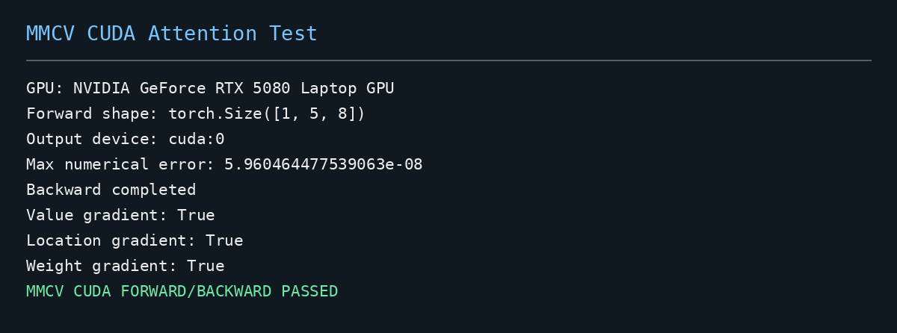

*图 2｜MMCV / 相关注意力模块测试结果。此处为依赖与模块级检查，不能替代完整模型精度评估。*

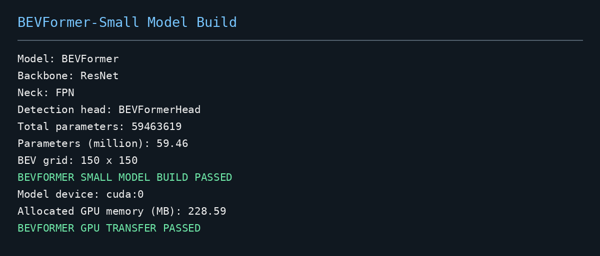

*图 3｜BEVFormer 模型构建检查，记录早期运行时的工程状态。*

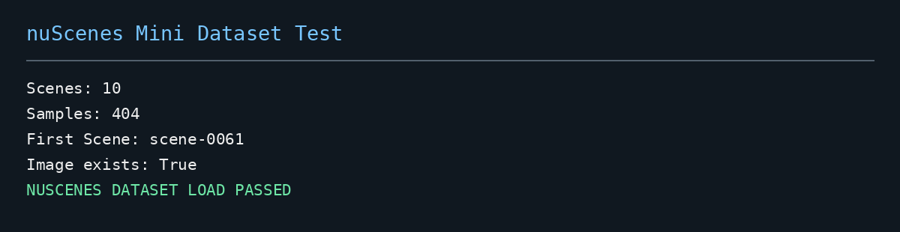

*图 4｜nuScenes Mini 读取与载入验证，为后续多相机实验提供数据基础。*

### 2.4 遇到的问题与处理

- **旧工程适配问题：** 不能简单按新版本依赖“一键安装”，必须对 PyTorch、MMCV、MMDetection3D 及自定义算子的版本与导入顺序做兼容性测试。处理策略是先跑模块自检，再跑模型构建和最小数据载入，而不是一开始直接进行全数据评估。
- **下载时间与目录管理：** Mini 包下载和数据解压耗时较长，将归档数据与代码分离，形成后续优先使用可信国内加速、校验文件完整性、保留下载源记录的工作原则。

**当日成果：** 基础推理环境初步可用，Mini 文件能够读取；保留 GPU、算子、模型和数据截图，支撑后续复现排查。该日没有宣称已取得完整官方验证集精度。

**对应日志：** `docs/logbook_2026-10-10.md`。

---

## 三、10 月 11 日：nuScenes 多模态可视化与 BEV 表征理解

### 3.1 当天目标

把前一天已读取的数据真正转化成可理解的视觉证据，建立从**六路相机图像 → 目标及几何标注 → BEV 鸟瞰表示 → 检测输出**的概念链路；通过可运行的小型测试理解注意力模块的张量输入输出形式。

### 3.2 多相机数据与标注检查

- 利用 `visualize_nuscenes.py`、`visualize_nuscenes_boxes.py` 等脚本读取 nuScenes 场景和 sample，展示车辆周围多视角画面。
- 查看相机投影及真实 3D 标注框，识别目标位置、朝向和自车坐标系的关系。六路相机为 `CAM_FRONT`、`CAM_FRONT_LEFT`、`CAM_FRONT_RIGHT`、`CAM_BACK`、`CAM_BACK_LEFT`、`CAM_BACK_RIGHT`。
- 使用 LiDAR 点云 BEV 可视化，帮助理解道路与目标在二维鸟瞰坐标中的位置分布，并与单个透视相机画面进行比较。

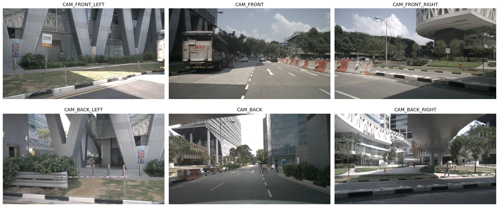

*图 5｜同一样本的多相机画面：为 BEVFormer 跨视角感知提供直观输入。*

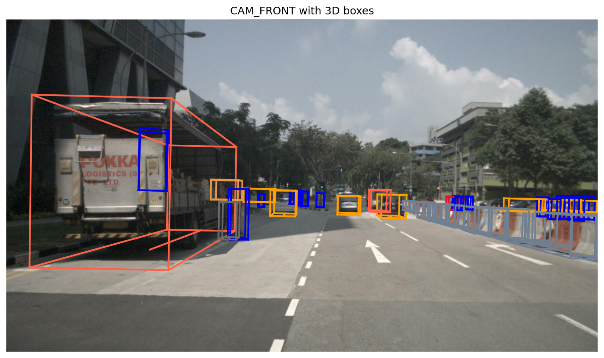

*图 6｜3D 标注框示例：用于理解相机透视显示与真实三维位置之间的对应关系。*

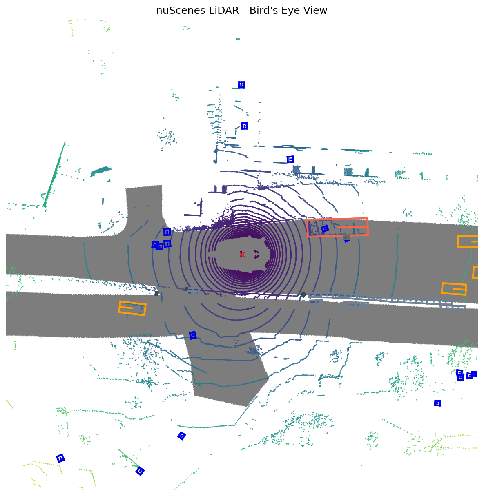

*图 7｜LiDAR 点云鸟瞰投影示例。此图是数据理解和空间几何辅助展示，不代表模型使用 LiDAR 作为输入。*

### 3.3 BEV 特征与注意力融合测试

- 阅读并运行 BEV 特征生成和注意力测试脚本，关注张量尺寸、通道数与空间网格索引。该阶段模拟 BEV 特征上的 GPU 注意力聚合用于**接口与数值稳定性验证**，不是从训练完成的语言指令模型中输出注意力。
- 对比可视化测试结果，检查增强前后的张量形状、融合权重及是否出现 NaN/Inf 等异常；记录注意力融合模块的运行日志与输出示例。
- 执行真实 BEVFormer-Small 3D 检测预测，保存前视相机检测框与 BEV 鸟瞰分布，和前述仅为模拟的融合测试相区分。

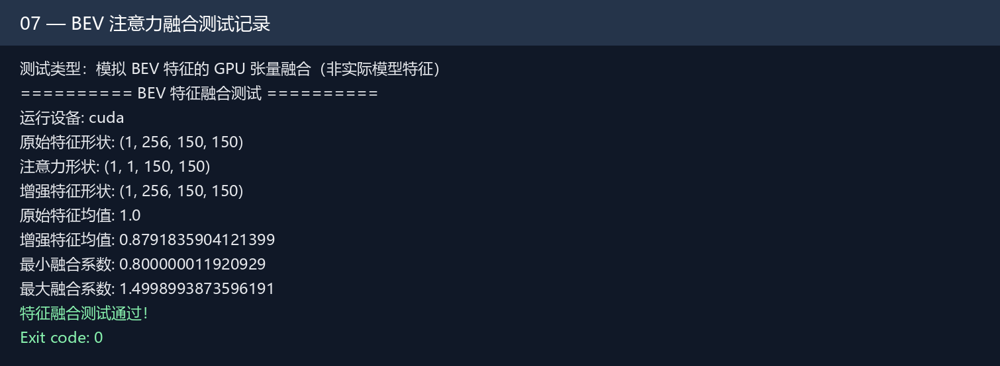

*图 8｜模拟 BEV 特征的 GPU 注意力融合测试：验证流程可运行，但不能作为真实注意力增强性能提升的证据。*

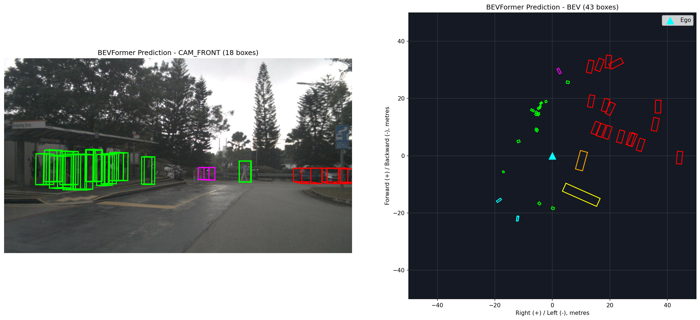

*图 9｜BEVFormer 模型预测结果（相机图与 BEV 空间），用于观察目标检测的几何表现。*

### 3.4 结果与当日结论

当天形成了从原始传感器数据到感知结果的第一批可视化材料。通过对照相机视图、点云 BEV 和模型输出，明确 BEV 不是简单把一张相机图转成俯视照片，而是在统一的空间表示中融合多视角几何与语义信息；同时严格区分**真实模型预测**和**人工构造的注意力融合功能测试**。所有中间可视化图均可用于师傅审阅和说明问题。

**对应日志：** `docs/logbook_2026-10-11.md`。

---

## 四、10 月 12 日：BEV 分割排障、Temporal 消融与 DriveLM 799 帧基线

### 4.1 当天目标与实验设计

工作重心从“能跑、能看”转为“能测量、能定位问题”。对 BEV 地图分割（如车道分隔线、行人过街区域和边界）开展逐帧性能检查；用 Temporal ON/OFF 检测历史 BEV 信息是否影响输出；随后将 DriveLM 验证帧与 nuScenes 元数据对齐，构造可复核的 799 帧稀疏子集实验。

### 4.2 地图分割与 BEV 网格空间检查

1. 运行 BEV Segmentation 推理脚本和标签检查脚本，观察分割图像的各类别区域，确认背景及前景的类别定义。
2. 分析预测与 Ground Truth 的空间对应关系；检查栅格坐标、BEV 网格索引、地图裁切、旋转与平移关系，避免在图像展示时把左右、前后方向错置。
3. 对 Mini 验证数据记录每帧指标、混淆矩阵等信息，用图像对照识别明显的偏差；脚本及报告分别保存在 `scripts/` 和 `docs/`。
4. 将专项排障独立归档到 `docs/logbook_bev_seg_debug_2026-10-12_CN.md`，不覆盖当天的主 Logbook，保证排错证据可追踪。


*图 10｜BEV 特征热力图，展示空间特征强度分布。*


*图 11｜不同通道的 BEV 特征可视化，有助于理解输出而非直接证明分割精度。*

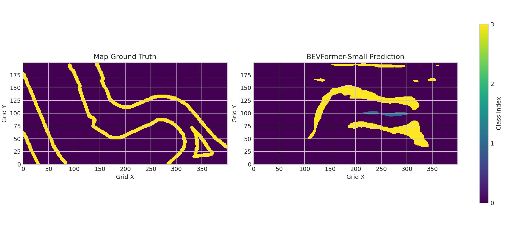

*图 12｜nuScenes Mini 样本的预测/GT 对照；前景 mIoU 偏低，因此必须结合指标而不是只看单张图片。*

### 4.3 Mini 的 Temporal ON/OFF 对照

在同一 Mini 81 帧实验范围内整理启用和禁用历史 BEV 的分割结果：

| 评估内容 | Temporal ON | Temporal OFF | 解读 |
|---|---:|---:|---|
| 实验范围 | 81 帧 | 81 帧 | Mini 子集，对照范围一致 |
| 前景 mIoU | **6.38%** | **5.99%** | 显示值相差 0.39 个百分点 |
| 结论 | 略高 | 略低 | 仅说明当前设置下的结果；不推广到官方完整 Val |

这组消融回答的是：在当前实验设置里，是否使用历史信息会影响分割指标。它**不等于**随后对 DriveLM 799 帧做的独立帧分割，不适合跨协议直接声称“Temporal 提升了 x%”。

### 4.4 DriveLM 数据与 nuScenes 场景/Token 对齐

- 检查 DriveLM 问答数据所引用的 nuScenes sample_token、scene_token 和图像文件，核实 DriveLM 验证子集对应的实际感知帧。
- 利用官方 `trainval` 元数据与 DriveLM 的样本关系，查明需要加载的是具体哪些图像，而不是仅依据文件名猜测场景。
- 核对结果：**DriveLM 验证子集 149 个场景、799 个关键帧；799/799 匹配到官方 nuScenes Val；场景 Token 不一致数为 0。** 该检查表明数据关联关系成立，但不代表语言问答性能已经评估。
- 为 BEVFormer 准备 799 帧 PKL 与相机路径，分别执行 3D 检测和 BEV 地图分割的**无历史 BEV、稀疏独立帧**推理及指标计算。


*图 13｜DriveLM 场景与 BEVFormer 感知数据的样例对应，展示数据层面如何关联。*


*图 14｜DriveLM 799 帧子集上的地图分割 GT 与预测对照。*

### 4.5 DriveLM 799 帧的量化指标

**3D 目标检测：** 799/799 帧推理完成；评估 JSON 给出 mAP **13.39%**、NDS **25.79%**，采用 nuScenes 检测匹配规则但只评估 DriveLM 的 799-token 子集。

**BEV 地图分割：** 799/799 帧评估完成；前景 mIoU **5.12%**，包含背景的四类 mIoU **22.22%**。详细类别指标如下：

| 地图类别 | IoU |
|---|---:|
| Background（背景） | 73.52% |
| Divider（分隔线） | 2.08% |
| Pedestrian Crossing（人行横道） | 8.07% |
| Boundary（边界） | 5.21% |

前景三类分割准确度低，背景 IoU 却明显较高，所以**不能只报告包含背景的 22.22% 而忽略前景 5.12%**。后续优先继续检查标注映射、几何坐标、预测阈值与权重和数据协议的一致性；仅从当前结果不能断定是某一个代码错误造成。

**对应本地原始证据（保存于实验工作目录，不作为 GitHub 必需交付文件）：**

- `outputs/drivelm_check/drivelm_val_official_split_check.json`
- `outputs/drivelm_check/det799/run_summary.json`
- `outputs/drivelm_check/det799_subset_eval/evaluation_protocol.json`
- `outputs/drivelm_check/det799_subset_eval/metrics_summary.json`
- `outputs/drivelm_check/seg799_independent_eval/metrics_summary.json`

**对应日志：** `docs/logbook_2026-10-12.md` 以及分割专项排障日志。

---

## 五、10 月 13 日：完整 Val 评估、时序验证、VQA 准备与 Git 交付

### 5.1 当天目标

补齐“全量 nuScenes 官方 Validation 检测评估”这条重要基线，在此前的 DriveLM 子集实验之外取得正式 6,019 帧检测结果；另外明确时序数据可用范围、检查 VQA 训练问答抽样的输入完整性，最终将脚本、日志和图像有序整合到已创建的 GitHub 私有仓库。

### 5.2 nuScenes Trainval 关键帧数据获取与完整性验收

**下载策略及实际问题：** 在官方 Full Dataset v1.0 页面选择 `Trainval` 的 Keyframe（关键帧）分包：part 01—10。之前已准备 metadata 与部分数据。Part 10 从官方海外地址下载时连续出现连接重置、SSL 错误、极低速率和超时；检测部分未经验证的国内镜像后没有盲目替换来源，而是使用可续传工具 `aria2c`，保留已下载 `.part` 文件，最终完成归档并通过 `tar -tzf` 完整性检查后解压。

**数据核验步骤：**

1. 读取官方 `v1.0-trainval` metadata（850 个场景、34,149 个 samples），验证数据版本及官方 train / val split。
2. 对需要的关键帧图像逐一检查真实文件存在性，尤其是六路相机文件是否齐备。
3. 完成 10 个分包后，核对官方 Val：**150 场景、6,019 个关键帧、36,114 张相机关键帧图片 = 6,019×6**，文件缺失为 0。
4. 核查 BEVFormer 完整 Val PKL 中的 `token`、`cams` 字段、六路相机路径及官方 keyframe token，对照匹配成功。

**技术判断：** 全部 Keyframe 影像到位，说明当前相机输入型 BEVFormer 评估所需的关键帧影像覆盖完整；这**不等于 nuScenes 全部 sweeps / LiDAR / Radar 原始数据已下载齐全**。后续若做完整多传感器训练或密集时序采样，需要按任务额外补充相应模态。

### 5.3 从 81/799 帧试验推进到完整 6,019 帧 3D 检测

**准备阶段：** 对 BEVFormer-Small 的配置、Checkpoint 与真实 6,019 帧 Val PKL 做匹配；使用 nuScenes 工具生成完整索引文件，并通过字段和相机路径检查。完整 Val PKL 存放在 `outputs/bevformer_full_infos/bevformer_full_infos_temporal_val.pkl`。

**排错过程（按实际出现的顺序记录）：**

| 遇到的问题 | 表现 | 处理方式 / 验证 |
|---|---|---|
| `ModuleNotFoundError: No module named 'projects'` | 直接运行评估脚本时，Python 找不到 BEVFormer 工程包 | 从 BEVFormer 项目目录执行并调整 `PYTHONPATH`，验证插件导入 |
| `AssertionError`（评估脚本的运行分支） | 初次调用 `tools/test.py` 参数组合与脚本要求不匹配 | 检查 `--out`、`--eval` 等 CLI 参数，并保留错误日志以便复核 |
| `TypeError: cannot pickle 'dict_keys' object` | PyTorch DataLoader 多进程创建子进程时失败 | 改用 `data.workers_per_gpu=0` 的单进程加载方式验证，绕过该环境下的序列化问题 |
| `MMDistributedDataParallel` 与新 PyTorch 接口不兼容 | `'_use_replicated_tensor_module'` 属性不存在 | 用局部兼容脚本测试并修复评估入口；先用 2 帧 Smoke Test，再扩大到全量 |
| 评估过程耗时及输出停顿 | 预测 6,019 帧结束后还需执行格式转换、加载 nuScenes 元数据及官方指标计算 | 不把正常后处理视为挂死；继续等待直到产生 mAP、NDS 和完整日志 |

**分层验证思路：** 先对 2 帧进行最小正式脚本测试，确认推理和结果转换可完成；随后运行 6,019 帧正式评估，避免在全量运行末端才发现导入与兼容性错误。完整模型评估输出和中间指标保存在实验工作区，本周报只复述已出现的真实输出。

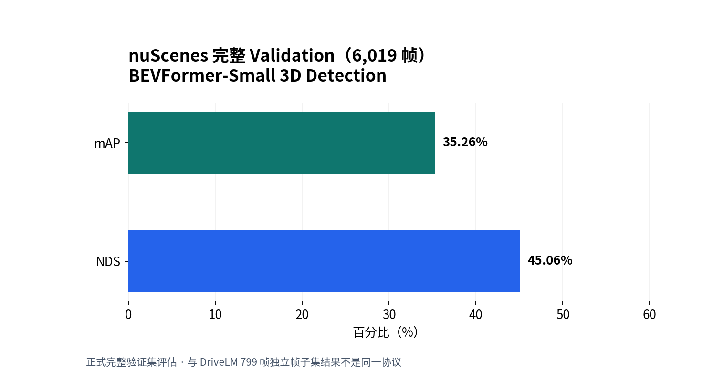

*图 15｜完整 nuScenes Val（6,019 帧）3D 检测结果：mAP 35.26%，NDS 45.06%。图表根据官方评估输出中的指标绘制。*

**正式结果：**

| 项目 | 结果 | 说明 |
|---|---:|---|
| 官方 Val 场景数 | 150 | nuScenes v1.0-trainval 的 Validation split |
| 完成推理的 Val 帧 | 6,019 / 6,019 | 100% 覆盖 |
| 3D Detection mAP | **35.26%** | 官方 nuScenes 检测指标 |
| NDS | **45.06%** | 官方 nuScenes 检测综合指标 |
| 检测预测 Token | 6,019 | 终端 JSON 核验与完整帧数一致 |

这一步是本阶段最重要的“完整验证集基线”证据；但在解释结果时必须仍然记录本地权重和配置的时序开关，不将其直接冒充论文报告数值。

### 5.4 Temporal 前后帧的机制测试与批量复核

在已有数据中搜索真实连续的 keyframe 链，按相同 `scene_token`、前后帧 `prev` 关系和时间差（实测有约 0.499 s 的相邻关键帧）筛选配对，而不是任意拼接图像。

- 单对 Smoke Test：模型第 1 帧在没有历史 BEV 情况下运行，第 2 帧使用上一帧信息，观察 `prev_bev` 的保存和利用状态；两帧均产生预测。
- 批量检查：准备 **27 对有效连续帧**，依次运行并生成 JSON/CSV，结果 **27/27 对通过，0 对失败**。
- **重要解释：** 27/27 是“前后帧处理和时序状态切换能正确运行”的功能测试结果，**不是 27/27 目标检测准确，也不是 Temporal 相较无时序模式的 AP 提升**。

证据：`outputs/temporal_pair_smoke/`、`outputs/temporal_batch_smoke/`，以及 `scripts/test_bevformer_temporal_pair.py`、`scripts/test_bevformer_temporal_batch.py`。

### 5.5 DriveLM 799 帧基线再次核对

在完整 nuScenes Val 评估完成后，重新打开已有的 799 帧子集实验 JSON，确认它们属于不同样本范围和不同 Temporal 策略；将模型名称、权重、数据 PKL、样本数、阈值、评估规则及 SHA256 身份信息明确写在指标记录中，避免以后把不同配置的结果混在一起。

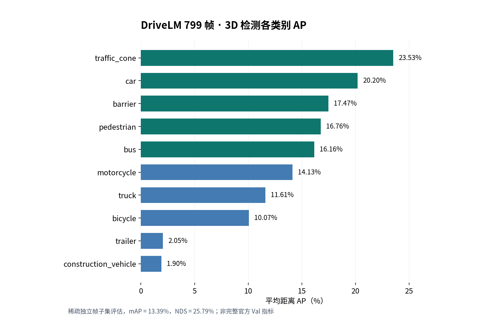

*图 16｜DriveLM 验证 799 帧子集 3D 检测的 10 类 AP：每类为不同距离阈值平均后的 AP。该图不是完整 Val 结果。*

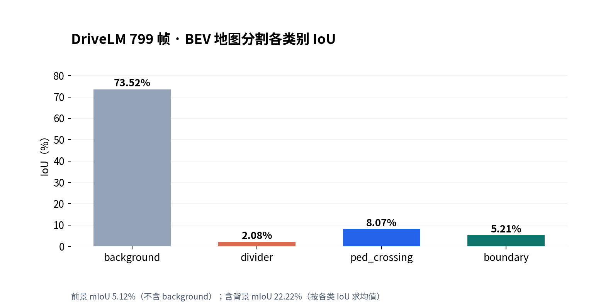

*图 17｜DriveLM 799 帧独立帧地图分割的四类 IoU。前景 mIoU 5.12%，含背景 mIoU 22.22%。*

**评估协议辨析：**

- **6,019 帧**：完整 nuScenes Val 检测 mAP/NDS。
- **799 帧**：DriveLM 对齐至 nuScenes Val 的稀疏关键帧子集；检测、分割均为不使用历史 BEV 的独立帧评估。
- **81 帧**：Mini 地图分割 Temporal ON/OFF 诊断对照。

三组样本、配置与任务不同，不能把它们之间的数值差当成严格消融或模型性能变化。

### 5.6 DriveLM VQA 训练问答数据准备（模型推理尚未完成）

为了给后续 VLA / VQA 任务准备入口，读取本地 `v1_1_train_nus.json` 的场景与关键帧问答结构，发现部分字段有 `Decimal` 数值，直接 `json.dumps()` 会报 `Object of type Decimal is not JSON serializable`；因此先明确数据结构及序列化处理，再运行本地基线样本准备脚本。

执行的准备命令示例：

```bash
python3 scripts/drivelm_vqa_baseline.py prepare --limit 20
```

**已验证结果：** 从训练集整理 20 条真实问答，覆盖 **perception、prediction、planning、behavior 各 5 条**，取自 20 个不同场景，且关联的六相机图像文件检查通过；数据准备信息落在 `outputs/drivelm_vqa_baseline/`。

**未完成内容：** 尚未调用视觉语言模型生成预测回答；未得到问答准确率、BLEU/CIDEr 或其他 VQA 性能指标。此前模型权重下载较慢，因此将模型推理留作后续独立任务。已有的答案文本属于 DriveLM 标注答案，不能冒充模型预测。

### 5.7 GitHub 交付与工程目录治理

**原因：** 工作目录 `~/projects/bev_vla` 同时包含多个第三方 Git 仓库、虚拟环境、nuScenes 数据链接和大量实验中间输出。若直接执行 `git add .`，容易上传不必要的大文件、重复的第三方源码或破坏项目历史。

**实际处理过程：**

1. 检查原 BEVFormer、BEVFormer-seg、bevformer-blackwell、MMCV、MMDetection3D 各自的 Git 状态，明确它们属于独立上游研究代码。
2. 在实验目录完成本地初始提交后，核查确认此前**已建立** GitHub 私有仓库 `JiaxuanJin/bev_vla_internship`，因此决定保留原远程历史，不强制覆盖。
3. 试图克隆仓库出现 `GnuTLS recv error` 和 `early EOF`；经检查，已有可用的本地工作目录 `~/projects/bev-vla-internship`，直接复用，不再重复下载。
4. 配置 `.gitignore` 排除数据、权重、虚拟环境、大型运行输出及历史备份；保存第三方工程中部分必要的二进制安全 Diff 补丁到 `patches/`。
5. 以不覆盖已有同名文件的方式合入 **47 个新增文件**；对 2 个同名内容不一致的文件单独列出差异，保留原版本；核查 Git 身份和暂存内容。
6. 正式提交并执行 `git push origin main`，终端记录远端 `main` 更新至新提交 `661197f`；README、中文日志、脚本、图片等在 GitHub 中能够浏览。

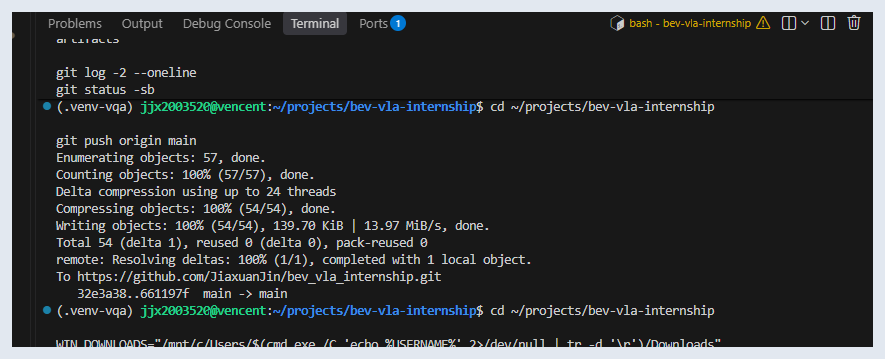

*图 18｜本阶段 GitHub 成果同步证据。完整数据集、权重与高体积推理结果仍保存在本地，不通过公开代码仓库发布。*

**统一管理原则：** `bev_vla` 继续作为研究工程、数据与模型运行目录；`bev-vla-internship` 作为轻量实验代码/Logbook/周报交付仓库。后续直接在已有交付仓库增量 Commit + Push，不重新创建 GitHub 仓库。

**对应日志：** `docs/logbook_2026-10-13.md`。

---

## 六、本阶段核心实验指标与证据索引

### 6.1 全部指标对照表

| 实验对象 | 范围和协议 | 核心数据 / 指标 | 能支持的结论 |
|---|---|---|---|
| nuScenes Mini | 数据集读取与可视化 | Mini 数据/相机/标注可读取 | 证明数据加载与可视化流程可用 |
| nuScenes Mini 地图分割 | 81 帧，Temporal ON | 前景 mIoU **6.38%** | 当前 Mini 设置下的结果 |
| nuScenes Mini 地图分割 | 81 帧，Temporal OFF | 前景 mIoU **5.99%** | 当前 Mini 设置下的对照 |
| DriveLM → nuScenes Val | 149 场景、799 帧 | **799/799 匹配**，Scene Token 错配 0 | 两套数据可关联 |
| DriveLM 799 3D 检测 | 相机输入、独立帧，无历史 BEV | mAP **13.39%**，NDS **25.79%** | 子集的检测基线 |
| DriveLM 799 BEV 分割 | 独立帧，全局交并比统计 | 前景 mIoU **5.12%** | 子集分割基线，低值待排查 |
| DriveLM 799 BEV 分割 | 同上 | 含背景 mIoU **22.22%** | 类别平均，不能替代前景指标 |
| 完整 nuScenes Val 3D 检测 | 150 场景，6,019 帧 | mAP **35.26%**，NDS **45.06%** | 完整 Val 的感知检测结果 |
| Temporal 连续帧功能 | 27 对有效前后帧 | **27/27 PASS** | 时序状态与处理链路功能通过 |
| DriveLM VQA 数据准备 | 训练集抽取 20 问 | 4 类×5；图像匹配成功 | 问答输入数据就绪，非语言模型性能 |

### 6.2 文件和脚本对照（便于审阅）

| 任务 | 核心脚本 / 文件 | 说明 |
|---|---|---|
| 数据检查、可视化 | `scripts/visualize_nuscenes.py`、`scripts/visualize_nuscenes_boxes.py` | 相机、标注、场景查看 |
| BEV 特征 | `scripts/extract_bev_features.py`、`scripts/generate_bev_attention.py` | 特征获取与测试辅助 |
| BEV Segmentation | `scripts/run_bev_seg_minival.py`、`scripts/diagnose_bev_seg_miou.py` | Mini 指标及专项排障 |
| DriveLM 对齐 | `scripts/check_drivelm_val_official_split.py`、`scripts/build_drivelm_799_bevformer_pkl.py` | 799 帧数据索引和验证 |
| DriveLM 检测 | `scripts/run_drivelm_799_det_all.py`、`scripts/evaluate_drivelm_799_det_subset.py` | GPU 推理与子集指标 |
| DriveLM 分割 | `scripts/run_drivelm_799_seg_all.py` | 独立帧分割基线 |
| Temporal | `scripts/test_bevformer_temporal_pair.py`、`scripts/test_bevformer_temporal_batch.py` | 前后帧处理测试 |
| 完整 Val | `scripts/fix_and_run_bevformer_val_6019.py` | 兼容性修复后正式检测评估 |
| VQA 样本 | `scripts/drivelm_vqa_baseline.py` | 问答选择与图像输入检查 |
| Git 提交补丁 | `patches/BEVFormer_sm120_plugin_compat.patch` | 记录部分第三方源码适配改动 |
| 中文记录 | `docs/logbook_2026-10-10.md` 至 `docs/logbook_2026-10-13.md` | 逐日原始工作记录 |

> **文件位置提醒：** 本表中的 `outputs/` JSON、CSV、NPZ 与权重通常存放在实验工作目录 `~/projects/bev_vla` 下，因为仓库的 `.gitignore` 排除了大型结果；GitHub 交付库主要提供轻量代码、文档和必要图片，不能从缺少大型原始数据推断实验未完成。

---

## 七、主要问题归纳、处理经验与剩余风险

| 类型 | 实际表现 | 本阶段处理 / 学到的经验 | 尚需注意 |
|---|---|---|---|
| 软件兼容 | 旧版 BEVFormer/MMCV 与当前 PyTorch 之间存在导入和接口变化 | 先兼容测试、再 2 帧 Smoke Test、最后全量运行；通过补丁留痕 | 固定最终依赖版本和配置；不要粗暴改上游全部代码 |
| 数据下载 | nuScenes Part 10 官方网络极慢、反复断线 | 使用可断点续传的官方文件链接，进行压缩包完整性检查 | 模型权重和未来更多模态下载仍需可信加速方案 |
| 数据定义 | DriveLM 与 nuScenes 的样本、场景关系需要核对 | 使用 token、scene_token 和官方分割元数据匹配 | 训练集问答和验证集感知评估不能混写 |
| Temporal 机制 | 真实相邻帧和上一帧状态可能被错误拼接 | 筛选同场景连续帧，严格检查 27 对并保存 `prev_bev` 状态 | 功能 PASS 不等于准确率提升 |
| 分割质量 | 前景 mIoU 低且背景占比较高 | 用混淆矩阵、IoU 分类别分析及预测/GT 图开展定位 | 尚不能确定是几何对齐还是模型本身等原因 |
| 全量评估 | DataLoader `dict_keys` 以及 DDP 接口兼容错误 | 改用单进程加载和局部兼容处理；保持评估协议稳定 | 更高效多进程评估仍可后续优化 |
| Git 历史 | 两个本地工作目录、多个上游 Git 仓库易混淆 | 复用上午原 GitHub 仓库、增量合并、显式忽略数据文件 | 禁用 `--force` 覆盖已有历史，提交前审查敏感信息 |
| VQA 进度 | 模型权重下载慢，尚无模型预测 | 先完成 20 问样本与相机路径验证，不虚构 VQA 指标 | 后续单独做推理与评估，注意实验依赖与来源 |

---

## 八、阶段交付清单及完成状态

| 交付项 | 当前状态 | 证据与限制 |
|---|---|---|
| BEVFormer 可运行环境 | **已在实验平台验证** | CUDA、算子、模型、Mini/完整 Val 推理均有运行记录；跨机器复现需依赖锁定 |
| nuScenes Mini + Trainval 关键帧 | **相机评估所需部分已完成** | Mini 与官方 Val 六相机关键帧到齐；不宣称所有 sweeps 模态已齐全 |
| 完整 nuScenes Val 检测指标 | **已完成** | 6,019/6,019；mAP 35.26%、NDS 45.06% |
| DriveLM 799 帧检测基线 | **已完成子集评估** | mAP 13.39%、NDS 25.79%；独立帧协议 |
| DriveLM 799 帧地图分割 | **已完成子集评估** | 前景 mIoU 5.12%；分割质量分析待深入 |
| Temporal 测试 | **已完成功能测试** | 27/27 连续帧 PASS；不是官方时序精度对照 |
| BEV 特征及结果图 | **已归档** | 六相机、GT、点云 BEV、特征、检测及分割图 |
| DriveLM VQA 真实预测 | **尚未完成** | 20 条真实训练问答已准备，模型未生成预测答案 |
| 中文文档与 GitHub | **已完成初步交付** | 逐日 Logbook、问题排查文档、脚本、图片和补丁提交至私有仓库 |

---

## 九、下一阶段的具体计划与可执行验收标准

1. **本阶段收尾验收（优先）。** 在仓库中更新说明，固定完整 Val 和 DriveLM 子集使用的配置、Checkpoint 校验值与数据范围；检查 Markdown 图片相对路径和真实原始日志是否对应，确保师傅能追溯每个数字。验收：README、周报、Logbook 不出现相互矛盾的指标口径。
2. **误差分析与注意力方向准备。** 从 DriveLM 799 帧分割结果中挑选错误具有代表性的样本，将 IoU 异常与类别映射、空间坐标和模型输出逐一对应。验收：至少形成可对照的案例、假设及排查结果，而不是仅凭直觉说明原因。
3. **VQA 最小真实推理。** 在网络和算力允许的条件下选取适用的视觉语言模型，先在少量真实六相机/单视角样本上运行，记录实际预测答案、延迟、资源占用和失败案例；再决定评价协议。验收：真实 `prediction` 与 `ground truth` 明确分离，不把准备的样例当成模型成绩。
4. **视觉与语言信息关联。** 探索如何让自然语言指令与 BEV 网格、目标特征或注意力区域建立可以验证的映射；如引入模拟模块，必须标记其测试性质。验收：清楚定义输入、输出、对照组与量化指标。
5. **维护规范。** 实验当日结束后统一更新中文 Logbook，后续 Git Commit 采用 `feat:`、`fix:`、`docs:` 等规范前缀；第三方源码与权重继续排除或按许可证说明。验收：更新不影响旧实验、可随时回溯。

---

## 十、阶段总结

本阶段搭建了 BEVFormer 感知研究环境，完成 nuScenes Mini 的基础数据读取、多相机与 3D 标注可视化、BEV 特征展示与模块级注意力测试；围绕 BEV 地图分割开展坐标与类别诊断，并在 Mini 81 帧中记录 Temporal ON/OFF 对照结果。进一步将 DriveLM 验证集 799 帧与 nuScenes 官方 Val 元数据完成匹配，在一致的独立帧协议下获得 3D 检测 mAP/NDS 与 BEV 地图分割 mIoU。10 月 13 日补齐全部 6,019 帧 nuScenes 官方 Val 的 3D 检测评估，取得 **mAP 35.26%、NDS 45.06%**，并对 27 对连续帧完成 Temporal 功能验证；同时整理 DriveLM VQA 20 条真实训练问答、完成图片路径检查、保存 GitHub 私有仓库的代码和日志。

当前最明确的后续任务是继续追踪分割低 IoU 的可能原因，并完成真正的视觉语言模型推理。**本周的有效成果是可运行的感知基线、可复核的不同协议指标、可视化证据和可回溯的实验管理流程，不提前宣称已完成语言指令增强或者 VLA 系统训练。**

---

### 附：实验材料与图像归档说明

本周报引用的实验图片统一归档于 `docs/images/2026-10-10/` 至 `docs/images/2026-10-13/`，正文使用相对路径引用，以便在 GitHub 与 Markdown 阅读器中保持一致显示。10 月 10—12 日的图像来自此前留存的实验截图；10 月 13 日的图表对应当日评估结果与版本管理记录。

实验脚本和阶段性总结归档于 `scripts/`、`docs/` 与 `docs/stage1/`。原始评估结果（JSON、CSV、NPZ）、模型权重和大型数据集保留在实验工作目录，不作为代码仓库的常规提交内容。各项指标的解释和复核应以相应的实验协议、运行日志及原始输出为依据。
