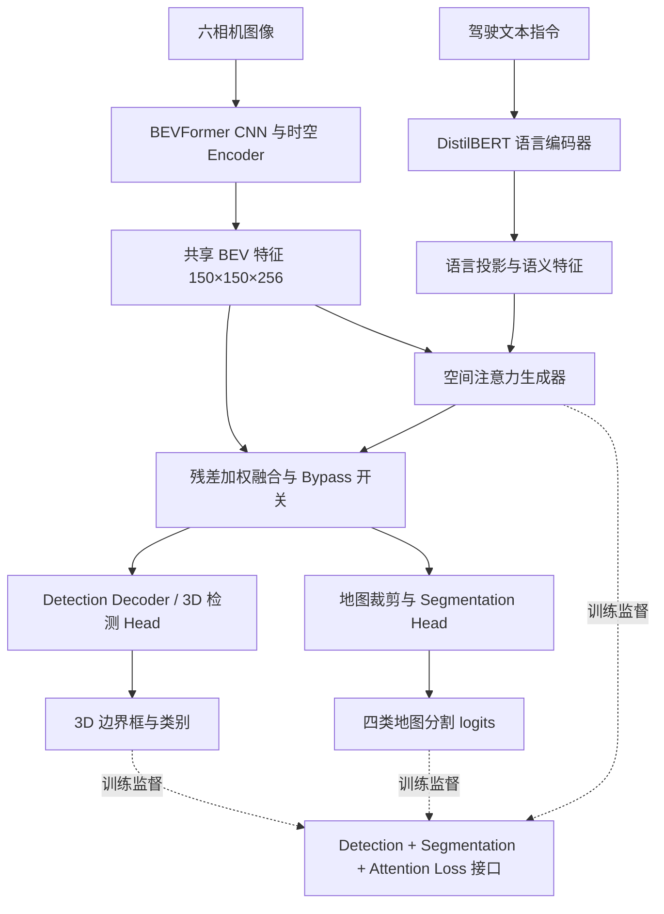

# 第二阶段：语言引导 BEV 注意力增强模块架构设计

## 1. 系统架构



**说明：** 实线表示 Step70 已完成的真实前向路径；虚线表示 Step69 实现的损失接口。
Step72 已使用真实单帧 3D/地图 GT 验证三项损失的联合反传，未执行参数更新，
详见 [真实联合梯度验证](14_真实联合梯度验证.md)。

## 2. 模块与接口

| 模块 | 主要接口/输入 | 输出/作用 | 实现 |
|---|---|---|---|
| 语言编码 | 文本指令 → DistilBERT | 文本向量（768 维） | `scripts/stage2/language_encoder.py` |
| 空间注意力 | BEV + 文本特征 | 对应 BEV 位置的注意力图 | `scripts/stage2/language_bev_attention.py` |
| 特征融合 | BEV [B,256,150,150] + 文本 | 增强 BEV（支持 bypass） | `scripts/stage2/bev_fusion.py` |
| 联合感知 | 共享 BEV [B,22500,256] | `seg_preds`、`all_cls_scores`、`all_bbox_preds` | `scripts/stage2/run_step70_joint_integration.py` |
| 统一损失 | 检测真实 loss dict + 分割 logits/GT + 类别 Attention | 标量总 Loss 与分项日志 | `scripts/stage2/multitask_training.py` |

## 3. 集成位置与控制路径

作者 `PerceptionTransformer.get_bev_features()` 返回的 BEV 是共享分支入口。
Step70 通过运行时 hook 在此进行语言融合，保证检测 Decoder 与分割裁剪共用增强后的特征。
`enabled=False` 时原样返回，测试实测检测和分割三个张量的旁路差异均为零。
注意：当前为可复现的实验集成 hook，并不是修改作者源码后的正式部署模型。

## 4. 实际限制

- Step70 采用作者联合 checkpoint 和随机初始化的语言融合权重，证明的是结构可用，不是模型精度提高。
- 现有文本模板不足以证明开放词表语义理解；Step68 置乱文字未导致稳定性能下降。
- 分割 GT 的物理参考与 BEV 坐标关系仍应在实际地图锚点上核验。
- Step72 已完成真实单帧三项损失联合反传；主干冻结、融合随机初始化、未执行 optimizer.step，不构成联合训练收敛证据。
- 真实完整时序 81 帧与性能提升不在 Step70 单帧功能验证覆盖范围内。

## 5. 复现入口

```bash
source ~/projects/bevformer_author_clean_5080/.venv-author/bin/activate
python3 -u scripts/stage2/run_step70_joint_integration.py --live \
  --joint-checkpoint /mnt/g/nus/bevformer_small_joint_author.pth --index 0
python3 scripts/stage2/run_step69_loss_contract.py --self-test
python3 scripts/stage2/run_regression.py
```

环境准备与真实梯度命令见 [复现指引](17_第二阶段复现指引.md)。Step71 的 `--audit` 会重新生成该步骤的历史报告，日常回归使用 `run_regression.py`。
