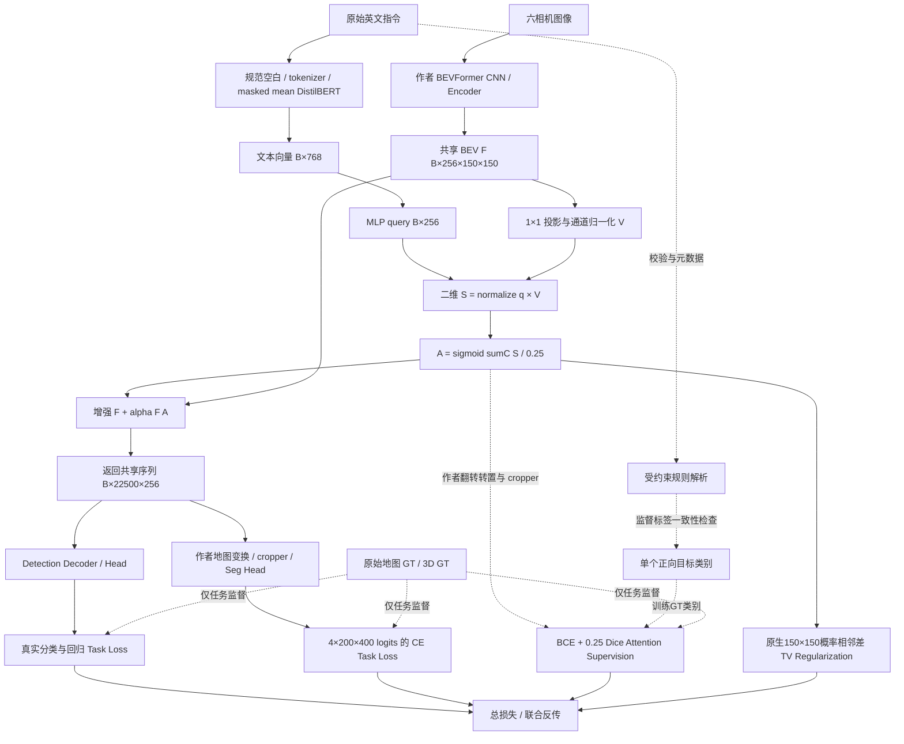

# 第二阶段模块架构设计（2026-10-22 源码审查版）

依据 [原始任务书](02_第二阶段原始任务书.md)，实现目标是语言引导 BEV 注意力增强模块与实验级真实集成。

## 接口与计算路径

| 模块 | 类 / 函数 | 输入 | 输出 / 实际作用 |
|---|---|---|---|
| 文本预处理与编码 | `language_encoder.py:normalize_instructions`、`DistilBERTLanguageEncoder.tokenize/forward` | 英文文本列表 | 仅规范空白；max_length=64，padding=longest；冻结 DistilBERT hidden[B,L,768]，按 attention_mask 平均为[B,768] |
| 规则解析 | `semantic_instruction.py:parse_instruction` | 规范化前后语义不变的英文 | targets/excluded/front_back/left_right；用于校验和元数据，不注入 Attention；`attention_target_class` 仅在单类别监督时绑定文本与 GT 类别 |
| 语义空间映射 | `SemanticProjection.forward_spatial` | t[B,768]，V[B,256,H,W] | LayerNorm+Linear+GELU+Linear 得 q；S=normalize(q)×V[B,256,H,W] |
| Attention | `LanguageBEVAttention.visual_features/from_semantic` | BEV 经1×1投影得到V；随后消费S | A=sigmoid(sum_C(S)/0.25)，[B,1,H,W] |
| Fusion | `LanguageBEVFusion.forward_with_details` | 原 F、语义编码 | E=F+alpha F A，尺寸保持不变；state_dict 仍为8个融合参数张量 |
| 序列/地图契约 | `BEVGrid.to_map/to_sequence` | [B,HW,C] / [B,C,H,W] | row-major，不插值、不自动翻转；非方形测试防止对称尺寸掩盖转置 |
| 集成 | `Stage2Pipeline.inject_shared_bev` | 作者 Transformer.get_bev_features 的输出 | 注入后增强序列供检测 Decoder 和分割 Head 共用；finally恢复方法，拒绝嵌套，Head hook 由调用者 finally 移除 |
| 损失 | `Stage2MultiTaskLoss` | 真实检测 dict、seg logits/GT、类别 Attention、可选原生 Attention logits | 标量总损失及 detached 日志；监督与正则明确分开 |

当前统一链路是 `pipeline.fuse_encoded → fusion.forward_with_details → forward_spatial → from_semantic → E`。S 是 Attention 前置依赖，并非仅供画图的辅助输出。`SemanticProjection.to_spatial(q,A)` 和 `ego_direction_mask` 等历史/坐标诊断接口不参与当前融合，不能将其功能写成模型已接受结构化方向约束。`LanguageBEVFusion.forward` 的直接余弦写法与 details 路径逐位等价，但只有后者显式返回 S；测试覆盖两条路径等价。

同一文本的不同位置响应来自 V 的空间差异；没有独立的位置模板或语言区域真值。均匀视觉网格会得到均匀 Mask。前后、左右、否定词保留在 DistilBERT 输入中且可改变输出，不构成方向执行或否定理解正确的证据。

## 多任务损失的严格定义

- Detection Task Loss：作者真实3D GT的 cls/bbox loss 字典，包括 Decoder 中间层；调用方先排除作者 loss_seg 和 acc 日志，避免重复计算。
- Segmentation Task Loss：本次双 Head 前向 logits[B,4,200,400] 与原始地图 GT 的 CrossEntropy。作者加权 loss_seg 只记录诊断，不再加入 total。
- Attention Supervision：本次 A 转 logits 后，使用作者相同的转置/翻转与 feat_cropper 到200×400，对文本正向类别做 `BCE + 0.25 Dice`，系数0.1；缺席目标返回保图零损失，ignore_index=255 被屏蔽。不代表存在配对语言区域 GT。
- Attention Regularization：新增 GT-free `TV(A)=mean(|A[r+1,c]-A[r,c]|)+mean(|A[r,c+1]-A[r,c]|)`，各轴不存在边时跳过。真实路径作用于原生150×150概率图，避免把裁剪边界当平滑先验。float32 sigmoid/归约，常量图和1×1可导零值，无熵或面积目标。

`L = w_det L_det + w_seg L_seg + w_sup L_sup + λ_TV TV(A)`。

历史20步为 `w_det=w_seg=1,w_sup=0.1,Dice=0.25,λ_TV=0`。新接口默认TV=0，以保持历史公式和梯度逐位一致；新的独立 smoke 取0.001验证梯度，未据验证指标调参，也未执行新训练。新鲜协议可通过 `--attention-tv-weight` 记录参数，恢复时从协议 `LossConfig(**protocol['loss'])` 读取，不覆盖旧协议。日志 `attention_loss` 保留监督别名，同时明确输出 `attention_supervision_loss`、`attention_regularization_loss`，没有将监督重复计入 total。

## 运行边界与状态生命周期

`joint`、`joint-backward` 为历史直接入口，仍沿用作者全量元数据路径。15 GiB WSL 优先使用 `micro-train --micro-phase smoke`：协议进程只固定样本，然后退出；smoke / train / validate 各自新进程，只保留本阶段数据集；模型/checkpoint先初始化释放，再构建流式元数据视图。0.2秒 watchdog 监测 RSS 与 MemAvailable，默认阈值11 GiB和2 GiB。

作者模型和 DistilBERT 始终冻结且eval；micro训练只将fusion设为train。单帧历史关闭，验证每轮重置prev_frame_info；推理上下文关闭梯度，增强反传上下文保留真实图。不对真实Head使用detach；仅报告输出副本detach。图像/GT共享只读，只有可变img_metas复制。每步清除loss/batch/Hook输出引用。

融合权重独立保存于新增文件，`load_fusion_weights` strict 加载fusion.state_dict，不加载作者模型命名空间；原checkpoint与新增权重互不覆盖。原模型、GT与受保护文件都有哈希核验。旧20步对应的40个源码文件已冻结在 `results/stage2_final_audit_2026-10-22/legacy_source/`；当前源代码不能冒充旧实验版本，旧验证由 `replay_stage2.py` 运行冻结源码。

本集成不需要改写第三方 BEVFormer 源码，也不等于完整分布式训练框架、长期时序部署系统或物理配准完成。原始 BEV 是150×150、地图输出200×400，沿用作者 raster/cropper 只是同作者协议诊断；物理一致性仍为 NOT_VERIFIED。执行入口见 [复现指引](17_第二阶段复现指引.md)。
