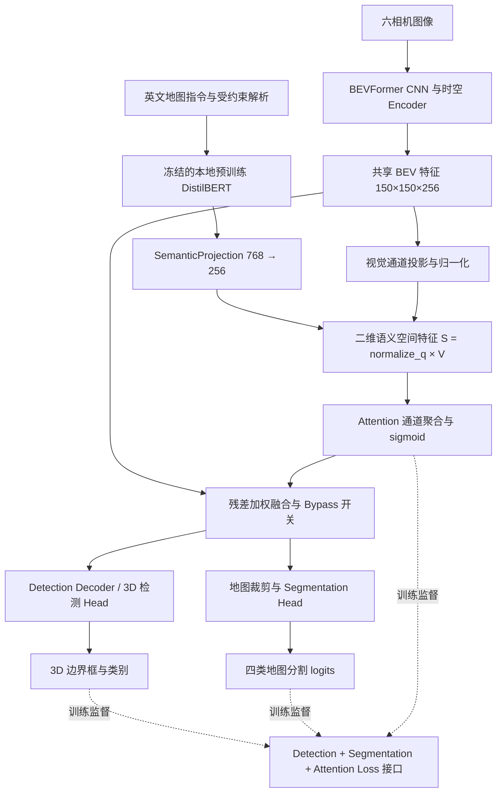

# 第二阶段：语言引导 BEV 注意力增强模块架构设计

## 1. 系统架构

验收依据：[第二阶段原始任务书](02_第二阶段原始任务书.md)。当前源码数据流如下，最终执行结果与逐项判定见 [最终严格验收报告](20_第二阶段最终严格验收_2026-10-21.md)。




**说明：** 实线是统一入口实际使用的前向依赖；虚线是同一次前向到多任务损失的监督路径。`joint` 执行 Mini Val 原始/旁路/增强对照；`joint-backward` 执行 Mini Train 单帧真实三任务反传，不执行参数更新。Step72 保留为 [历史证据](14_真实联合梯度验证.md)，不用于冒充新入口结果。

本轮 `Stage2Pipeline` 将文本编码、投影、二维映射、注意力和共享 BEV 注入封装为统一接口；真实双 Head 前向通过，新结果与历史 Step70 分开保存，见 [缺口补齐记录](19_第二阶段工程缺口补齐_2026-10-21.md)。

## 2. 模块与接口

| 模块 | 主要接口/输入 | 输出/作用 | 实现 |
|---|---|---|---|
| 语言编码 | 文本指令 → DistilBERT | 文本向量（768 维） | `scripts/stage2/language_encoder.py` |
| 语义—空间映射 | 文本 [B,768] + 归一化视觉网格 | q[B,256]、S[B,256,H,W] | `scripts/stage2/semantic_projection.py` 的 `forward_spatial()` |
| 空间注意力 | 二维语义 S[B,256,H,W] | A[B,1,H,W] | `scripts/stage2/language_bev_attention.py` 的 `from_semantic()` |
| 特征融合 | BEV [B,256,150,150] + 文本 | 增强 BEV（支持 bypass） | `scripts/stage2/bev_fusion.py` |
| 联合感知 | 共享 BEV [B,22500,256] | `seg_preds`、`all_cls_scores`、`all_bbox_preds` | `scripts/stage2/joint_runtime.py`；历史 Step70 入口保留 |
| 统一损失 | 检测真实 loss dict + 分割 logits/GT + 类别 Attention | 标量总 Loss 与分项日志 | `scripts/stage2/multitask_training.py` |
| 统一系统 | 真实指令 + BEV / get_bev_features | 二维语义、注意力、增强 BEV、双 Head 预测 | `scripts/stage2/pipeline.py`、`joint_runtime.py` |
| 坐标契约 | [B,HW,C]、显式 pc_range 和 LiDAR→Ego 标定 | 无转置歧义的网格与方向测试 | `scripts/stage2/bev_coordinates.py` |

### 2.1 一维语义到二维 BEV 的完整数据流

```text
原始英文指令（保留目标、否定与方位）
 → 空白规范化 → tokenizer（padding / truncation=64 / attention_mask）
 → 冻结 DistilBERT + masked mean pooling：t [B,768]
 → LayerNorm + Linear + GELU + Linear：q [B,256]

真实 BEV F [B,256,H,W] → 1×1 visual_projection → 通道归一化 V
S[b,c,r,k] = normalize(q)[b,c] × V[b,c,r,k]：[B,256,H,W]
S → 通道求和 → sigmoid(sum(S) / 0.25)：A [B,1,H,W]
Enhanced = F + alpha × F × A：增强 BEV [B,256,H,W]
```

`H=W=150` 为作者 Small 配置。`SemanticProjection.forward_spatial()` 在 Attention 之前产生 `S`，`LanguageBEVAttention.from_semantic()` 必须消费它；它不是掩码生成后的展示副产物。旧 `to_spatial(q,A)` 仅保留为历史辅助接口，当前统一链路不调用。上述分解与旧余弦门控数值等价，残差公式、融合权重键不变。`S` 或 `A` 的形状正确、数值变化不代表目标定位正确。

多目标、同义、有限否定和方位的规则解析只用于输入检查与元数据，不把类别 GT、方向模板或地图区域硬编码进 Attention。未知对象、矛盾方位、含糊否定和失去目标短语的置乱指令拒绝执行。词序规则仍是受约束词典规则，不是开放式语法理解；同义文本向量不要求逐元素相同。

### 2.2 空间索引与坐标验证

统一使用 `index = row * W + col`，`[B,HW,C] ↔ [B,C,H,W]` 不翻转、不缩放。作者 `BEVFormerEncoder.get_reference_points()` 的 2D/3D 参考点中列对应 x、行对应 y；`BEVGrid` 按此生成 pc_range 内的栅格中心，并在非方形 2×3 网格上验证往返，避免 150×150 的对称尺寸掩盖错误转置。

米制中心为 `x=x_min+(col+0.5)Δx`、`y=y_min+(row+0.5)Δy`。只有显式提供 LiDAR→Ego 的合法旋转和平移后，才能使用 ego x 正向为前、y 正向为左的方向规则。测试覆盖平移、90° 旋转、四象限、中心线、反射/非正交/非有限标定拒绝。这里验证张量顺序和坐标运算，不等于 150×150 网络 BEV 与 200×400 地图 GT 已物理配准；禁止 resize GT 充当配准。

## 3. 集成位置与控制路径

作者 `PerceptionTransformer.get_bev_features()` 返回的 BEV 是共享分支入口。
Step70 通过运行时 hook 在此进行语言融合，保证检测 Decoder 与分割裁剪共用增强后的特征。
`enabled=False` 时原样返回，测试实测检测和分割三个张量的旁路差异均为零。
注意：当前为可复现的实验集成 hook，并不是修改作者源码后的正式部署模型。

统一入口的临时 Hook 同样位于该共享接口：启用时从原始指令动态编码，一帧对应一条指令；关闭时跳过 tokenizer/编码/投影并返回原 BEV tensor。正常结束、推理异常均恢复原方法和 Head Hook，拒绝嵌套注入与隐式文本 batch 广播。GT 从推理用的深拷贝 batch 中移除，原数据不修改。

### 3.1 同一次真实前向的联合反传

`joint-backward` 使用真实 Mini Train 的图像、3D 框与地图 GT，队列长度为 1，冻结作者模型和 DistilBERT。`capture_details=True` 保留同一共享 BEV 调用产生的 Attention 计算图，Head Hook 保留本次检测与分割输出图。

- Detection：聚合作者本次 `forward_train` 返回的真实分类/回归 loss，不纳入分割 loss 或日志指标。
- Segmentation：本次分割 logits 对真实地图 GT 的 CrossEntropy。
- Attention：本次掩码转 logits，经过作者相同的转置/翻转和 `feat_cropper`，对指令对应的真实地图类别计算 BCE + 0.25 Dice；不 resize 或改写 GT。
- Total：`L_det + L_seg + 0.1 L_att`。分别检查三项与总项到融合参数的梯度，再调用一次总损失 `backward()`；不创建优化器。

前向与共享 Hook 都必须各调用一次，梯度必须非零且有限；冻结模型不得收到梯度，融合参数值与 GT 张量不得改变，checkpoint 文件前后哈希必须一致。该测试证明实际 loss/梯度链可运行，不证明注意力的语义定位或优化后的精度。

## 4. 实际限制

- Step70 采用作者联合 checkpoint 和随机初始化的语言融合权重，证明的是结构可用，不是模型精度提高。
- 现有文本模板不足以证明开放词表语义理解；Step68 置乱文字未导致稳定性能下降。
- 分割 GT 的物理参考与 BEV 坐标关系仍应在实际地图锚点上核验。
- Step72 已完成真实单帧三项损失联合反传；主干冻结、融合随机初始化、未执行 optimizer.step，不构成联合训练收敛证据。
- 真实完整时序 81 帧与性能提升不在 Step70 单帧功能验证覆盖范围内。

## 5. 复现入口

当前统一入口：

```bash
cd ~/projects/bev_vla
.venv-bevformer/bin/python scripts/stage2/run_stage2.py --mode cpu-tests \
  --output outputs/stage2_completion/reproduce_cpu.json
.venv-bevformer/bin/python scripts/stage2/run_stage2.py --mode offline-bev --device cpu \
  --output outputs/stage2_completion/reproduce_offline.json
~/projects/bevformer_author_clean_5080/.venv-author/bin/python \
  scripts/stage2/run_stage2.py --mode joint --text 'Find lane markings ahead' \
  --output outputs/stage2_completion/reproduce_joint.json
~/projects/bevformer_author_clean_5080/.venv-author/bin/python \
  scripts/stage2/run_stage2.py --mode joint-backward --text 'Find lane markings' \
  --output outputs/stage2_final_acceptance/reproduce_backward.json
```

默认只读取本地模型；`joint` 与 `joint-backward` 需要可访问 GPU 的作者环境。输出已存在时拒绝覆盖，应换一个新路径。`offline-bev` 使用已保存真实 BEV，不等于本次重新跑了图像主干；两个 joint 模式均执行真实图像到双 Head 的前向。

以下历史入口保持可用；执行真实模式会更新其原有报告，日常复现优先使用上方的新路径入口：

```bash
source ~/projects/bevformer_author_clean_5080/.venv-author/bin/activate
python3 -u scripts/stage2/run_step70_joint_integration.py --live \
  --joint-checkpoint /mnt/g/nus/bevformer_small_joint_author.pth --index 0
python3 scripts/stage2/run_step69_loss_contract.py --self-test
python3 scripts/stage2/run_regression.py
```

环境准备与真实梯度命令见 [复现指引](17_第二阶段复现指引.md)。Step71 的 `--audit` 会重新生成该步骤的历史报告，日常回归使用 `run_regression.py`。
