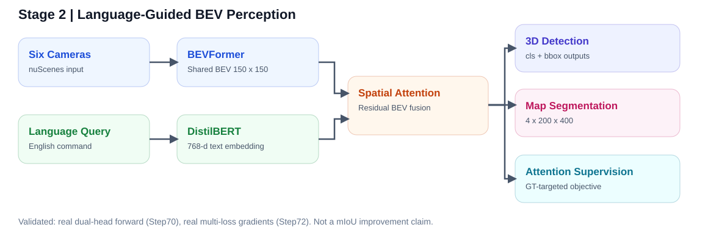
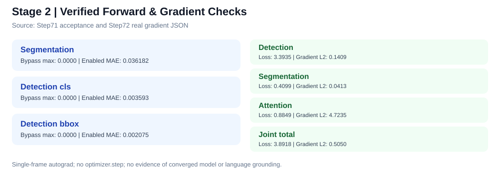
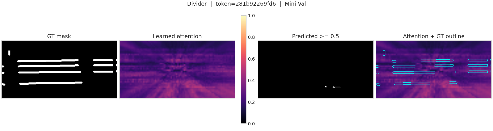
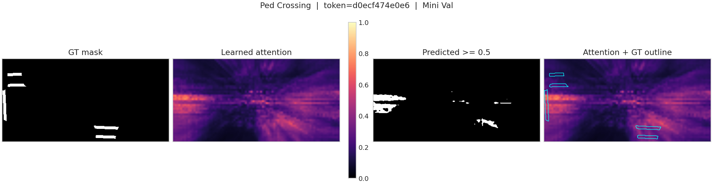
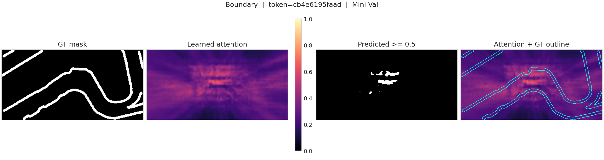

# 第二阶段核心模块进展及证据汇总（2026-10-21）

> 实验范围：语言编码、BEV 注意力生成与融合、联合检测/分割前向、多任务损失及梯度可达性。

## 1. 系统数据流

作者联合配置采用共享 BEV 主干和检测/分割双 Head；语言模块在共享 BEV 特征上生成空间注意力并执行残差融合。

## 2. 真实模型集成与梯度验收

### 2.1 Step70：真实联合 Head 前向

| 输出 | 维度 | 关闭融合最大绝对差 | 开启融合平均绝对差 |
|---|---|---:|---:|
| 分割 | `[1, 4, 200, 400]` | 0.00000 | 0.03618 |
| 检测分类 | `[6, 1, 900, 10]` | 0.00000 | 0.00359 |
| 检测回归 | `[6, 1, 900, 10]` | 0.00000 | 0.00208 |

采用作者联合 checkpoint，关闭增强时输出与原始预测一致；开启增强后两类感知 Head 均出现响应。该对照验证可插拔集成，不表示精度提升。

### 2.2 Step72：真实监督的多任务梯度

| 分支 | Loss | 梯度 L2 | 梯度均有限 |
|---|---:|---:|---|
| 检测 | 3.39347 | 0.14086 | True |
| 地图分割 | 0.40986 | 0.04127 | True |
| 注意力 | 0.88487 | 4.72352 | True |
| 联合总损失 | 3.89181 | 0.50498 | True |

测试模式：`frozen_real_joint_model_single_train_frame_autograd_no_update`。使用真实 3D 和地图 GT，在冻结作者主干、单帧无历史模式下检测梯度连通性；没有执行 `optimizer.step()`。

## 3. 语言与空间功能检查

- Step73 指令解析与真实 DistilBERT：`PASS_FUNCTION_ONLY`；文本向量形状 `[8, 768]`，注意力形状 `[2, 1, 150, 150]`。
- 不同指令的编码 MAE：0.13035；Attention MAE：0.01960。
- 地图锚点独立投影：`MAP_ANCHOR_DIAGNOSTIC_ONLY`；direct F1（2 px 容差）= 0.82090，Precision = 0.96741，Recall = 0.71293。
- 注意力头的独立功能检查不构成目标定位准确率证明；网络 BEV 与地图 GT 物理坐标的端到端对应关系仍需进一步验证。

## 4. 类别注意力示例与问题分析

以下图片复制自 Step62 原始可视化结果，用于记录模型对地图要素的注意力分布，与最终语言语义有效性结论区分。

**Divider 注意力与地图 GT 可视化**

**Ped Crossing 注意力与地图 GT 可视化**

**Boundary 注意力与地图 GT 可视化**

## 5. 有限的验证结论

- Step65～67 在单帧 Mini Val 的部分前景类别上有改善，但 Background IoU 明显退化，未形成稳定的四类 mIoU 提升。
- Step67 基于 Mini Train 校准条件锁定 Original，不应将 raw adapter 的局部指标当作正式改善。
- Step68 正常文本、置乱文本与常量文本预测较接近，语言正确定位尚未证实。
- Step73 具有受约束指令解析能力，不等同于任意开放自然语言理解。
- 与 nuScenes 地图 GT 的物理空间完整对应未闭环。
- 检测 + 分割 + 注意力联合梯度通过，不代表训练已收敛或提升检测/分割准确率。

## 6. 复现及资料位置

- 核心代码：`scripts/stage2/`
- 架构说明：`docs/stage2/11_模块架构设计.md`
- 单元测试：`docs/stage2/12_单元测试报告.md`
- 阶段任务对照：`docs/stage2/13_阶段二任务对照.md`
- 真实联合梯度：`docs/stage2/14_真实联合梯度验证.md`
- 语言与空间功能：`docs/stage2/15_语言与空间能力补充验收.md`
- 小型 JSON 结果归档：`results/stage2_2026-10-21/`

统一运行命令参见 [第二阶段复现指引](17_第二阶段复现指引.md)。
