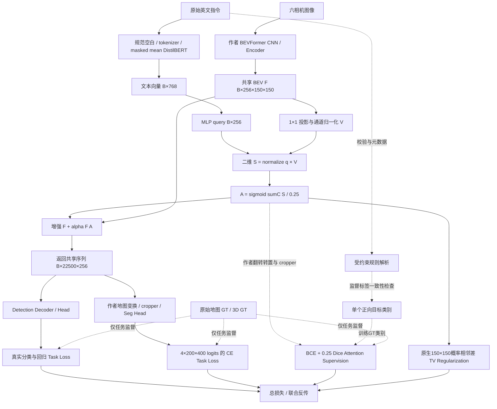

# 第二阶段最终缺口审查（2026-10-22）

本次首先逐项读取 [指导老师原始任务书](02_第二阶段原始任务书.md) 和真实源码，再检查全部未提交修改、原始JSON/JSONL/NPZ、协议、权重与数据划分；没有将旧“8/8 PASS”作为结论依据。修复前先在对话中给出严格结论与P0/P1/P2，再实施最小修复。当前所有功能PASS仅按任务书实现与可运行性解释。

**版本界限：旧源码完成20次真实更新和固定6帧A/B；新源码补齐TV与工程检查，本轮新增训练更新为0。** 旧实验、作者checkpoint、原始GT、第三方源码及全部预先存在的未提交文件均保留；main不变，没有commit/push。

## 一、8项任务证据矩阵

| ID | 原始任务 | 修复前 → 修复后 | 源码与实际调用 | 上游输入 → 下游输出 / 张量形状 | 测试与真实证据 | 未验证边界 |
|---|---|---|---|---|---|---|
| T1 | DistilBERT 集成与预训练权重 | PASS → PASS | `language_encoder.py:DistilBERTLanguageEncoder.__init__` → `AutoModel.from_pretrained(local_files_only=True,use_safetensors=True)`；`pipeline.py:from_local_model` | 原始英文列表 → input_ids/mask [B,L≤64] → hidden [B,L,768] | `language_probe.json` 将全部 encoder state_dict 张量与本地 safetensors 逐张量比较；GPU smoke 实际动态编码；`test_encoder_padding_mask_and_frozen_dropout` | 本地哈希与加载一致，不替代 checkpoint 上游来源证明；未评估中文/开放语言 |
| T2 | 预处理、编码、语义提取 | PASS → PASS | `normalize_instructions`、`tokenize`、`DistilBERTLanguageEncoder.forward`、`Stage2Pipeline.encode` | 保留否定/方向/目标的规范化文本 → masked mean [B,768]；规则 Instruction 为校验/元数据 | `language_probe.json` 的目标、方向、否定、词序对照；`tests/test_stage2_pipeline.py` 的 mask/padding/truncation/拒绝测试 | Instruction.targets/excluded/front_back/left_right 不直接进入融合；编码响应不等于理解 |
| T3 | 1D→2D 语义空间映射 | PASS → PASS | `SemanticProjection.forward_spatial` 在 `LanguageBEVFusion.forward_with_details` 中被调用 | t[B,768]→MLP q[B,256]，与 V[B,256,H,W] 交互生成 S[B,256,H,W] | `test_attention_consumes_spatial_head_output_before_mask` 检查 S 到 A 的导数；真实 smoke trace S=[1,256,150,150] | 视觉条件映射；均匀 V 不会凭文本产生独立位置图，不保证物理方向/grounding |
| T4 | 输入输出/异常单元测试 | PASS → PASS | `tests/test_stage2_day1.py`、`test_stage2_pipeline.py`、`test_stage2_joint_backward.py`、`test_stage2_micro_training.py`、`test_stage2_final_audit.py` | 张量/文本/配置/Hook/协议 → 正常输出或明确异常 | 本轮 `pytest.log`：117 passed；损失自检 6 项；`checks.json` 保存命令与 exit_code；实际 GPU 独立佐证集成 | 单元测试主要是合成张量和随机小 DistilBERT，不能冒充感知效果评估 |
| T5 | 从语义空间特征生成 Mask | PASS → PASS | `LanguageBEVAttention.from_semantic(S)`；实际 pipeline 使用 details 路径 | S[B,256,H,W]→sum(C)/0.25→sigmoid A[B,1,H,W] | S 强制归零→A=0.5、非零导数、位置差异测试；真实缓存 Attention 空间 std=0.03032818 | `SemanticProjection.to_spatial(q,A)` 是未调用的历史辅助接口；不作为本条证据 |
| T6 | Mask 与原 BEV 加权融合 | PASS → PASS | `LanguageBEVFusion.forward_with_details` → `Stage2Pipeline.fuse_sequence` | F[B,256,150,150] + alpha F A → [B,22500,256] | 原模型/bypass 的三类输出最大差均为0；真实 smoke 增强分类、框、分割输出均改变；state_dict 键测试 | alpha=0 的零残差等价与 disabled bypass 分别验证，不混作“训练有效” |
| T7 | 检测+分割+注意力正则损失 | FAIL → PASS（实现/梯度） | `multitask_training.py:Stage2MultiTaskLoss`、`supervised_attention_loss`、新增 `attention_regularization_loss`；`micro_training.py:real_training_forward` | 作者真实 cls/bbox loss dict；seg logits[B,4,200,400]/GT[B,200,400]；类别监督 crop logits；原生 Attention logits[B,1,150,150]做 TV→标量 total | 零 TV 数值/梯度逐位兼容测试；忽略像素、缺席类别、边界/饱和测试；新 GPU smoke 监督与 TV 梯度均有限非零 | 原20步只有 BCE+Dice 监督，TV=0；本轮 TV=0.001 仅做 backward、0次更新，未验证正则训练收益 |
| T8 | 接入真实 BEVFormer 流程 | PASS → PASS | `run_stage2.py`→`joint_runtime.run_joint`→`inject_shared_bev` 临时替换 `get_bev_features` | 六相机→共享 BEV [B,22500,256]→增强→Detection decoder 和 Segmentation head；分类/框[6,B,900,10]、seg[B,4,200,400] | 当前源码 GPU smoke、旧20步 JSONL 与6帧 NPZ；异常/重复/已有实例覆盖 Hook 恢复测试；冻结状态/文件核验 | 单帧实验 Hook 集成，依赖外部作者工程；未证明完整历史时序、部署服务或官方AP/NDS |

## 二、4项阶段产出矩阵

| ID | 原始阶段产出 | 修复前 → 修复后 | 交付路径 / 证据 |
|---|---|---|---|
| D1 | 完整增强模块源码 | FAIL → PASS | `scripts/stage2/` 的编码、投影、Attention、fusion、pipeline、多任务损失；T7 缺口已补，融合权重键未变 |
| D2 | 架构图与子模块说明 | FAIL（过时）→ PASS | `docs/stage2/11_模块架构设计.md`、`docs/images/stage2/stage2_audited_architecture_20261022.svg`；标明真实 S→A 依赖与解析元数据边界 |
| D3 | 完整集成感知系统源码 | PASS → PASS | `run_stage2.py`、`joint_runtime.py`、`micro_training.py`、`micro_process.py`、`low_memory_dataset.py`、`runtime_memory.py`、`integration_smoke.py`；外部作者模型与数据依赖见复现指引 |
| D4 | 测试报告及可复现证据 | FAIL（过时）→ PASS | `docs/stage2/12_单元测试报告.md`、`17_第二阶段复现指引.md`、`results/stage2_final_audit_2026-10-22/`；冻结旧源码与重放入口；原始JSON/JSONL/NPZ/新增融合权重单独保留 |

源码可点击索引（行号以交付版本为准）：[编码器](../../scripts/stage2/language_encoder.py)、[二维映射](../../scripts/stage2/semantic_projection.py)、[Attention](../../scripts/stage2/language_bev_attention.py)、[Fusion](../../scripts/stage2/bev_fusion.py)、[Pipeline](../../scripts/stage2/pipeline.py)、[多任务损失](../../scripts/stage2/multitask_training.py)、[真实运行时](../../scripts/stage2/joint_runtime.py)、[微型训练](../../scripts/stage2/micro_training.py)。精确类/方法行号在 [source_locations.json](../../results/stage2_final_audit_2026-10-22/source_locations.json)。

## 三、真实缺口分级与修复

| 优先级 | 修复前事实与代码位置 | 最小修复 / 当前结论 |
|---|---|---|
| P0 | `multitask_training.py:supervised_attention_loss` 只有GT类别BCE+Dice，却被旧文档称为“注意力正则” | 严格区分supervision和regularization；新增单个GT-free概率TV，保留监督不重复入总损失。默认0、独立新协议显式可配置，数值边界/零兼容/真实梯度通过 |
| P1 | `prepare_protocol` 用n%3同时排文本与类别，`real_training_forward` 无文本/类别断言 | 当前20条原记录逐条相符，**未发现旧实验指令错配**。新代码用 `attention_target_class(text)` 派生类别，在协议读取和前向再次校验；多正向目标的单类别监督明确拒绝 |
| P1 | `real_training_forward` 硬编码新建LossConfig，无法保证今后协议配置确实被使用 | 新训练/新smoke从 `LossConfig(**protocol['loss'])` 读取配置；CLI拒绝覆盖已有协议损失参数 |
| P1 | 改源码会使旧协议绝对源码哈希失配；单凭新代码不能复现旧20步 | 编辑前冻结40个逐文件相同的旧源码；新增 `replay_stage2.py` 真正执行快照，保留原资产/权重哈希检查，只运行只读validate |
| P1 | 新增TV及独立加载权重缺少当前真实端到端证据 | 新增 `integration_smoke.py` 和micro-phase smoke，加载旧fusion strict keys，三类Head输出bypass=0，增强输出非零差，四来源梯度通过；0次optimizer.step |
| P1 | 文档仍声称69项/无更新，旧micro_report布局不支持今天独立进程目录 | 重写11/12/13/17，新增本报告和logbook；新只读 `audit_stage2_evidence.py` 复算20步/6帧原始数据和语言响应；旧report工具保留并明确适用边界 |
| P2 | 语义正确定位、方向/否定执行、BEV/GT物理配准、泛化/显著收益 | 不作为任务书强制门槛。本轮未新增区域模板、GT resize、模型结构或大规模训练；单独列后续研究 |

`requirements_stage2.txt` 已核查：是向既有Torch/CUDA环境增加Transformers/HF/safetensors/pytest的清单，当前修复未引入新依赖，因此不为改动而改依赖文件。GPU完整环境版本来自本次实际结果JSON，复现指引明确外部作者工程、CUDA自定义算子和模型/数据要求。

本次实际改动7个已有运行/损失/解析文件和新增3个工程入口、1个测试文件；精确逐文件变化以证据目录 `changes.json` 为准。原有 `pipeline.py`、`semantic_projection.py`、`language_bev_attention.py`、`bev_fusion.py`、`language_encoder.py` 计算结构未改，融合8个参数键和旧state_dict可严格加载。

## 四、A：Attention Regularization 的定义与兼容性

原始任务书只写“检测损失+分割损失+注意力正则化损失”，未限定数学形式。BCE+Dice虽能约束Attention，但其优化目标来自GT类别掩码，技术上是监督损失；不能据名称把它当作独立的GT-free结构先验。严格审查将这视为P0设计缺口，而非抹去原三任务监督/梯度实现。新增TV是一个明确、简单的结构先验；不盲目增加稀疏性（会偏置面积）、熵（可能鼓励错误置信）等多项损失。

令A=sigmoid(Z)，`R_TV=mean(|A[:, :,1:,:]-A[:,:,:-1,:]|)+mean(|A[:,:,:,1:]-A[:,:,:,:-1]|)`。只对存在邻接边的轴求均值；1×1返回可反传0。使用float32概率与归约避免半精度问题，对有限饱和logits仍有限。真实训练入口的TV作用于原生150×150 Attention；不使用GT、不经过地图cropper。正则不保证Mask语义正确，也不将BEV/GT配准作为已验证前提。

总损失是 `w_det Ldet + w_seg Lseg + w_sup (BCE+0.25 Dice) + λTV R_TV`。历史20步记录的权重为1、1、0.1、0；新增TV默认0，条件分支不增加zero tensor到旧total，测试验证旧标量与seg/attention梯度**逐位相同**。新smoke显式0.001，仅验证运行，不据6帧调参。原协议不加字段、不改旧日志、不改checkpoint；现代码从新协议恢复损失配置，并将监督/正则分别记日志。作者自带loss_seg只作诊断，不与统一CE重复加入total。

监督边界：ignore=255屏蔽，缺席目标保图零损失；不存在配对自然语言区域GT，目标只是文本对应的地图类别。单类别监督不等于多目标、否定区域或方向区域的监督。

## 五、B：语言是否真正参与二维空间注意力

真实调用依赖为 `Stage2Pipeline.fuse_encoded → LanguageBEVFusion.forward_with_details → SemanticProjection.forward_spatial → LanguageBEVAttention.from_semantic → F+alpha F A`。S在A之前产生，A对S导数非零，强制S=0得到A=0.5；同一S节点不是后置可视化。直接fusion.forward的余弦形式与该分解数值相同，测试覆盖等价。

S=q_norm×V，V来自每个位置的BEV视觉通道投影，因此不同位置能有不同响应；均匀视觉输入无法仅靠query得到独立空间位置分布。`to_spatial(q,A)`、`ego_direction_mask` 和解析的方向结构都是辅助/诊断接口，未进入当前实际Fusion。规则解析负责拒绝歧义和输出元数据；目标/方向/否定词本身仍作为文本进入DistilBERT，结构字段没有被偷偷当作GT区域模板注入。

真实本地预训练模型参数与safetensors逐张量一致；加载第20步fusion，在同一真实BEV缓存上定量探测如下。否定对照是“and road boundaries”与“but ignore road boundaries”，属于完整表达对照，不能将差异全归因为单个词的因果作用。

| 文本对照 | token变化 | embedding MAE | Attention MAE | Attention最大差 |
|---|---|---:|---:|---:|
| target_word | True | 0.069910139 | 0.006797360 | 0.038234711 |
| front_rear | True | 0.052435290 | 0.006671357 | 0.017183661 |
| left_right | True | 0.035400819 | 0.001775878 | 0.010256439 |
| negation | True | 0.075846858 | 0.003097753 | 0.019138157 |
| word_shuffle | True | 0.074248590 | 0.008776667 | 0.032839864 |

同一Mask空间std=0.030328179。这是已验证的输入/计算依赖和响应，**不是已理解目标/方向/否定或定位正确的结论**。训练协议20条文本和target_class均重新比对，无错配；新代码从文本解析单个正向类别并拒绝不一致，不再把样本序号当成标签来源。

## 六、C：真实集成审查

只读查看了作者 `projects/mmdet3d_plugin/bevformer/modules/transformer.py`：`get_bev_features` 返回后，同一bev_embed作为Detection decoder value并返回Head；作者 `dense_heads/bevformer_head.py` 的forward将该bev_embed做地图变换/cropper送Segmentation。Hook在分叉之前返回增强序列，因而两个任务真实共享E。新增GPU smoke 用旧训练fusion验证各Head输出均改变，证明不是只对辅助输出做增强。

| 核对点 | 证据与结论 |
|---|---|
| baseline/disabled bypass | 当前真实GPU三类张量最大差均0；旧6帧original/zero-init logits与已记录检测/分割原始张量差均0 |
| Hook异常/多次/已有实例方法恢复 | `inject_shared_bev` finally恢复，拒绝嵌套；CPU测试覆盖编码前拒绝、前向形状异常、多次调用、已有实例覆盖；Head hooks由各调用者finally移除 |
| 训练/验证/推理状态 | 作者与encoder冻结eval；fusion train仅在训练入口；inference_mode/no_grad包裹验证；单帧history关闭，val每轮prev_frame_info重置 |
| 保留真实联合梯度 | 三项损失来自同一次Head前向，输出图不detach；新增TV与它们共同进入total；外部报告副本detach不会替代真实返回值 |
| 独立权重保存/加载 | 新文件排他创建，strict加载fusion.state_dict；没有作者模型前缀混入，旧8个参数张量键不变；本次加载20步权重后未改任何参数 |
| 低内存进程入口 | 当前smoke、旧protocol/train/validate和冻结重放均独立进程；仅保留本阶段数据集；2GiB MemAvailable /11GiB RSS watchdog，无需手动临时修改第三方文件 |
| 集成边界 | 实验级单帧Hook满足任务书“集成并可运行”；不强行重写第三方源码，不声称完整时序、分布式训练框架或部署服务 |

## 七、当前架构与真实数据流

图示：[SVG架构](../images/stage2/stage2_audited_architecture_20261022.svg)；完整模块说明见 [11_模块架构设计](11_模块架构设计.md)。

## 八、今天原20步和6帧A/B独立复核

固定协议创建在训练前；train=linspace(0,322,20)，val=linspace(0,80,6)，训练与验证token无交集。重新读取完整323/81个infos并对照官方mini_train/mini_val场景；6帧来自两个验证scene，不能视为六个独立场景。JSONL序号恰为1～20，逐条与预先固定文本/索引/token/类别相同，每步Head/BEV hook均1次。全部20份checkpoint与协议SHA绑定，AdamW各参数step依次为1～20，所有权重有限。文件哈希与原result/NPZ记录一致。

固定协议SHA256：`d3f9847fbb681e29f95609d672469a5bb3240ef9e4ced09d5d725fef783d5f6b`。

第20步fusion SHA256：`125237365f3b456384009168ad8b97df6f0e46805331f79c7e1c344d4c2e9d5a`。

| 分支 | foreground mIoU | TP/FP/FN（XY≤2m诊断） |
|---|---:|---|
| original | 0.3159926671 | 207/599/35 |
| untrained | 0.3159926671 | 207/599/35 |
| trained | 0.3159515546 | 207/599/35 |
| shuffled | 0.3159652746 | 207/599/35 |

每帧预测为4通道logits argmax；汇总混淆矩阵GT行/预测列，IoU_c=TP_c/(GT_c+Pred_c-TP_c)，foreground mIoU只平均1～3类的非空并集。背景误报=GT背景被预测成1～3的数量/GT背景总数；不按帧简单平均，不对GT resize。NPZ的GT转回原int64后SHA与逐帧GT记录相符。

检测独立复算：score≥0.1、预测及GT中心XY在±51.2m、GT label有效，按稳定置信度排序同类一对一贪心匹配，中心XY距离≤2m计TP；其余预测FP、未匹配GTFN。不是3D IoU/AP/NDS。原作者loss cls/bbox与此诊断指标也不是同一个量。原/训练后计数相同不代表框坐标逐位相同。

Trained相对Original foreground mIoU下降0.0000411124（约0.00411个百分点），Shuffled略高于Trained，不能宣称正常指令稳定优于置乱。不同checkpoint、时序设定、score/匹配阈值或GT协议的Step54、65等数值不得直接比较。**本次没有证明稳定精度提升、真实语义定位成功或BEV/GT完整物理空间一致性。**

## 九、本轮实际测试命令、退出码与结果

| 命令 / 入口 | Exit | 实测 |
|---|---:|---|
| `.venv-bevformer/bin/python -m pytest tests/ -q -p no:cacheprovider` | 0 | 117 passed；修复前基线88 passed |
| 编译scripts/stage2与tests的全部Python文件 | 0 | 48文件；完整命令在checks.json |
| `git diff --check` | 0 | 无空白错误 |
| `run_step69_loss_contract.py --self-test` | 0 | 6项通过 |
| `replay_stage2.py --verify-only` | 0 | 冻结40份源码与旧权重哈希通过 |
| `audit_stage2_evidence.py --mode artifacts` | 0 | 原20步与6帧JSON/NPZ/权重/原始输入完整性复核 |
| `audit_stage2_evidence.py --mode language` | 0 | 真实预训练与缓存BEV响应探测，无模型更新 |
| `run_stage2.py --mode micro-train --micro-phase smoke --attention-tv-weight 0.001 --fusion-checkpoint 旧step020` | 0 | 当前代码真实三次前向/一次总backward，无optimizer |

新GPU smoke中，TV=0.017262230，正则梯度L2=0.054315888；峰值RSS 2951.48 MiB，最低WSL可用 10673.73 MiB，CUDA peak allocated 1701.50 MiB。原/旁路最大差0，增强差分seg=0.010666847、cls=0.046897411、bbox=0.007176876；frozen/integrity均通过。三次前向是同帧的original、bypass和enhanced控制，不是三次训练更新。

| 补充重放命令 | Exit | 实测 |
|---|---:|---|
| `replay_stage2.py --output outputs/stage2_final_audit_20261022_legacy_replay/result.json` | 0 | 真正从冻结旧源码导入，6帧所有数组/指标精确复现，0次更新 |

完整命令、环境、退出码和日志在 `results/stage2_final_audit_2026-10-22/checks.json`、`gpu_smoke_command.json`；冻结旧源码验证重放也已实际完成，exit=0、PASS_FIXED_AB、新增0次更新；6帧全部NPZ数组与原结果逐数组完全相等，四分支指标精确相同。记录在 `legacy_replay_summary.json`，新产物位于 `outputs/stage2_final_audit_20261022_legacy_replay/`，未覆盖旧A/B。复现流程见 [17_第二阶段复现指引](17_第二阶段复现指引.md)。

## 十、仍为NOT_VERIFIED的能力与研究建议

- 真实语义grounding、方向/否定遵循、开放式/多语言理解：需独立语言区域标注、同BEV指令干预、目标位置精度及合理负对照；文本响应差异不是验收替代。
- BEV→地图完整物理配准：需独立几何锚点/坐标闭环；当前作者转置/翻转/cropper仅验证张量和同作者raster诊断，不新增GT变换来凑PASS。
- 稳定感知收益、泛化、长期时序与官方AP/NDS：需更大且独立的数据划分、多种子和统计评估；不能从20步/6帧推出收益。
- TV的最佳权重与训练效果：0.001只是新smoke参数，未调参、未训练，可能过度平滑目标边缘；如研究再做预注册对照。
- 第三方checkpoint上游来源：本地SHA不等价于发布来源认证；列为资产来源限制，不擅自增加任务书强制条件。

## 十一、2026-10-23交付师傅的路径清单

1. 任务原文与对照：`docs/stage2/02_第二阶段原始任务书.md`、`13_阶段二任务对照.md`、本报告。
2. 架构：`11_模块架构设计.md`、`docs/images/stage2/stage2_audited_architecture_20261022.svg`。
3. 源码与依赖：完整 `scripts/stage2/`、`stage2/`兼容封装、`requirements_stage2.txt`；主入口run_stage2，当前只读smoke、旧版本重放、独立证据审计均有明确命令。
4. 测试与复现：`tests/`、`12_单元测试报告.md`、`17_第二阶段复现指引.md`。
5. 新证据与旧源码版本：`results/stage2_final_audit_2026-10-22/`（测试日志/JSON、raw_artifact_audit、language_probe、GPU smoke、legacy_source、before_source、protected_experiments、changes和delivery_manifest）。
6. 实验资产：`outputs/stage2_oom_fix_20261022_step1/`、`outputs/stage2_oom_fix_20261022_continue/`、`outputs/stage2_oom_fix_20261022_validation/`。包含固定协议、训练日志、初始/中间/第20步融合权重、六帧NPZ和完整性文件，保留原目录原字节。原作者checkpoint/预训练DistilBERT/图像/原GT及作者工程依赖单列，不冒称包含在Git中。
7. 当日日志：`docs/logbook_2026-10-22.md`；交付包路径、内容哈希和排除项见证据目录README及delivery_manifest。

本次修复与文档更新没有创建分支、暂存、commit或push。所有预先存在的实验文件SHA将在 `preservation.json` 再次核对；完整变化列表与git status保存，既有无关未提交文件不删除、不覆盖。
