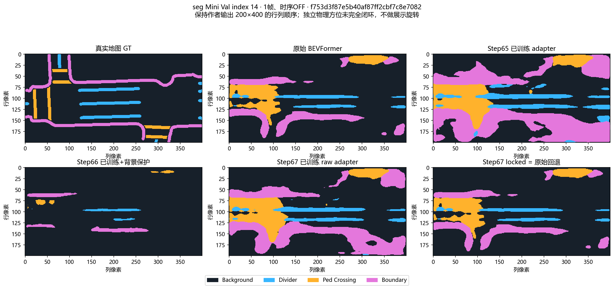
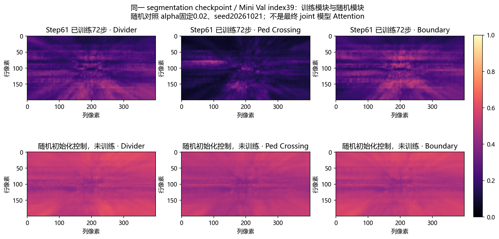
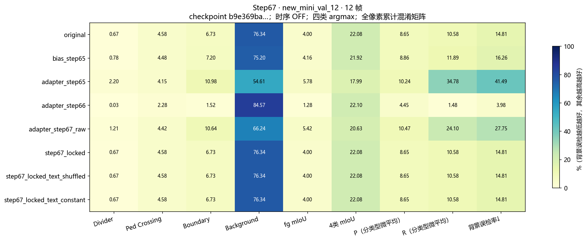
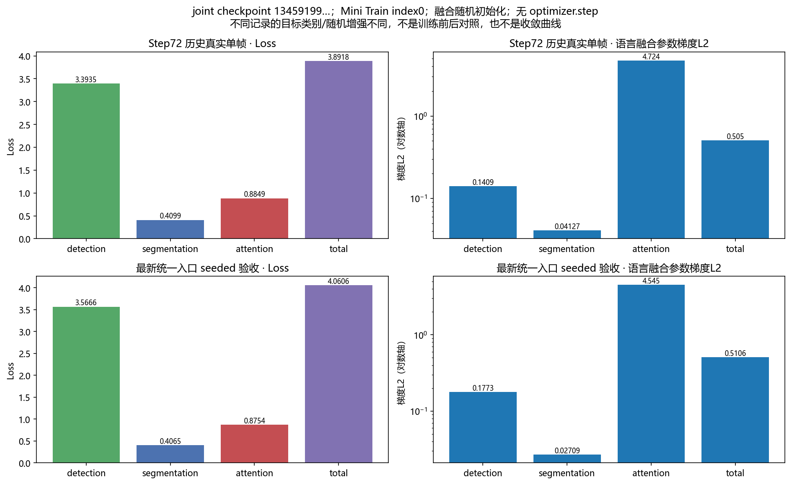

# 第二阶段：全部实验图表索引（45 张）

> 项目：语言引导 BEV 注意力增强模块 / BEVFormer + DistilBERT
> 归档日期：2026-10-21。本文为已上传 GitHub 图片的分类导航，不更改原始图像或实验结果。

## 阅读入口

- [第二阶段精选图表总览](数据图表总览_2026-10-21.md)：优先阅读的代表性图片。
- [第二阶段完整数据分析报告](数据分析报告_2026-10-21.md)：指标计算口径、A/B 结果及限制。
- [指标汇总 CSV](../../results/stage2_data_review/metrics.csv) · [指标 JSON](../../results/stage2_data_review/metrics.json) · [训练历史 JSON](../../results/stage2_data_review/training_histories.json)。
- [全部图片所在目录](../images/stage2/data_review/)：保留原文件名，便于与本地 `outputs/stage2_data_review/figures/` 对照。

## 使用说明与结论边界

- 本索引共收录 **45 张 PNG**，按分割、注意力、指标、训练与梯度、联合模型、几何六组组织。
- 单帧 Mini Val、81 帧时序评估，以及 segmentation-only 与 joint checkpoint 的实验协议不同，**不能跨协议直接比较性能**。
- Step65/67 raw adapter 在部分样本上增加前景预测，同时可能明显提高背景误检；Step66 背景保护可能降低前景召回；Step67 locked 为回退原始模型。
- 注意力热图有变化不代表正确语言定位；真实 Loss/Backward 通过不代表模型已经完成联合训练或精度提升。
- BEV 与地图 GT 的完整物理坐标一致性尚未独立闭环。详细指标和样本标识以正式分析报告及 JSON 为准。
- 大型预测 `.npz`、原始数据集、checkpoint 和日志保留在本地 `outputs/`，未归档到本索引。

## 建议先看的四张图

### 原始与增强模型分割对照

### 训练后与随机初始化注意力对照

### Step67 新增 Mini Val 的指标对照

### 真实联合 Loss 与梯度

---

## 全部 45 张图片（完整目录）

| 类别 | 图片数量 |
|---|---:|
| 真实地图分割：六相机、GT 与预测 | 12 |
| 语言注意力与文本干预 | 11 |
| 分割指标 A/B 对照 | 11 |
| 训练损失与联合梯度 | 6 |
| 联合 BEVFormer 双 Head 实机前向 | 3 |
| 空间几何与历史时序诊断 | 2 |
| **合计** | **45** |

### 01｜真实地图分割：六相机、GT 与预测

| 文件（点击查看） | 内容 |
|---|---|
| [`seg_014_cameras.png`](../images/stage2/data_review/seg_014_cameras.png) | Mini Val 14：六相机输入 |
| [`seg_014_segmentation.png`](../images/stage2/data_review/seg_014_segmentation.png) | Mini Val 14：真实地图 GT、原始模型及 Step65–67 分割对照 |
| [`seg_014_errors.png`](../images/stage2/data_review/seg_014_errors.png) | Mini Val 14：原始与增强预测的错误区域 |
| [`seg_021_cameras.png`](../images/stage2/data_review/seg_021_cameras.png) | Mini Val 21：六相机输入 |
| [`seg_021_segmentation.png`](../images/stage2/data_review/seg_021_segmentation.png) | Mini Val 21：分割对照 |
| [`seg_021_errors.png`](../images/stage2/data_review/seg_021_errors.png) | Mini Val 21：预测错误区域 |
| [`seg_039_cameras.png`](../images/stage2/data_review/seg_039_cameras.png) | Mini Val 39：六相机输入 |
| [`seg_039_segmentation.png`](../images/stage2/data_review/seg_039_segmentation.png) | Mini Val 39：分割对照 |
| [`seg_039_errors.png`](../images/stage2/data_review/seg_039_errors.png) | Mini Val 39：预测错误区域 |
| [`seg_077_cameras.png`](../images/stage2/data_review/seg_077_cameras.png) | Mini Val 77：六相机输入 |
| [`seg_077_segmentation.png`](../images/stage2/data_review/seg_077_segmentation.png) | Mini Val 77：分割对照 |
| [`seg_077_errors.png`](../images/stage2/data_review/seg_077_errors.png) | Mini Val 77：预测错误区域 |

### 02｜语言注意力与文本干预

| 文件（点击查看） | 内容 |
|---|---|
| [`attention_trained_vs_random.png`](../images/stage2/data_review/attention_trained_vs_random.png) | Step61 已训练注意力与随机初始化对照 |
| [`attention_ap_controls.png`](../images/stage2/data_review/attention_ap_controls.png) | Attention AP 对照 |
| [`attention_joint_random.png`](../images/stage2/data_review/attention_joint_random.png) | 联合模型随机初始化注意力 |
| [`attention_step65_intervention.png`](../images/stage2/data_review/attention_step65_intervention.png) | Step65 文本干预注意力图 |
| [`attention_step65_real_sentences.png`](../images/stage2/data_review/attention_step65_real_sentences.png) | Step65 真实句子输入注意力图 |
| [`attention_step66_intervention.png`](../images/stage2/data_review/attention_step66_intervention.png) | Step66 文本干预注意力图 |
| [`attention_step66_real_sentences.png`](../images/stage2/data_review/attention_step66_real_sentences.png) | Step66 真实句子输入注意力图 |
| [`attention_step67_intervention.png`](../images/stage2/data_review/attention_step67_intervention.png) | Step67 文本干预注意力图 |
| [`attention_step67_real_sentences.png`](../images/stage2/data_review/attention_step67_real_sentences.png) | Step67 真实句子输入注意力图 |
| [`step62_existing_attention.png`](../images/stage2/data_review/step62_existing_attention.png) | Step62 历史注意力诊断 |
| [`text_intervention_metrics.png`](../images/stage2/data_review/text_intervention_metrics.png) | 正常、置乱等文本输入对应的指标对照 |

### 03｜分割指标 A/B 对照

| 文件（点击查看） | 内容 |
|---|---|
| [`metrics_step65_development_6.png`](../images/stage2/data_review/metrics_step65_development_6.png) | Step65：开发期 6 帧 |
| [`metrics_step65_fresh_tokens.png`](../images/stage2/data_review/metrics_step65_fresh_tokens.png) | Step65：后续 12 帧 token 对照 |
| [`metrics_step66_development_6.png`](../images/stage2/data_review/metrics_step66_development_6.png) | Step66：开发期 6 帧 |
| [`metrics_step66_step65_seen_12.png`](../images/stage2/data_review/metrics_step66_step65_seen_12.png) | Step66：已查看 12 帧 |
| [`metrics_step66_reserved_12.png`](../images/stage2/data_review/metrics_step66_reserved_12.png) | Step66：预留 12 帧 |
| [`metrics_step67_development_6.png`](../images/stage2/data_review/metrics_step67_development_6.png) | Step67：开发期 6 帧 |
| [`metrics_step67_step65_seen_12.png`](../images/stage2/data_review/metrics_step67_step65_seen_12.png) | Step67：Step65 已查看 12 帧 |
| [`metrics_step67_step66_seen_12.png`](../images/stage2/data_review/metrics_step67_step66_seen_12.png) | Step67：Step66 已查看 12 帧 |
| [`metrics_step67_new_mini_val_12.png`](../images/stage2/data_review/metrics_step67_new_mini_val_12.png) | Step67：新增 12 帧 Mini Val |
| [`metrics_joint_single_frame.png`](../images/stage2/data_review/metrics_joint_single_frame.png) | 联合模型单帧分割指标 |
| [`metrics_real_sentence_controls.png`](../images/stage2/data_review/metrics_real_sentence_controls.png) | 真实句子干预指标 |

### 04｜训练损失与联合梯度

| 文件（点击查看） | 内容 |
|---|---|
| [`loss_step61.png`](../images/stage2/data_review/loss_step61.png) | Step61 训练损失 |
| [`loss_step65.png`](../images/stage2/data_review/loss_step65.png) | Step65 训练损失 |
| [`loss_step66.png`](../images/stage2/data_review/loss_step66.png) | Step66 训练损失 |
| [`loss_step67.png`](../images/stage2/data_review/loss_step67.png) | Step67 训练损失 |
| [`real_joint_loss_gradient.png`](../images/stage2/data_review/real_joint_loss_gradient.png) | 真实检测、分割、注意力 Loss 与梯度 |
| [`step61_before_after.png`](../images/stage2/data_review/step61_before_after.png) | Step61 训练前后对照 |

### 05｜联合 BEVFormer 双 Head 实机前向

| 文件（点击查看） | 内容 |
|---|---|
| [`joint_000_cameras.png`](../images/stage2/data_review/joint_000_cameras.png) | 联合模型样本：六相机输入 |
| [`joint_000_segmentation.png`](../images/stage2/data_review/joint_000_segmentation.png) | 联合模型样本：分割预测 |
| [`joint_000_errors.png`](../images/stage2/data_review/joint_000_errors.png) | 联合模型样本：误差分析 |

### 06｜空间几何与历史时序诊断

| 文件（点击查看） | 内容 |
|---|---|
| [`step54_temporal_geometry.png`](../images/stage2/data_review/step54_temporal_geometry.png) | Step54：81 帧时序空间几何 A/B |
| [`step73_geometry_context.png`](../images/stage2/data_review/step73_geometry_context.png) | Step73：地图锚点与 BEV/GT 几何诊断 |

## GitHub 归档路径

- 本索引：`docs/stage2/全部实验图表索引_2026-10-21.md`
- PNG 图片：`docs/images/stage2/data_review/`
- 指标文件：`results/stage2_data_review/`
- 本地原始生成目录（未上传）：`outputs/stage2_data_review/`

原始图像及数据不因本文件而重新训练、重采样或修改。
