# 第二阶段：真实数据与可视化总览

本页归档的是本地实验得到的原始 PNG，可用于人工复核；不修改图像像素或指标。
数据源为 `outputs/stage2_data_review/`。该目录中的大型预测 NPZ 和运行日志仍在本地，未上传 Git。

- [完整数据分析报告](数据分析报告_2026-10-21.md)
- [指标汇总 CSV](../../results/stage2_data_review/metrics.csv)
- [指标 JSON](../../results/stage2_data_review/metrics.json)
- [训练历史 JSON](../../results/stage2_data_review/training_histories.json)
- [全部实验图片](../images/stage2/data_review/)

**解释边界：** 注意力图≠语言定位精度通过，真实梯度≠训练收敛，单帧指标≠81帧时序评估。

## 一、真实地图分割：原始与增强模型

Mini Val 独立单帧、时序 OFF；GT 与预测保留作者 200×400 栅格顺序。
Step65/67 raw adapter 在部分图上增加前景预测，也扩大了背景误检；Step66 背景保护会压制部分真前景。不得把局部前景改善表述为总体分割效果提升。

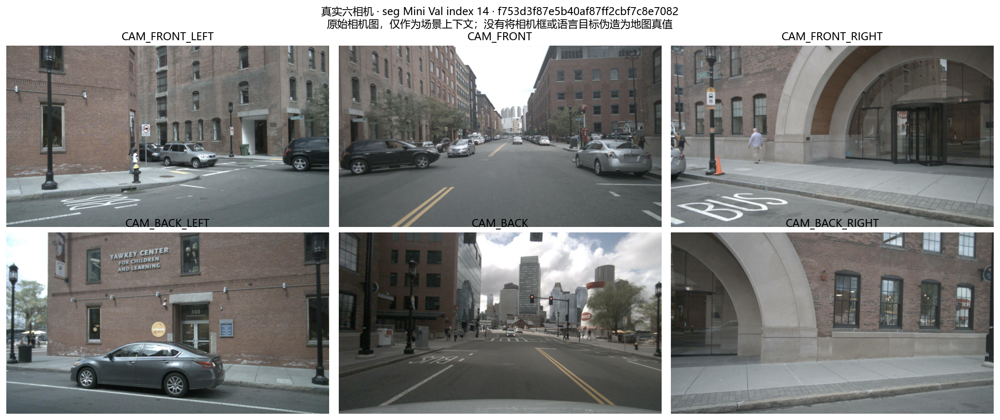

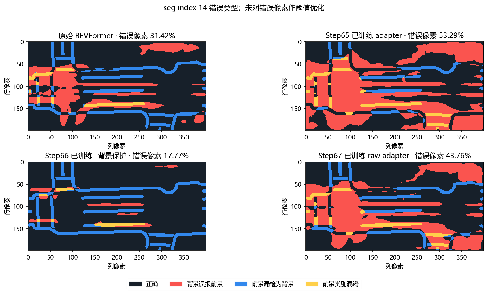

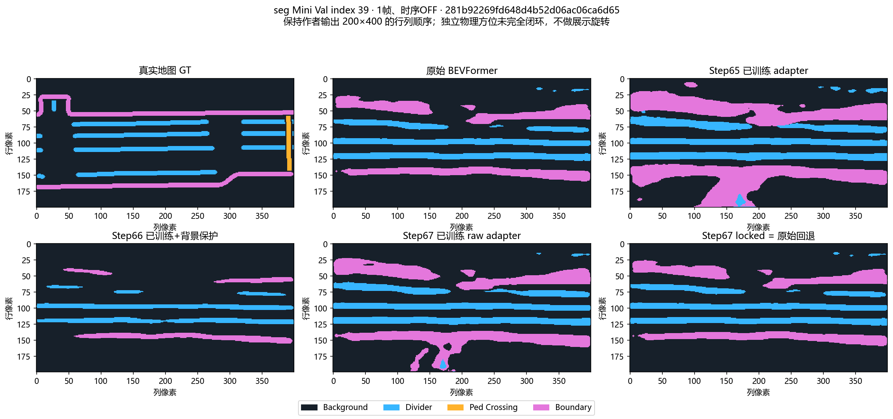

## 二、语言注意力：训练与随机对照

热力图仅反映当前注意力模块输出，既不代表开放式语言理解通过，也不代表网络 BEV/地图 GT 完整物理坐标协议已经闭环。

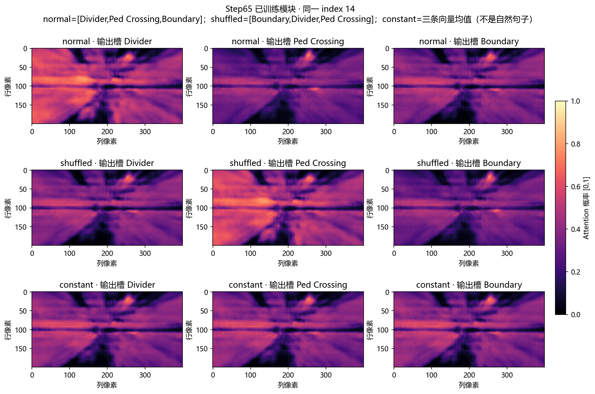

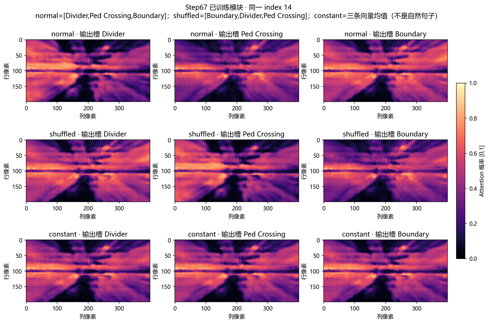

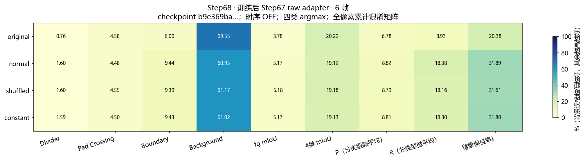

## 三、分割指标：同时观察前景与背景

不同实验的验证帧、模型分支及参数可能不同；请只在原报告明确相同协议的分支间比较。不能把单帧 Mini Val 与作者完整 81 帧时序成绩直接比较。

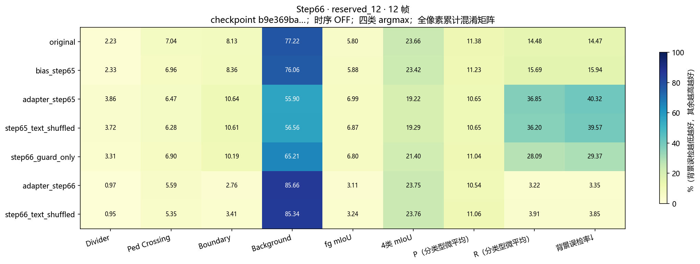

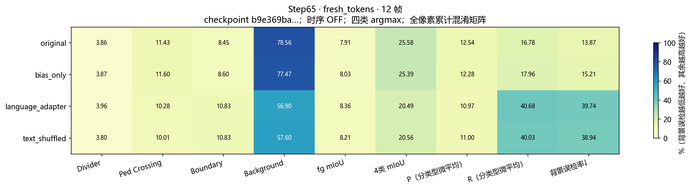

## 四、联合模型与真实梯度

联合检测/分割前向、bypass 及三任务损失梯度证明工程计算链路可运行；没有执行正式联合训练，也没有据此得到最终精度提升结论。

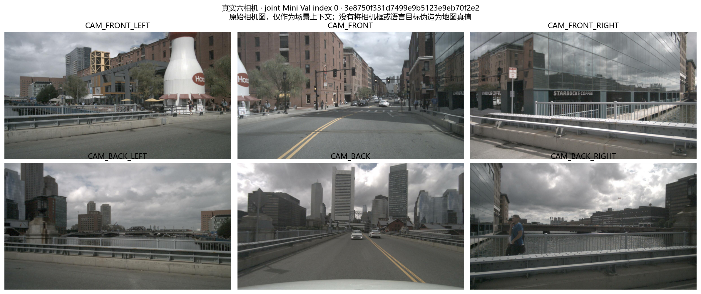

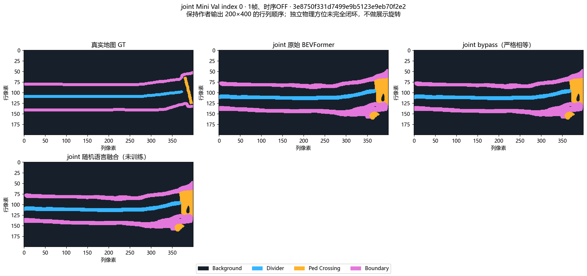

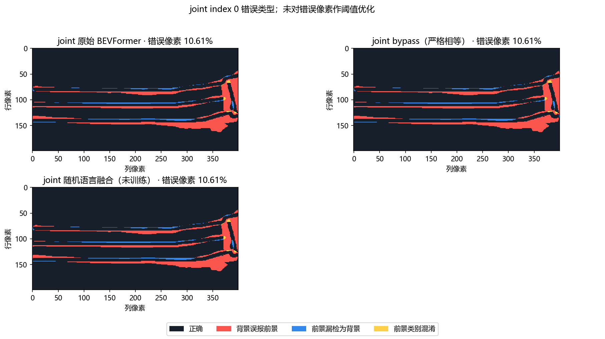

## 五、空间几何核查

独立地图锚点是必要的空间诊断，但仍不足以证明真实网络 BEV 的物理配准完全正确。

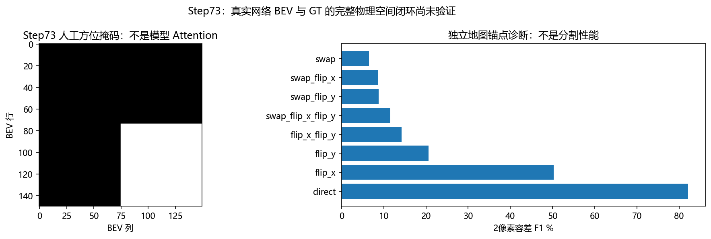

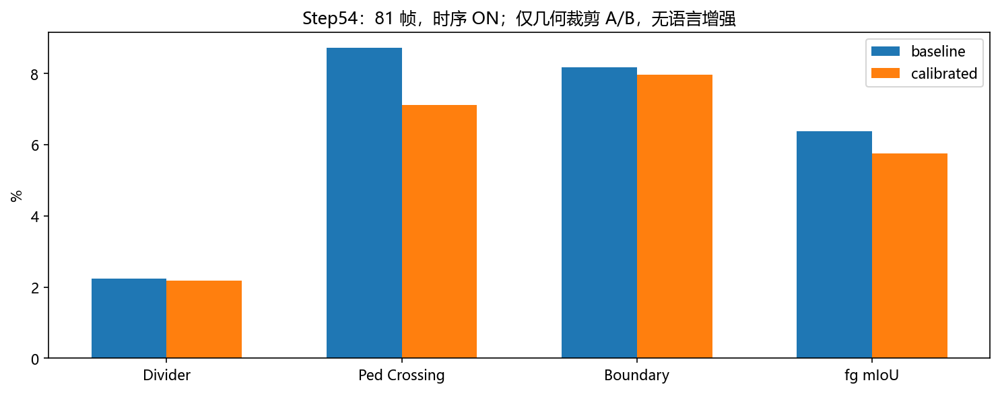

## 其他原始图

以下图像也随本次 Git 归档，便于追溯。

- [attention_ap_controls.png](../images/stage2/data_review/attention_ap_controls.png)
- [attention_joint_random.png](../images/stage2/data_review/attention_joint_random.png)
- [attention_step65_real_sentences.png](../images/stage2/data_review/attention_step65_real_sentences.png)
- [attention_step66_intervention.png](../images/stage2/data_review/attention_step66_intervention.png)
- [attention_step66_real_sentences.png](../images/stage2/data_review/attention_step66_real_sentences.png)
- [attention_step67_real_sentences.png](../images/stage2/data_review/attention_step67_real_sentences.png)
- [loss_step61.png](../images/stage2/data_review/loss_step61.png)
- [loss_step65.png](../images/stage2/data_review/loss_step65.png)
- [loss_step66.png](../images/stage2/data_review/loss_step66.png)
- [loss_step67.png](../images/stage2/data_review/loss_step67.png)
- [metrics_joint_single_frame.png](../images/stage2/data_review/metrics_joint_single_frame.png)
- [metrics_real_sentence_controls.png](../images/stage2/data_review/metrics_real_sentence_controls.png)
- [metrics_step65_development_6.png](../images/stage2/data_review/metrics_step65_development_6.png)
- [metrics_step66_development_6.png](../images/stage2/data_review/metrics_step66_development_6.png)
- [metrics_step66_step65_seen_12.png](../images/stage2/data_review/metrics_step66_step65_seen_12.png)
- [metrics_step67_development_6.png](../images/stage2/data_review/metrics_step67_development_6.png)
- [metrics_step67_step65_seen_12.png](../images/stage2/data_review/metrics_step67_step65_seen_12.png)
- [metrics_step67_step66_seen_12.png](../images/stage2/data_review/metrics_step67_step66_seen_12.png)
- [seg_021_cameras.png](../images/stage2/data_review/seg_021_cameras.png)
- [seg_021_errors.png](../images/stage2/data_review/seg_021_errors.png)
- [seg_021_segmentation.png](../images/stage2/data_review/seg_021_segmentation.png)
- [seg_039_cameras.png](../images/stage2/data_review/seg_039_cameras.png)
- [seg_039_errors.png](../images/stage2/data_review/seg_039_errors.png)
- [seg_077_cameras.png](../images/stage2/data_review/seg_077_cameras.png)
- [seg_077_errors.png](../images/stage2/data_review/seg_077_errors.png)
- [seg_077_segmentation.png](../images/stage2/data_review/seg_077_segmentation.png)
- [step61_before_after.png](../images/stage2/data_review/step61_before_after.png)
- [step62_existing_attention.png](../images/stage2/data_review/step62_existing_attention.png)
