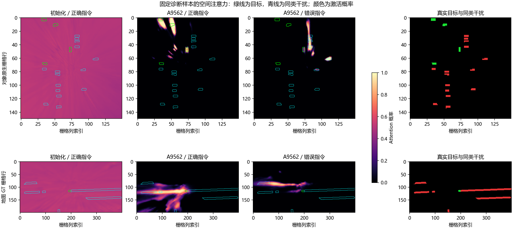
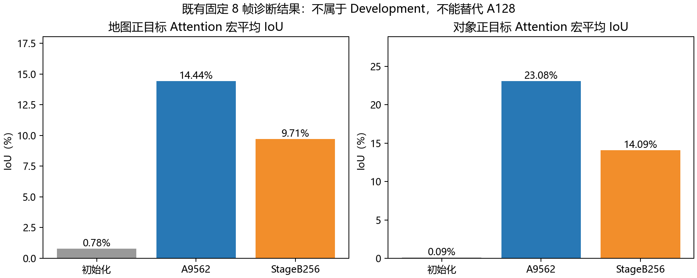

# Stage A 核心验收与已有诊断结果复核（2026-11-02）

正式验收结论仍为 **GROUNDING_NOT_READY，未通过**。本次新增的是既有固定 8 帧 GPU 诊断结果的只读复核、逐实例统计与可视化，没有重新训练或推理。

## 历史正式 A128：保留原结论

| 指标 | 历史值 | 原门槛 | 结果 |
|---|---:|---:|---|
| 地图 Attention macro IoU | 12.2168% | ≥15% | 未通过 |
| 对象 Attention macro IoU | 11.7125% | ≥15% | 未通过 |
| 正确−错误目标 Logit gap | 5.459627 | ≥0.10 | 通过 |
| 空目标激活率 | 0.6011% | ≤5% | 通过 |

来源为正式 run 的 `warmup_gate.json`，具体路径、SHA 和 A9562 身份见 `核心验收汇总.json`。未重算 A128、调整门槛或解除原正式 Stage B 禁止恢复状态。

## 固定 8 帧诊断：同一协议下的 A0 / A9562 / StageB256

四个预登记训练侧诊断场景各取前两帧，共 8 帧、16 条指令；地图正目标 4 条、空目标 4 条，对象正目标 5 条、空目标 3 条。该集合与 A128 不同，属于工程诊断，不能充当 Development 或独立泛化结果。

| 模型 | 地图宏平均 IoU | 对象宏平均 IoU | 地图空目标激活 | 对象空目标激活 |
|---|---:|---:|---:|---:|
| 零更新初始化候选 | 0.7842% | 0.0949% | 71.4541% | 65.4148% |
| A9562 | 14.4377% | 23.0789% | 1.6066% | 0.7067% |
| StageB256 | 9.7131% | 14.0929% | 4.5300% | 0.6415% |

A9562 相对同集合初始化候选，地图/对象宏平均 IoU 分别增加 **13.6535 / 22.9840 个百分点**。A0 是已核验来源的独立零更新参数候选，不冒称正式 A0 回执；不能将这里的增益套用于 A128。StageB256 的 Attention 在该诊断集合低于 A9562，是需保留的负向证据。

## 正确与错误指令

仅在“目标非空且存在有效反事实配对”的相同 query 上比较，避免把无配对 query 混入错误指令均值。

| 任务 | 有效正目标配对数 | 正确 IoU | 错误 IoU | 正确−错误 Logit gap |
|---|---:|---:|---:|---:|
| 地图 | 3 | 1.6080% | 0.0000% | 3.497844 |
| 对象 | 5 | 23.0789% | 5.0000% | 11.203561 |

地图在 3 条有效正目标配对上的正确 IoU 仅约 **1.61%**。全部地图正例的 14.44% 平均值还包含一条没有有效反事实配对的 query，不能将两个分母混用。较大的 Logit 差说明响应随指令改变，但仍不能证明地图定位足够准确。

## 同类不同位置与空间可视化

8 条对象指令中，4 条同时存在非空目标、同类干扰和有效配对；4/4 的正确指令目标平均 Logit 高于同类干扰，4/4 的目标响应高于错误指令。导出 49 条同类对象实例记录，保留目标/干扰身份与响应，不删除不利结果。该统计只验证小集合上的区域选择性，不证明唯一实例泛化。

可视化按固定样本顺序，选择第一个同时有目标和同类干扰的对象/地图 query，不按模型分数挑选。对象显示原生 LiDAR BEV 栅格，地图显示既定标定投影后的 GT 栅格；保持原轴向，未拟合坐标或重投影改善结果。

## 证据与限制

- `Attention对照.csv`：三组宏平均、合并 IoU、正/空目标计数。
- `有效指令配对.csv`、`逐指令定位.csv`：相同有效配对分母及逐 query 结果。
- `同类不同位置实例.csv`：49 条逐实例原始统计。
- `核心验收汇总.json`：原协议、Checkpoint、A9562、A128 与每份原始预测 SHA。
- `空间注意力对照.png/.pdf`、`Attention指标对照.png/.pdf`：结项可用图表。

所有数值来自此前已通过 PREFLIGHT_PASS 的 8 帧原始预测；本次只读复核。作者主干预训练暴露未核实、样本小、单 seed、没有统计显著性保证。A9562 的零 up 使原生检测/分割双 Head 与 Baseline 逐位一致，因此该组不能宣称感知 AP/mIoU 增益。
