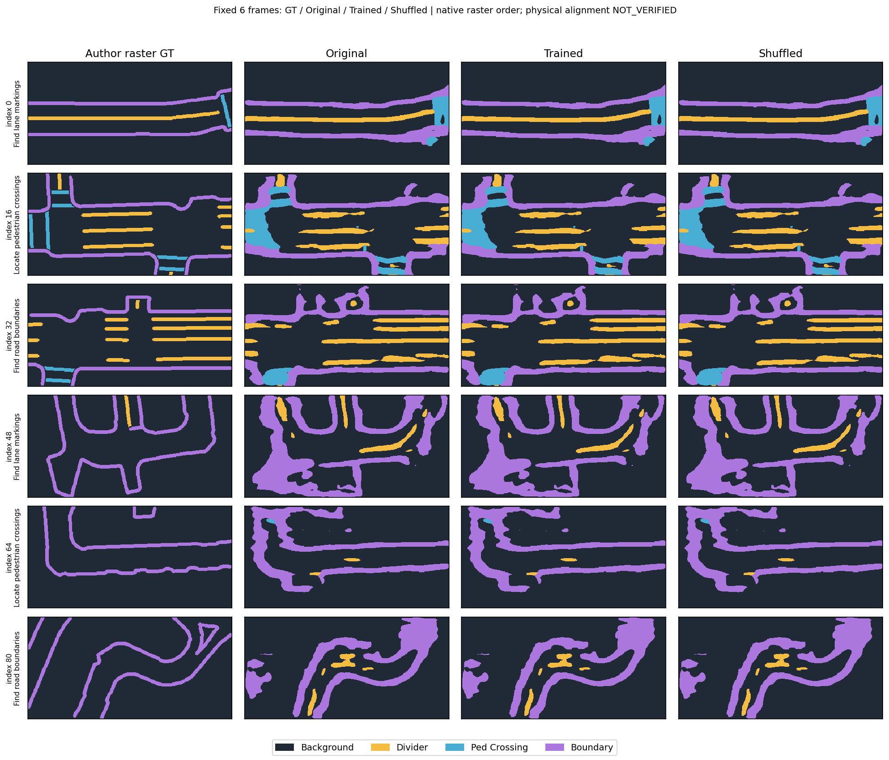
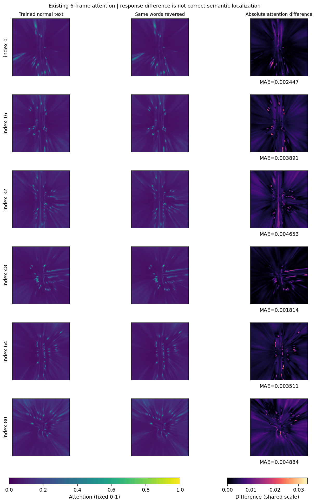

# 第二阶段 Git 交付检查与真实图表（2026-10-23）

准备日期为2026-10-22，面向明天交付。本轮只做文件整理、既有数据离线绘图、CPU测试和哈希/链接检查；新增训练更新0次、模型推理0次。43个核心Python文件、全部冻结审查证据和原实验资产保持原字节。

入口：[最终交付检查](../../docs/stage2/22_第二阶段Git交付检查_2026-10-23.md) · [师傅任务原文](../../docs/stage2/02_第二阶段原始任务书.md) · [源码审查8+4](../../docs/stage2/21_第二阶段最终缺口审查_2026-10-22.md) · [复现指引](../../docs/stage2/17_第二阶段复现指引.md)。

## 真实20步Loss（原实验TV=0）


图取自首步与续训两份training.jsonl，严格拼接step1～20，没有平滑或生成额外数据。每步使用不同的预先固定帧/文本，因此曲线不能证明收敛或验证收益。Attention曲线为BCE+0.25 Dice监督，权重0.1；某帧目标类别缺席时监督为0。**不是新增TV正则的训练曲线。** 完整数值见 [20步CSV](figures/training_20steps.csv)。

## 固定6帧A/B（同一checkpoint及协议）


Original / Trained / Shuffled foreground mIoU分别为0.3159926671 / 0.3159515546 / 0.3159652746；三者检测TP/FP/FN均207/599/35。左图为三前景类汇总IoU，中图显示原始mIoU，右图明确放大标示相对Original的微小负差（单位1e-5），不将微小差异包装成显著改善。IoU来自六帧混淆矩阵累加，不按帧平均；检测为score≥0.1、同类贪心XY中心≤2m诊断，不是官方AP/NDS。



行对应固定Mini Val索引0、16、32、48、64、80，覆盖原协议中两个验证场景。列为作者原始raster GT、Original、Trained、同句逆序Shuffled。类别颜色固定，按NPZ原200×400数组显示，不旋转、翻转或resize GT以改善视觉效果；此图不证明BEV/GT物理配准。



显示既有NPZ中的Trained正常文本、同句逆序文本和绝对差。正常/置乱热力图共用0～1色标，差图共用六帧全局最大差色标；每帧标MAE。**响应有差异不等于目标、方向或否定被正确理解。**

所有源JSONL/NPZ、固定协议、图像SHA与独立重算指标见 [图表溯源](figures/figure_provenance.json)。重绘命令（输出需换新目录）：

```bash
MPLCONFIGDIR=/tmp/stage2-mpl .venv-bevformer/bin/python scripts/prepare_stage2_delivery.py \
  --output-dir outputs/new_stage2_figures
```

## 训练与功能证据分开

| 证据 | TV权重 | optimizer.step | 支持的结论 |
|---|---:|---:|---|
| 原20步JSONL、AdamW/checkpoint、6帧A/B | 0 | 20（已完成的原实验） | 真实更新、原A/B数值；没有稳定精度提升 |
| 新源码GPU smoke及当前pytest | 0.001（GPU smoke） | 0 | TV实现/非零梯度、旧权重加载及bypass；没有TV训练收益证据 |
| 本轮交付整理、离线图表和核验 | 不运行模型 | 0 | 文件、数值、归档、链接和可提交范围完整性 |

实际GPU、预训练语言响应和冻结源码重放记录保留在 [原审查证据目录](../stage2_final_audit_2026-10-22/README.md)，没有改写该目录中的冻结结果。

## Git白名单与本轮实际检查

- [精确文件白名单](git_whitelist.txt)：仅在最后确认后使用；不使用git add -A。
- [逐文件Git归属与大小](file_inventory.json)、[可读文件清单](file_inventory.md)：区分新文件、已修改文件和已有无变化文件；遗留无关文件单列。
- [本轮pytest/入口/只读核验命令和退出码](checks.json)、[117项pytest输出](pytest.txt)、[原20步/6帧重新复算](raw_recheck.json)。
- [最终Git树/Markdown/依赖/资产检查](preflight.json)：检查所有已跟踪和白名单Markdown；代码块不当链接。外部网页只识别语法，未联网逐页验证。
- [不随Git上传的资产清单](non_git_assets.json)：原171MiB包SHA为 `99b58c982111d244e07aee3940c887303c9406928cc0c2c7a1acd9bc49f3b54a`；重新逐成员核对270份内容，原包不改写。
- [提交前git差异与状态](final_git_status.txt)、[本轮变更说明](delivery_changes.md)、[师傅简报草稿](teacher_message.txt)。

Git不包含outputs、checkpoint、NPZ/NPY、模型、原始数据集、虚拟环境或大tar.gz。原始大资产保存在原独立交付包；本轮文档/图表/小型证据另存Git补充包，路径与SHA单列在 `outputs/stage2_delivery_20261023/git_supplement_v2.json`（本地资产，不是Git文件）。历史OOM文档中的12个outputs链接需要原独立交付包解压后本地查看，GitHub不托管这些资产；统一入口和本页图表/证据均为Git可达路径。

当前仍在main，未暂存、commit、push。远端main只检查本地缓存，不对明天远端状态或push权限作已验证声明。最终确认后可按白名单提交；push前应再核对远端。

## 最终文件数量与检查结果

精确白名单228个文件：16个已跟踪修改、111个新增、101个已跟踪无变化；真正拟提交差异127个文件。10个既有无关未跟踪文件排除，完整路径见file_inventory.md。无变化文件列入白名单用于完整交付核对，不会制造额外commit差异。

本轮实际重跑117项pytest（exit=0）、50文件静态编译、统一入口--help、旧源码哈希检查及原20步/6帧只读复算。最终检查覆盖67份Markdown，571个仓库链接可达、12个独立包本地资产链接已验证归档、无失效目标；14个外部网址只识别语法，未联网逐页验证。原171MiB包SHA与270个成员均通过，43个核心Python和165份冻结文件未改，Git index未改。大文件和模型资产不在Git白名单。
