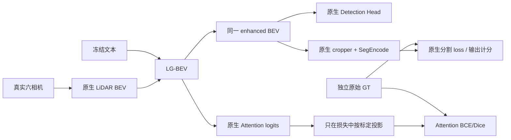

# LG-BEV 原生双 Head 与独立 Attention 监督空间

本页是监督空间与历史 16 步 pilot 的记录；最新工程状态见 [源码总索引](README.md)。
正式训练尚未启动、正式更新 0、BLOCKED；GT 仅完成 5787/19123 帧，640 块校验通过；
V3 仍为 DRAFT_NOT_APPLIED。2026-10-28 仅做 Git 检查，不执行下述 GPU 复现。

当前原作者 `BEVFormerHead`、cropper、SegEncode、Detection decoder、checkpoint 和整个推理路径均保留。新增模块只将 **Attention logits** 投影到独立物理 GT 空间，不改变输入原生双 Head 的 enhanced BEV。真实监督、完整前向重放和原始预测不变量已验收；唯一预注册16步 pilot 已完成，**没有发现相关 AP/IoU 提升**。全部当日记录追加在 `docs/logbook_2026-10-27.md`。

## 15m 根因及 decoder 检查

配置实际选择 `type='BEVFormerHead'`，运行时加载 `bevformer/dense_heads/bevformer_head.py`，使用 `transpose(H,W) + flip(dim=2)`。上一轮诊断手动复现了另一个未激活类 `BEVFormerHead_seg` 的 `rot90(-1)+flip(dim=3)`，等价于仅转置；因此约15.06m的侧向镜像差异不能作为当前实际模型错误的证据。

这项审计对象错误已通过 `type(instance)`、实际源码路径/SHA、cropper/decoder forward hook 和合成 XYZ ramp 纠正。原报告完整保留，纠正证据在 `results/lg_bev_coordinate_rca_20261027/correction.json`。

实际 Head 的 pre-decoder 采样与逐帧标定平均相差0.89958m、最大0.94198m。`seg_subnet.SegEncode` 后续包含卷积、ResNet、BatchNorm、ReLU、skip concatenation 和双线性上采样，没有读取标定的 warp/flip；hook 验证 cropper 输出就是 decoder 输入，decoder 输出直接成为最终 segmentation logits。

**不能把该 decoder 当成逐像素恒等变换。** 只读梯度探针显示输出像素对输入的绝对梯度中心列偏移约 -4.13、-4.52、-6.53 像素。一次解析标定桥接虽把 ramp 最大误差降至约1.59e-5m，却使四个固定训练帧的前景 mIoU 从0.389749降至0.299916（-8.9833个百分点）。这些结果支持冻结网络依赖旧采样/可能已学习偏移补偿，但不证明精确或普适补偿。桥接候选未采用，其 hook 已恢复；最新监督方案不调用它，不修改任何原生采样。

## 四种空间与最小修复

| 对象 | 坐标协议 | 处理 |
|---|---|---|
| 原始/增强 BEV | LiDAR XY；150×150；±51.2m；行y、列x，像素中心 | 同一 enhanced BEV 进入两个原生 Head |
| Attention logits / mask | 同一 LiDAR 网格 | map监督时用逐帧 R/t 投影到 Ego GT；object监督保留 native footprint |
| Detection Head | 原生 LiDAR 3D框，作者过滤与损失 | 不变；指令评价时显式使用 gravity centre→Ego 区域 |
| Segmentation Head 输出 | 原始200×400 Ego raster GT协议，0.15m/像素 | 完整 transpose/flip/cropper/learned decoder 保留；直接用原始GT计分 |



此前正确的 Attention 标定公式无需额外平移或翻转。本次将其独立为 `AttentionSupervisionSpace`，白名单提取 R/t，明确区分监督张量和模型输出，不用 native cropper 反推 Attention 标签，不用 GT/预测拟合映射。修复的是审计对象、监督空间接口及不适用于 learned decoder 的旧门槛；没有声称修复了原作者模型的所有物理预测误差。

## 真实数据读取与验收

- G盘真实读取：允许训练场景 `scene-0796` 的6张 JPEG 完整解码、34,720个 LiDAR 点、原始标定/位姿/annotation JSON；checkpoint完整读取774,591,208字节，实际反序列化1,111个权重键。证据 `raw_access_probe.json`、`raw_checkpoint_decode.json`。
- 真实六相机网络前向：输入 `[1,6,3,736,1280]`，输出 BEV `[1,256,150,150]`、300框；该前向没有注入缓存。`raw_camera_forward.json` 记录原始测试流水线与缓存的差异。
- 旧缓存来源：旧 cache 来自含 PhotoMetricDistortion 的训练流水线，fresh test pipeline 不含该增强，两者 BEV L2差约11.64%。用旧训练流水线和相同 `seed=20261027+index` 重跑，转成float16后与旧缓存逐位相同，剩余L2差0.000209556等于量化误差。`cache_replay.json`。
- 4个允许训练场景首帧从 G盘原始地图重建 GT，与既有真实标签逐像素相同；另用独立 raw node/line→inverse yaw→裁剪→OpenCV 栅格验证轴向和像素中心，不调用作者 vector/raster 工具。独立致密线与作者采样/优先级 raster 的差异原样保留，没有拟合GT。原始3D annotation→Ego→LiDAR→PKL中心数值误差≤1.03e-13m；这是数值一致性，不是传感器测量精度。
- 新 Attention 空间：四个固定真实训练目标的 XYZ ramp 最大误差7.04e-6m；独立四邻域插值 adjoint 权重与 autograd 完全一致，梯度质量为1。
- 全模型不变量：真实原图完整前向与同一 BEV 的原生双 Head 重放逐位一致；零初始化 LG-BEV 等同 baseline；真实监督反向前后原始 cls/bbox/seg 输出逐位一致。cropper 实例无 forward 替换，作者/文本状态哈希前后一致。
- 169项测试通过；新增源码 Black88、pyflakes检查通过。

## 固定16步 pilot 与指标

新结果独立写入 `results/lg_bev_supervision_space_20261027/`。原 `results/lg_bev_20261027/` 和所有 V1–V5 文件未改写。新登记保留原模型、seed20261027、split、lr3e-4、batch1、权重、clip5和16步预算；没有重训主干，没有替换cropper。监督验收本身0更新，pilot独立随机初始化16更新（8地图、4非空对象、4空对象），不扩训、不改阈值、不挑checkpoint。

训练为4场景/32帧/685指令；固定内部开发 `scene-0757` 为1场景/8帧/189指令，其中地图81条、对象108条，检测AP只用64条plural指令，含空目标。均属于历史适配器训练分布，作者预训练未见泛化未验证，最终holdout不运行。

| 分支 | 相关非官方 AP@2m_xy | 相关分割 IoU | 无关分割 mIoU | map Attention IoU | object Attention IoU |
|---|---:|---:|---:|---:|---:|
| original | 0.849845887 | 0.433050894 | 0.479282373 | — | — |
| zero_text | 0.849849612 | 0.433021521 | 0.479248012 | 0.004375995 | 0.000620185 |
| wrong_text | 0.849845887 | 0.433050894 | 0.479253039 | 0.005130269 | 0.015608091 |
| correct_text | 0.849845887 | 0.433000680 | 0.479255762 | 0.005056958 | 0.015547057 |

correct相对original：相关AP变化0，相关分割 **-0.0050214个百分点**，无关分割 **-0.0026611个百分点**。正确语言未优于错误语言，当前pilot没有有效精度收益；不能将坐标/梯度PASS解读为模型提升。zero/wrong是同一已训练checkpoint的推理消融，不是等预算独立训练对照。

AP保留全部原生top300、按类别/固定Ego象限分区、2m XY贪心唯一匹配、不插值；不等于nuScenes官方mAP。分割相关IoU使用固定2m真实目标邻域，未改GT；Attention先投影logits，再固定0.5阈值。map/object像素尺度不同，分别汇总；背景FP只使用原始GT背景，空指令不删除。

16步训练约4.61秒（不含构建/加载），峰值GPU allocated约1688.61MiB。更新后原始预测逐位一致，作者和文本参数均未变。新checkpoint SHA256 `db6b1ce14a438d9058e3ab27e2e383d5d9aa126ba8cff55934e2f4825f9b00f0`，protocol SHA256 `223dccc58b853232363400bb6ae765dad5bb09a85288abe16af407eb6fc4a87a`。

RTX5080 Laptop上cached路径189次/分支的均值约27–29ms，包含decode和CPU输出拷贝，分支差异有计时噪声，不解释为负开销。LG六相机端到端与RTX3090延迟未测。本轮固定终点已保存，性能不佳不回退坐标约束，也不在该开发集继续挑选方案；保留监督空间和原生基线作为后续可复用基础。

## 文件与复现

| 新增文件 | 作用 |
|---|---|
| `lg_bev_coordinate_core.py` | 实际运行时Head解析、独立GT辅助；含已拒绝的解析桥接历史诊断函数 |
| `lg_bev_coordinate_rca.py` | 四训练帧hook/ramp/GT/root cause；`--fresh-only`为原始六相机前向 |
| `lg_bev_coordinate_raw_probe.py` | 可重复的G盘真实文件解码/权重反序列化 |
| `lg_bev_coordinate_cache_replay.py` | 相同训练增强和seed重放缓存来源 |
| `lg_bev_coordinate_independent_gt.py` | 不调用作者vector/raster的独立原始GT链 |
| `lg_bev_supervision_space.py` | 参数无关的独立Attention监督空间与损失 |
| `lg_bev_supervision_run.py` | 新目录登记、零更新验收、唯一16步pilot |
| `lg_bev_supervision_metrics.py` | 无GT配对推理、固定内部开发计分 |
| `tests/test_lg_bev_coordinate_rca.py`、`tests/test_lg_bev_supervision_space.py` | 16个新增测试 |

在有本机GPU权限的终端运行真实模型命令；受限沙箱内CUDA不可访问。新增结果拒绝覆盖，复现使用新目录。当前证据可直接读取，无需重跑实验：

```bash
cd ~/projects/bev_vla
OMP_NUM_THREADS=2 MKL_NUM_THREADS=2 .venv-bevformer/bin/python -m pytest -q
.venv-bevformer/bin/python -m pyflakes scripts/stage3/lg_bev_coordinate*.py scripts/stage3/lg_bev_supervision*.py
```

独立复查真实G盘与缓存来源（新目录，不运行被拒绝的cropper替换）：

```bash
cd ~/projects/bev_vla
set -e
export OMP_NUM_THREADS=2
export MKL_NUM_THREADS=2
export PYTHONDONTWRITEBYTECODE=1
export MPLCONFIGDIR=/tmp/lg_bev_rca_matplotlib
LG_RAW_RUN=results/lg_bev_coordinate_raw_repro_01
mkdir "$LG_RAW_RUN"
.venv-bevformer/bin/python -m scripts.stage3.lg_bev_coordinate_raw_probe --out "$LG_RAW_RUN"
.venv-bevformer/bin/python -m scripts.stage3.lg_bev_coordinate_independent_gt --out "$LG_RAW_RUN"
.venv-bevformer/bin/python -m scripts.stage3.lg_bev_coordinate_rca --out "$LG_RAW_RUN" --fresh-only
.venv-bevformer/bin/python -m scripts.stage3.lg_bev_coordinate_cache_replay --out "$LG_RAW_RUN"
```

复现当前监督空间和16步固定预算（依赖本机已保存的RCA原始证据；不改变原生Head）：

```bash
cd ~/projects/bev_vla
set -e
export OMP_NUM_THREADS=2
export MKL_NUM_THREADS=2
export PYTHONDONTWRITEBYTECODE=1
export MPLCONFIGDIR=/tmp/lg_bev_rca_matplotlib
LG_SPACE_RUN=results/lg_bev_supervision_space_repro_01
.venv-bevformer/bin/python -m scripts.stage3.lg_bev_supervision_run --out "$LG_SPACE_RUN" --phase prepare
.venv-bevformer/bin/python -m scripts.stage3.lg_bev_supervision_run --out "$LG_SPACE_RUN" --phase audit
.venv-bevformer/bin/python -m scripts.stage3.lg_bev_supervision_run --out "$LG_SPACE_RUN" --phase pilot
.venv-bevformer/bin/python -m scripts.stage3.lg_bev_supervision_metrics --out "$LG_SPACE_RUN"
```

机器可读证据见新目录的 `supervision_space_audit.json`、`spatial_gate.json`、`pilot_training.json`、`metrics.json/csv`、`pilot_decision.json`、`acceptance.json`。原始模型预测、梯度和文件保留证据均可按SHA复核；所有checkpoint、缓存、NPZ、原始传感器与含图像的可视化不默认提交Git；未暂存、commit、push。
